# Capture trigger: from save-content to the tier-0 manifest

Snapshot of the uncommitted working tree over `802b4e7d1` (`main`), whose 2026-10-13 subject is **feat(hutch,@packages/domain): price-anchor the homepage AI comparison (#1207)**. Generated 2026-10-14. The base commit already selects content by a tier-0 manifest's `captureTrigger` (that selection change landed in `d56cf6769`), but nothing writes the field yet. This change carries it from the save-content form to the manifest.

A capture the reader tapped keeps the reader's "this is the page I saw" trust: selection may serve it as the article's first content without asking the judge, and may keep it when the judge finds nothing readable. The iOS and Android apps are about to capture a failed article on their own when the reader opens it. Nobody chose that page, so selection must be able to tell the two apart. This change gives it the information to do so.

- **The save-content form gains an optional `captureTrigger` text part**, `automatic` or `manual`. An absent part means `manual`, which is what every shipped client sends today. Any other value is refused with a 422 `invalid-save-content` before anything is staged. The part is used on the inline form and on the upload-slot completion request. A slot request does not use the value but still refuses a malformed one with the same 422, and the upload-slot entity does not echo it. The Siren `save-content` action advertises the new field. The change is additive: old clients keep working unchanged.
- **`SaveLinkRawHtmlCommand` gains a required `captureTrigger`.** This is a wire-format change to one existing command. Its `source` and `detail-type` stay the same, so no EventBridge rule moves. The bulk Save All Tabs path always sends `manual`. The PDF command is unchanged and carries no trigger: the apps' page capture stops without HTML when the page is a PDF, so the automatic capture this field is for is always HTML.
- **The raw-html worker writes the trigger into the tier-0 manifest** through candidate provenance, and names it on its "tier-0 source written" log line. Selection then treats an automatic capture as a crawl candidate: it gets no `first-capture`, no `own-capture-over-verdict` and never raises `ownCaptureFailed`.
- **The raw-html dead-letter handler parses only `url`.** A dead letter published before the deploy has no `captureTrigger`. With the narrowed parse it is still terminalised, instead of bouncing between the shared DLQ and the router.
- **No Lambda, queue, rule, grant or environment variable is added, removed or re-wired.**

---

## Legend

Amber marks what this change adds or changes. Everything else is existing infrastructure shown for context.


[BPMN image](diagrams-bpmn/legend.png) · [Editable BPMN](diagrams-bpmn/legend.bpmn)

Mermaid source

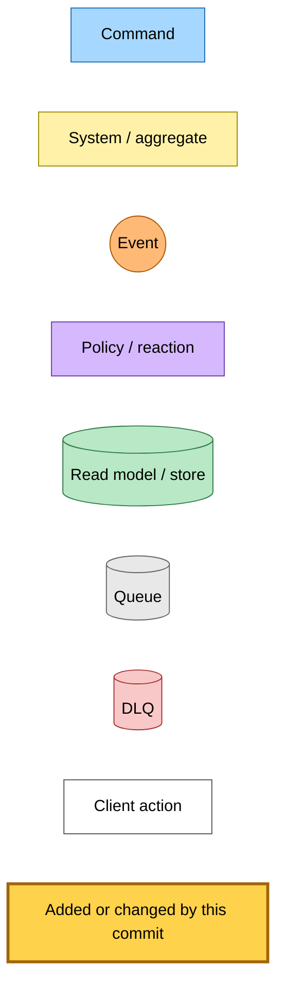

---

## 1. Save-content intake reads the trigger

Clients find `save-content` on the collection's Siren actions. The browser extensions upload a page's HTML inline, or through an upload slot when it is over the inline budget. The apps upload through the share sheet, through their deferred upload drain, and through the reader's "Capture it here" rescue. The daily Tier 1+ canary uploads a page too. None of them sends a trigger yet, so every one of these uploads stays a tap capture.

The route reads the trigger once, right after the multipart parse and before it decides which leg the request is. A malformed value is refused on every leg, including a slot request. A slot request never uses the trigger, and its response does not echo it back. A client that wants the trigger on the completion adds the part to the completion form itself.


[BPMN image](diagrams-bpmn/save-content-intake.png) · [Editable BPMN](diagrams-bpmn/save-content-intake.bpmn)

Mermaid source

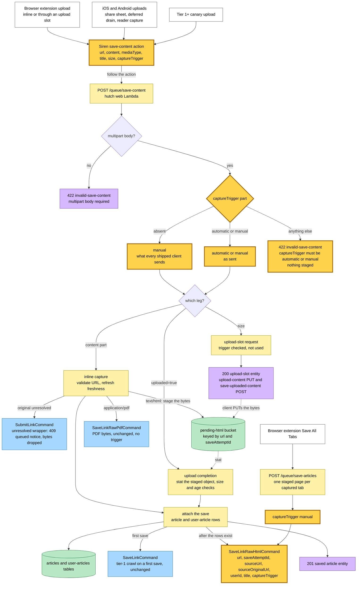

---

## 2. The raw-html worker writes the trigger into the manifest

The command handler parses the full detail, so the trigger is required on every message it accepts. It reads the staged capture and finalizes it, then stamps the candidate's provenance with `kind: extension` and the trigger. It writes the tier-0 manifest with the reader and evaluation bodies, and announces the candidate through the unchanged `TierContentExtractedEvent`. A terminal parse error, unless the capture came from a wrapper URL, marks the crawl failed and is retried. A detail that does not parse is retried too, until it dead-letters (section 4).


[BPMN image](diagrams-bpmn/raw-html-worker.png) · [Editable BPMN](diagrams-bpmn/raw-html-worker.bpmn)

Mermaid source

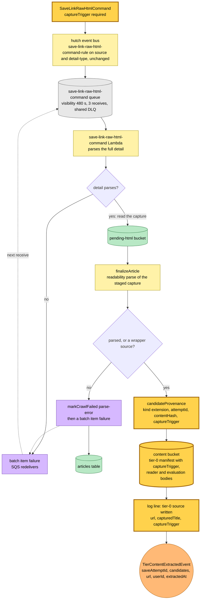

---

## 3. Selection reads the trigger

This part landed with `d56cf6769` and is unchanged here. It is drawn because this change is what feeds it. The selector verifies every listed candidate. A tier-0 candidate must keep `kind: extension`, so the trigger has to live on its own field rather than on a new kind. A tier-0 candidate whose `captureTrigger` is `manual` or absent is a tapped capture, and it keeps both trust rules: `first-capture` serves a lone tapped capture as the article's first content without the judge, and `own-capture-over-verdict` keeps a readable tapped capture from this save when the judge answers `none` and there is no canonical yet. An automatic capture goes to the judge like a crawl copy. When the judge answers `none` and nothing else is kept, the article is marked failed, with the reason this save's live fetch recorded or `parse-error` when there is none. `ownCaptureFailed` stays false for an automatic capture, so the alarm stays quiet. Each candidate on the comparison log line names its `captureTrigger`.


[BPMN image](diagrams-bpmn/selection.png) · [Editable BPMN](diagrams-bpmn/selection.bpmn)

Mermaid source

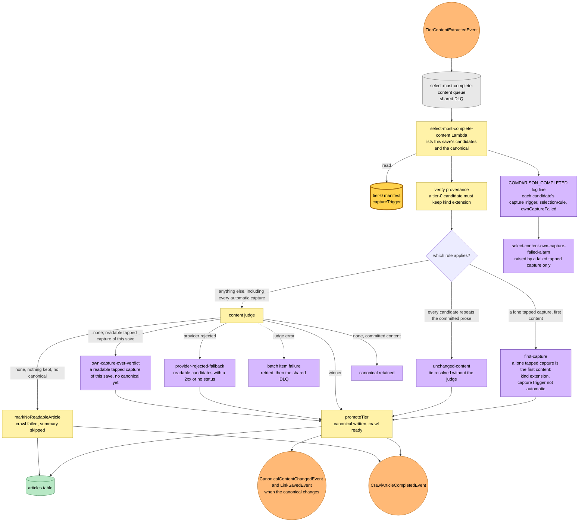

---

## 4. Retry exhaustion reaches the narrowed dead-letter parse

The raw-html queue sets no receive count of its own, so the shared default of three applies. After the third failed receive a message moves to the save-link shared failures DLQ, which keeps messages for 14 days and has no redrive of its own. Its single consumer is the dead-letter router, which hands each dead letter to the handler registered for its source queue. The raw-html handler needs only the URL to terminalise a crawl, so it now parses only `url`. `markCrawlExhausted` does nothing to a `ready` row. It moves a `pending` row to `failed` with `exhausted-retries`, and moves a pending summary to failed. It keeps a `failed` row's existing reason. It publishes `CrawlArticleFailedEvent` for every row that is not `ready`. A dead letter with no URL at all is still returned as a batch item failure.


[BPMN image](diagrams-bpmn/dead-letter.png) · [Editable BPMN](diagrams-bpmn/dead-letter.bpmn)

Mermaid source

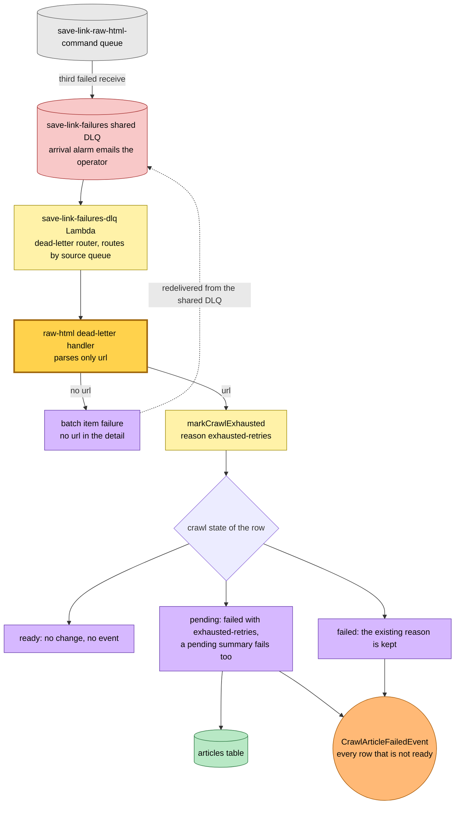

---

## 5. The deploy window

The CI matrix deploys hutch and save-link in parallel, in no fixed order. A required field is safe in one order only.

- **hutch first.** For a short time the new hutch publishes `captureTrigger` to the old raw-html Lambda. That Lambda's schema strips unknown keys, so it ignores the field and writes a manifest with no trigger, which is a tapped capture. Nothing is lost: no client sends `automatic` until the app builds are through store review.
- **save-link first, or a message already in flight.** A `SaveLinkRawHtmlCommand` published by the old hutch has no `captureTrigger`. The new Lambda rejects it on all three receives, and it lands in the shared DLQ. Before this change the raw-html dead-letter handler parsed the same full schema. It would have rejected the dead letter too. The shared DLQ has no redrive of its own, so the router would have received the same message again and again until the queue's 14-day retention expired, holding the arrival alarm in alarm and never touching the article. With the narrowed parse the dead letter is terminalised on its first delivery. That capture is lost: unless another candidate made the article readable, the reader sees the failed notice and captures the page again. The arrival alarm emails the operator when such dead letters arrive. The expected count is zero to a few: only tap captures and extension saves use the raw-html queue, and the window is the gap between two parallel deploy jobs.


[BPMN image](diagrams-bpmn/deploy-window.png) · [Editable BPMN](diagrams-bpmn/deploy-window.bpmn)

Mermaid source

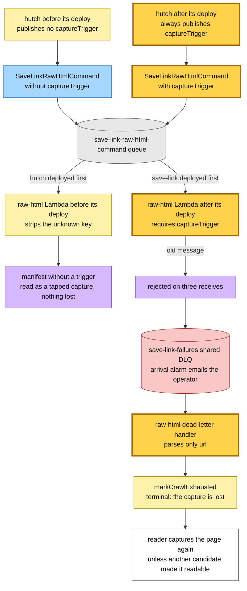

---

## Command → System → Event(s) reference

| Command or input | System and durable result | Emitted events or next actions |
|---|---|---|
| `POST /queue/save-content` with an HTML capture, inline or completing an upload slot | hutch web Lambda reads `captureTrigger` (absent means `manual`; a malformed value is refused with a 422 before anything is staged), stages the bytes in the pending-html bucket and attaches the save to the article and user-article rows | **`SaveLinkRawHtmlCommand` carrying `captureTrigger`**; on a first save also `SaveLinkCommand` for the tier-1 crawl; an unresolved wrapper publishes `SubmitLinkCommand` instead and answers with a 409 notice |
| `POST /queue/save-content` with a PDF | hutch web Lambda stages the bytes in the pending-pdf bucket | `SaveLinkRawPdfCommand`, unchanged and without a trigger |
| `POST /queue/save-content` asking for an upload slot | hutch web Lambda refuses a malformed `captureTrigger` with a 422 `invalid-save-content`, otherwise mints a presigned PUT into the pending bucket without using the value | none; a 200 `upload-slot` entity whose completion action does not echo `captureTrigger` |
| `POST /queue/save-articles` | hutch web Lambda stages each captured tab and saves every listed URL | **`SaveLinkRawHtmlCommand` with `captureTrigger: manual`** for each HTML tab |
| `SaveLinkRawHtmlCommand` | save-link `save-link-raw-html-command` Lambda finalizes the staged HTML and writes the tier-0 candidate: **the manifest carries `captureTrigger`**, with the reader and evaluation bodies | `TierContentExtractedEvent`, unchanged; a terminal parse error marks the crawl failed and the message is retried |
| `TierContentExtractedEvent` | save-link `select-most-complete-content` Lambda selects among the verified candidates; an automatic capture is judged like a crawl candidate | `CrawlArticleCompletedEvent` after `promoteTier` or `markNoReadableArticle`; `CanonicalContentChangedEvent` and `LinkSavedEvent` or `AnonymousLinkSavedEvent` when the canonical changes |
| Dead-lettered `SaveLinkRawHtmlCommand` | `save-link-failures-dlq` router hands it to the raw-html dead-letter handler, which **parses only `url`** and applies `markCrawlExhausted` | `CrawlArticleFailedEvent` for every row that is not `ready` |

---

## Known gaps recorded with the change

- **No client sends `automatic` yet.** The iOS and Android rescue and the extension's background-tab capture start sending it in their own changes, after store review. Until then every manifest the raw-html path writes says `manual`.
- **The upload-slot entity does not echo the trigger.** A client that completes an upload by posting only the completion action's declared fields sends no trigger, and the server reads that as a tap. A client that wants the trigger on a completion appends the part to the completion form itself; the extension's background-tab capture is to do so in its own change.
- **The deploy window loses in-flight captures from before the deploy.** The loss is terminal, not self-healing: the reader captures the page again. The alternative was to make the field optional for one release, which weakens an internal contract for a window of minutes, and it was not taken.
- **A judged-none automatic capture rewrites a blocked reason to `parse-error`.** This is what a tapped blank page already does, and it is recorded rather than changed.

---

## Source evidence at capture time

| Boundary | Evidence |
|---|---|
| Intake | [Readlist routes, save-content and save-articles](../../projects/hutch/src/runtime/web/pages/readlist/readlist.page.ts), [collection Siren actions](../../projects/hutch/src/runtime/web/api/collection-siren.ts), [upload-slot entity](../../projects/hutch/src/runtime/web/api/upload-slot-siren.ts) |
| Command contract | [Event catalogue](../../src/packages/hutch-infra-components/src/events.ts), [publisher contract](../../src/packages/provider-contracts/src/events.ts), [capture trigger schema](../../src/packages/domain/src/article/article.schema.ts) |
| Raw-html worker | [Command handler](../../projects/save-link/src/runtime/domain/save-link-raw-html/save-link-raw-html-command-handler.ts), [candidate provenance](../../projects/save-link/src/runtime/domain/select-content/candidate-provenance.ts), [manifest schema](../../projects/save-link/src/runtime/domain/select-content/tier-source.types.ts) |
| Selection | [Selection preparation and comparison log line](../../projects/save-link/src/runtime/domain/select-content/prepare-content-selection.ts), [selection outcomes](../../projects/save-link/src/runtime/domain/select-content/select-content-work.ts) |
| Dead letters | [Raw-html dead-letter handler](../../projects/save-link/src/runtime/domain/crawl-article-state/save-link-raw-html-dlq-handler.ts), [shared DLQ router composition root](../../projects/save-link/src/runtime/save-link-failures-dlq.main.ts), [crawl-exhausted transition](../../src/packages/domain/src/article-aggregate/transitions/mark-crawl-exhausted.ts) |
| Infrastructure | [save-link infrastructure](../../projects/save-link/src/infra/index.ts), [queue component and its default receive count](../../src/packages/hutch-infra-components/src/infra/sqs-queue.ts), [event bus rules](../../src/packages/hutch-infra-components/src/infra/event-bus.ts) |
