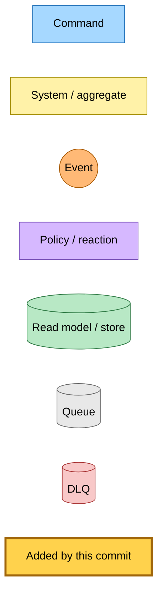
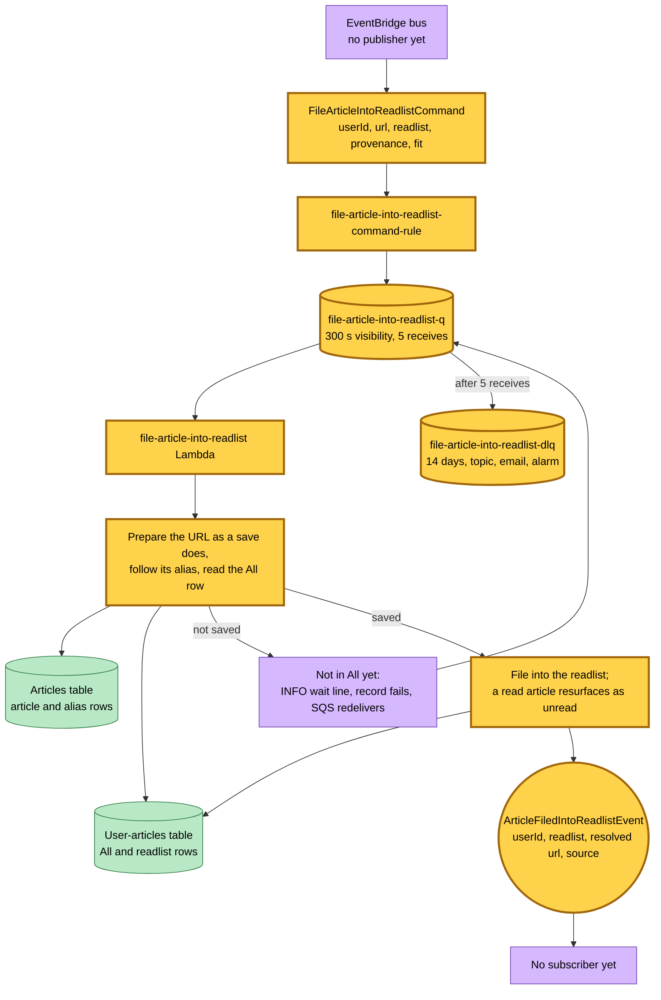

# Readlist filing: one command files an article into a readlist

Snapshot of the uncommitted working tree over `58b9096` (`rp/determined-franklin-7crvbn`), whose 2026-10-25 subject is **feat(@packages/article-store,@packages/provider-contracts): find a reader's saved article for a link through its alias**. Generated 2026-10-25.

This change adds the one way a readlist decision puts an article into a readlist. Nothing publishes the command yet: the email filter starts publishing it when it switches to the shared fit contract, and the email page's reader controls publish it later.

- **`FileArticleIntoReadlistCommand` is new.** It names the reader, the link as it arrived, the readlist and the save provenance, plus the fit that justified the filing: an email keep with its reason and purpose version, a reader keep, or a readlist with no purpose.
- **The `file-article-into-readlist` Lambda handles it** from its own queue, with five receives and its own dead-letter queue, topic, email subscription and alarm. It looks the link up the way a save keys it: it prepares the URL, follows an alias row to its canonical, then reads the reader's row in All. A link whose article is not in All yet is redelivered. Otherwise the article is filed into the readlist, and a read article resurfaces as unread in every readlist that holds it.
- **`ArticleFiledIntoReadlistEvent` is new.** The handler publishes it after every completed filing, including one that finds the article already filed. Nothing subscribes to it yet.

---

## Legend

Amber marks what this change adds. Everything else is existing infrastructure shown for context.

[BPMN image](diagrams-bpmn/legend.png) · [Editable BPMN](diagrams-bpmn/legend.bpmn)

Mermaid source

---

## 1. The filing flow

No publisher exists yet, so the command enters from the bus with nothing upstream. The lookup reads the canonical alias rows in the articles table before it reads the reader's All row, because a tracker wrapper or an adopted terminal URL is saved under its canonical.

[BPMN image](diagrams-bpmn/filing-flow.png) · [Editable BPMN](diagrams-bpmn/filing-flow.bpmn)

Mermaid source

---

## Command → System → Event(s) reference

| Command or event | Handled by | Emits | Triggers next |
|---|---|---|---|
| `FileArticleIntoReadlistCommand` | `file-article-into-readlist` Lambda, through its own queue | `ArticleFiledIntoReadlistEvent` after every completed filing | Nothing yet |
| `ArticleFiledIntoReadlistEvent` | No subscriber | — | — |
