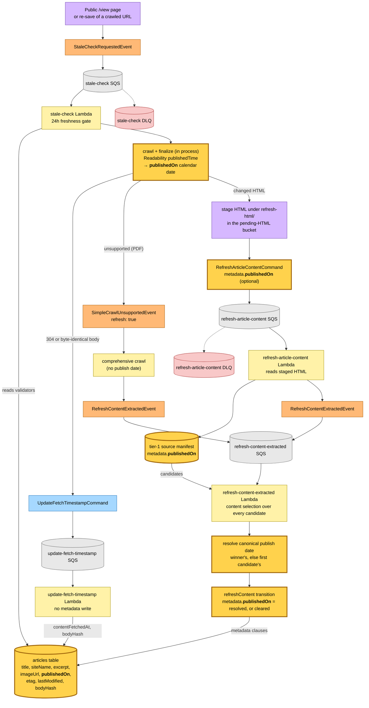
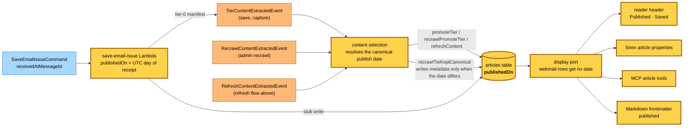

# Article Publish Date — Refresh Flow

Commit: `62c7381` (working tree carries the change; snapshot generated before it was committed)
Date (commit): 2026-10-25
Generated: 2026-10-25
Branch: `rp/jolly-brahmagupta-xgkrhu`

## Why

The reader header showed a bare "17d ago" — the moment a save happened — and a
reader took it for the article's publish date. The article now carries an
optional `publishedOn` calendar date (`YYYY-MM-DD`, taken as the source wrote
it) and the header reads "Published Oct 8, 2025 · Saved 17d ago".

The date travels the same path as the other article metadata. Every hop
validates its payload with a schema that drops undeclared keys, so the one
wire-format change is an optional `metadata.publishedOn` on
`RefreshArticleContentCommand`: without it the stale-check refresh would
publish the command and lose the date before the refresh handler staged the
tier-1 manifest. Selection then resolves the date across every candidate (the
winner's, else the first candidate's), so a refresh that keeps the stored
canonical — whose manifest predates the date — still writes the fresh
candidate's date to the row.

No new command, event, queue, Lambda or EventBridge rule. Rules match detail
types, not payload fields.

## Legend

| Role | Fill | Stroke |
|---|---|---|
| Command | `#a6d8ff` | `#1e6fb8` |
| System / aggregate | `#fff2a8` | `#a08a00` |
| Event | `#ffb976` | `#a85800` |
| Policy / reaction | `#d6b8ff` | `#6b3fb0` |
| Read model / store | `#b8e8c5` | `#2f7a45` |
| Queue | `#e8e8e8` | `#666` |
| DLQ | `#f8c8c8` | `#a83434` |
| **New** (this snapshot) | `#ffd24c` | `#a0660b` |

`:::new` marks the nodes that now carry `publishedOn`.

## Refresh flow — every path that touches `RefreshArticleContentCommand`

The public `/view` page and a re-save of an already-crawled URL ask for a
freshness check. The stale-check Lambda re-fetches with the stored
validators; a `304` or a byte-identical body never parses and only advances
the fetch timestamp. A changed HTML body is parsed and finalized (Readability's
published time is normalised to a calendar date here), staged in S3 and
announced with `RefreshArticleContentCommand`. A PDF body defers to the
comprehensive crawl, which carries no publish date.

Mermaid source

## Where the date lands — every write and read of `publishedOn`

The refresh flow is one of four writers. A first save, a tapped capture and an
admin recrawl go through the same selection step; a recrawl whose prose is
unchanged now writes the resolved date through the tie-kept transition. A
newsletter issue takes the UTC day of the inbox's receipt instant, from the
first stub write onwards. Every read goes through the display port, which
withholds the date from a webmail row.

Mermaid source

## Command → System → Event(s) reference

| Command / event | System | Emits | Next |
|---|---|---|---|
| `StaleCheckRequestedEvent` | stale-check Lambda | `UpdateFetchTimestampCommand` (unchanged body), `SimpleCrawlUnsupportedEvent` (PDF), `RefreshArticleContentCommand` (changed HTML, now with `metadata.publishedOn`) | — |
| `UpdateFetchTimestampCommand` | update-fetch-timestamp Lambda | — (writes fetch timestamp and body hash; no metadata) | — |
| `SimpleCrawlUnsupportedEvent` (refresh) | simple-crawl-unsupported policy → comprehensive crawl | `RefreshContentExtractedEvent` (no publish date) | refresh-content-extracted |
| `RefreshArticleContentCommand` | refresh-article-content Lambda | `RefreshContentExtractedEvent`; writes the tier-1 manifest carrying `publishedOn` | refresh-content-extracted |
| `RefreshContentExtractedEvent` | refresh-content-extracted Lambda | — (runs selection and the `refreshContent` transition, writing the resolved `publishedOn`) | summary regeneration when the canonical changes, as before |
| `RecrawlContentExtractedEvent` | recrawl selection | `RecrawlCompleted` as before; a tie now writes the resolved `publishedOn` | — |
| `TierContentExtractedEvent` | save selection | as before; `promoteTier` writes the resolved `publishedOn` | — |
| `SaveEmailIssueCommand` | save-email-issue Lambda | `TierContentExtractedEvent` as before; stub and manifest carry the receipt day | save selection |
