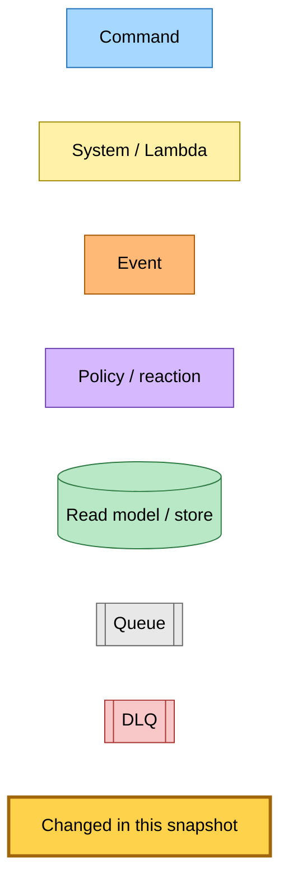
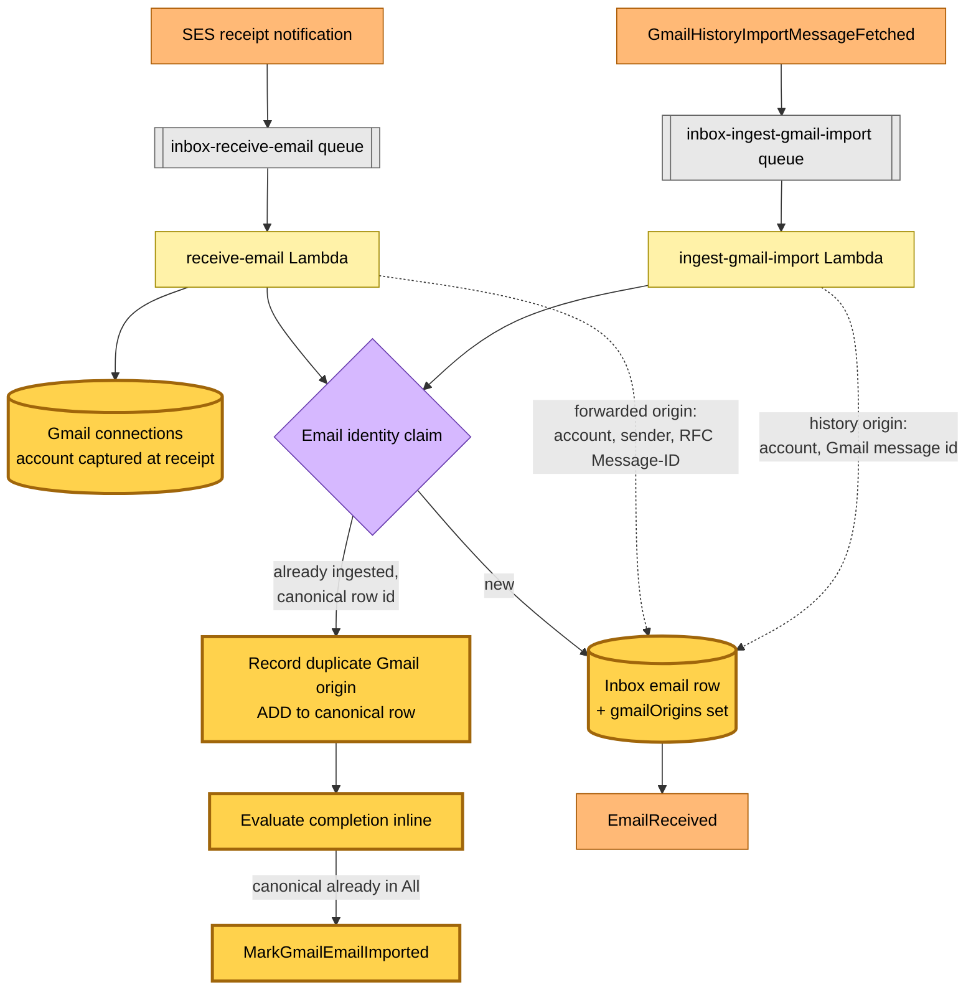
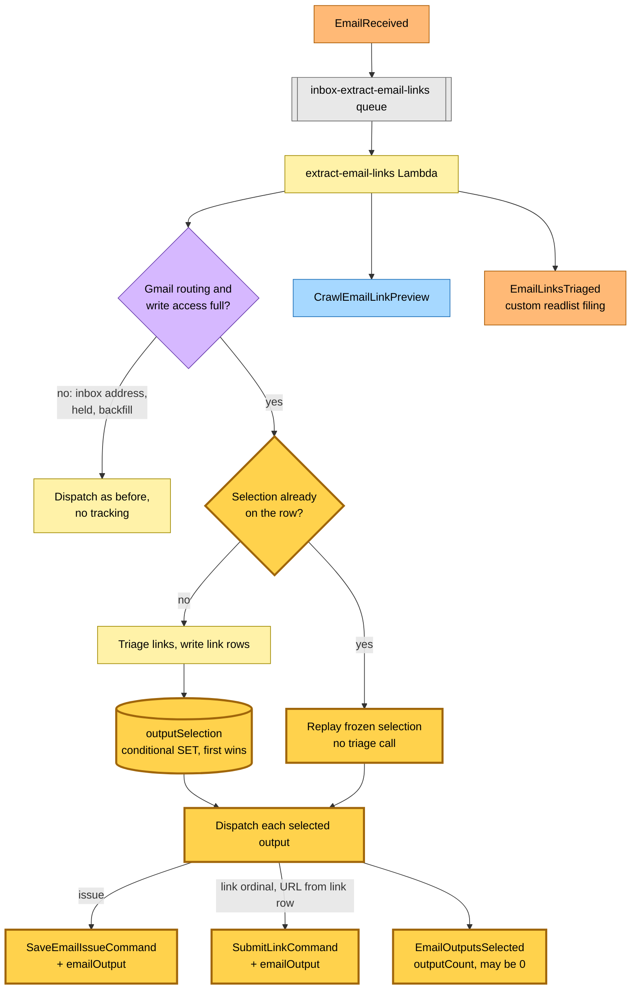
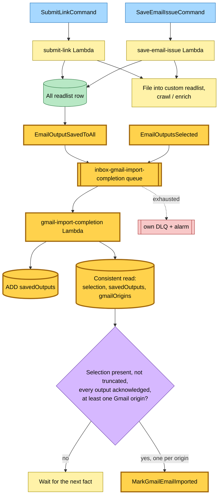
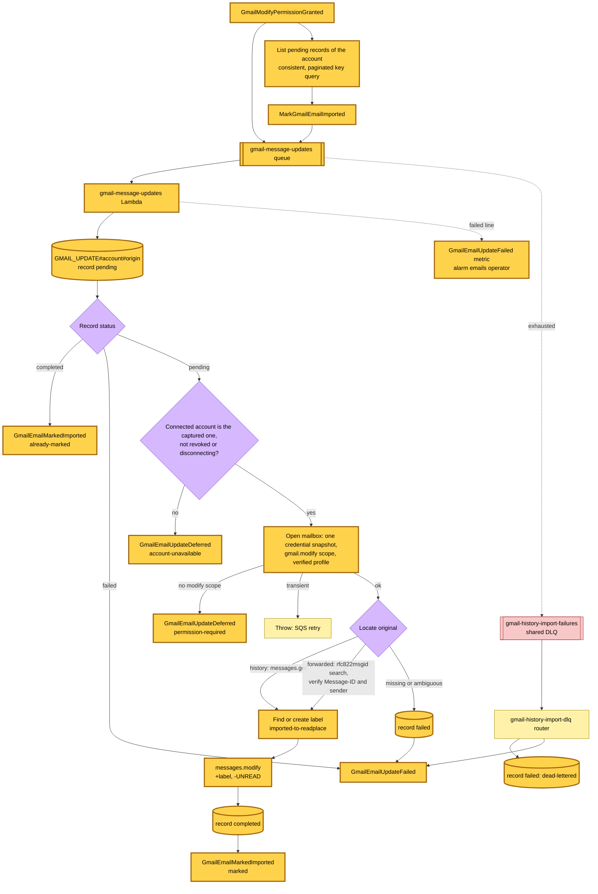
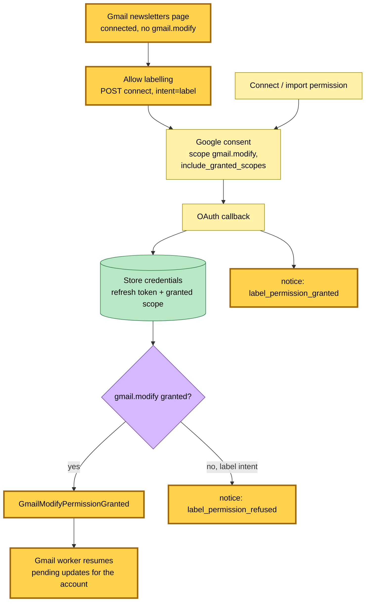
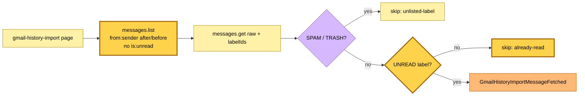

# Gmail import labelling — label and mark read after a save reaches All

**Commit:** `b918eea` · **Commit date:** 2026-10-27 · **Generated:** 2026-10-27 · **Branch:** `rp/blissful-hopper-kukf1y`

**Subject:** feat: label and mark Gmail originals read once their email is saved to All

Once every output a Gmail-mapped email selected for the reader's All readlist is durably saved there, the original Gmail message is labelled `imported-to-readplace` and marked read. This covers both entry points: a manual history import of a mapped sender's mail, and future mail forwarded through the Gmail filter. Saves that are held, unparsed, truncated or failed never qualify. Article enrichment, summaries and filing into custom readlists do not delay the Gmail update.

## Legend

Nodes and edges highlighted in **gold** (`:::new`) are new in this snapshot; everything else is the flow as it already stood.

Mermaid source

## 1. Capturing the Gmail identity of an accepted email

Both ingestion paths now record which Gmail message an inbox email came from on the canonical inbox email row. A duplicate (the same issue arriving by forwarding and by import) resolves back to the canonical row and keeps the newly discovered identity, then re-evaluates completion so the new copy is labelled too.

Mermaid source

## 2. Frozen selection and dispatch to All

Extraction for a Gmail-mapped email whose saves are not held is split into a selection step and a dispatch step. The selection — the full issue, the eligible link ordinals, or both — is persisted on the inbox email row before any save is dispatched, frozen the first time it is made. A retry replays it without re-running triage. Every save command carries the email/output correlation, and a selection-completed fact is published on every run, including one that selected nothing.

Mermaid source

## 3. Confirming saves in All and completing the import

The save workers emit `EmailOutputSavedToAll` immediately after the durable write to All — duplicate saves included — and before custom-readlist filing or enrichment. A completion Lambda records each acknowledgement atomically (a DynamoDB string-set `ADD`) and evaluates completion with a strongly consistent read; duplicates and reordered facts converge, and nothing ever removes an acknowledgement.

Mermaid source

## 4. Labelling the Gmail original

The Gmail worker records the update as pending (an account-prefixed record in the Gmail history-imports table) before it checks permission, then opens the mailbox through one credential snapshot: refresh token and granted scope read together, one access token minted from that token, and the mailbox's own address verified before any lookup or change. A history message is found by its Gmail id; a forwarded one by RFC Message-ID search with the sender and Message-ID verified, mutating only an unambiguous match. The `imported-to-readplace` label is reused or created (a creation conflict re-lists and reuses). One modify request adds the label and removes `UNREAD`, leaving other labels and inbox placement alone. Completion is recorded only after Gmail accepts it, and a completed record answers every later request.

Mermaid source

## 5. Permission: request, upgrade and resume

New connections and the import permission request ask for `gmail.modify`, which also reads mail, so a reader who grants it needs no separate read-only grant; existing read-only grants keep working. Readers connected without it see an "Allow labelling" prompt that runs the incremental OAuth upgrade. After the upgraded credentials are stored, the callback publishes `GmailModifyPermissionGranted`, which resumes every pending update for that account. Because pending work is persisted before permission is checked, a grant that lands concurrently with a completion is never missed.

Mermaid source

## 6. History pagination independent of read state

The history import lists the sender's mail in its fixed date window without `is:unread`, keeping the spam and trash exclusions, and checks `UNREAD` on each fetched message. Marking imported mail read therefore never shifts which messages a later page holds, including updates caused by concurrent forwarding; already-read messages cost one extra read each and are skipped.

Mermaid source

## Command → System → Event(s) reference

| Command / event | Handled by | Emits | Next |
|---|---|---|---|
| SES receipt (forwarded mail) | inbox receive-email Lambda | `EmailReceived`; on a duplicate, `MarkGmailEmailImported` if the canonical email is already in All | extract-email-links; Gmail worker |
| `GmailHistoryImportMessageFetched` | inbox ingest-gmail-import Lambda | `EmailReceived`, `GmailHistoryImportMessageIngested`; on a duplicate, `MarkGmailEmailImported` if already in All | extract-email-links; history outcomes; Gmail worker |
| `EmailReceived` | inbox extract-email-links Lambda | `SubmitLinkCommand` / `SaveEmailIssueCommand` (with `emailOutput` when tracked), `CrawlEmailLinkPreview`, `EmailLinksTriaged`, **`EmailOutputsSelected`** | save-link workers; preview crawler; custom-readlist filter; completion |
| `SubmitLinkCommand` | save-link submit-link Lambda | `LinkQueued`, `QueueEntryCreated`, **`EmailOutputSavedToAll`**, `TierContentExtracted` | inbox read model; completion; content selection |
| `SaveEmailIssueCommand` | save-link save-email-issue Lambda | **`EmailOutputSavedToAll`**, `TierContentExtracted` | completion; content selection |
| **`EmailOutputsSelected`** | inbox gmail-import-completion Lambda | `MarkGmailEmailImported` per Gmail origin when complete | Gmail worker |
| **`EmailOutputSavedToAll`** | inbox gmail-import-completion Lambda | `MarkGmailEmailImported` per Gmail origin when complete | Gmail worker |
| **`MarkGmailEmailImported`** | hutch gmail-message-updates Lambda | **`GmailEmailMarkedImported`** / **`GmailEmailUpdateDeferred`** / **`GmailEmailUpdateFailed`** | — (facts) |
| **`GmailModifyPermissionGranted`** | hutch gmail-message-updates Lambda | `MarkGmailEmailImported` per pending update of the account | Gmail worker |
| Dead-lettered `MarkGmailEmailImported` | hutch gmail-history-import-dlq router | **`GmailEmailUpdateFailed`** (dead-lettered) | — |
| OAuth callback with `gmail.modify` | hutch web Lambda | **`GmailModifyPermissionGranted`** | Gmail worker |
