# Gmail import labelling — label and mark read after a save reaches All

**Commit:** `b918eea` · **Commit date:** 2026-10-27 · **Generated:** 2026-10-31 · **Branch:** `rp/blissful-hopper-kukf1y`

**Subject:** feat: label and mark Gmail originals read once their email is saved to All

Once every output a Gmail-mapped email selected for the reader's All readlist is durably saved there, the original Gmail message can be labelled `imported-to-readplace` and marked read. Marking is opt-in per sender mapping and off by default: a checkbox on each mapping card and in the new-mapping dialog, where it is ticked by default once `gmail.modify` is granted. Ticking it without that permission goes straight to Google consent, and the option turns on only when Google grants it. A backfill can apply it to mail Readplace saved before the option was on. This covers both entry points: a manual history import of a mapped sender's mail, and future mail forwarded through the Gmail filter. Saves that are held, unparsed, truncated or failed never qualify. Article enrichment, summaries and filing into custom readlists do not delay the Gmail update.

## Legend

Nodes and edges highlighted in **gold** (`:::new`) are new in this snapshot; everything else is the flow as it already stood.


Mermaid source

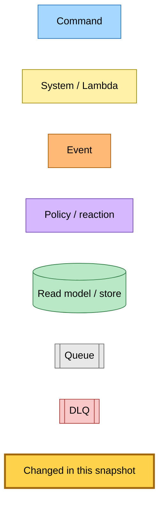

## 1. Capturing the Gmail identity of an accepted email

Both ingestion paths now record which Gmail message an inbox email came from on the canonical inbox email row, including the sender, which the opt-in gate uses to find the mapping. A duplicate (the same issue arriving by forwarding and by import) resolves back to the canonical row and keeps the newly discovered identity, then re-evaluates completion so the new copy is labelled too.


Mermaid source

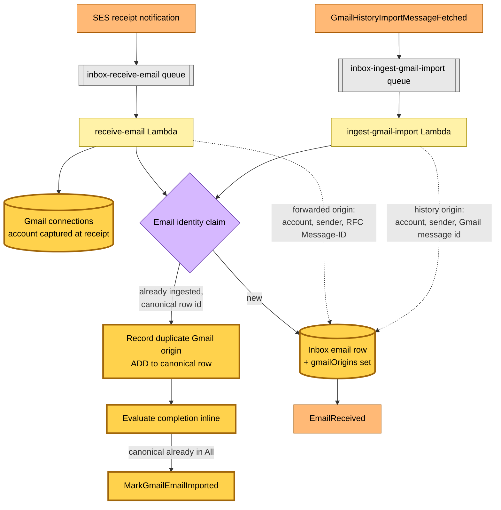

## 2. Frozen selection and dispatch to All

Extraction for a Gmail-mapped email whose saves are not held is split into a selection step and a dispatch step. The selection — the full issue, the eligible link ordinals, or both — is persisted on the inbox email row before any save is dispatched, frozen the first time it is made. A retry replays it without re-running triage. Every save command carries the email/output correlation, and a selection-completed fact is published on every run, including one that selected nothing.


Mermaid source

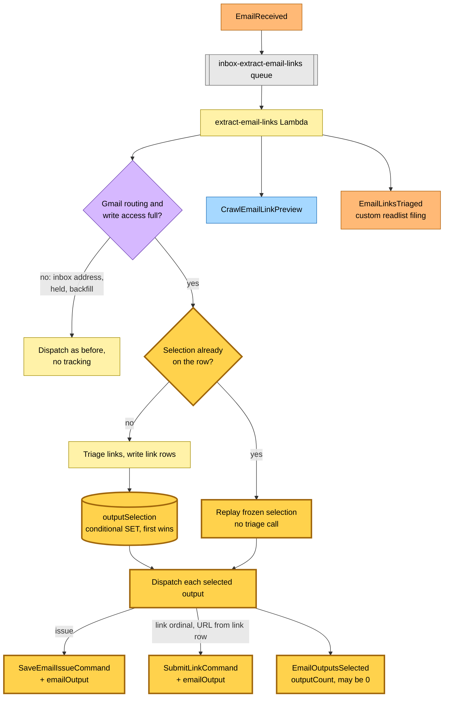

## 3. Confirming saves in All and completing the import

The save workers emit `EmailOutputSavedToAll` immediately after the durable write to All — duplicate saves included — and before custom-readlist filing or enrichment. A completion Lambda records each acknowledgement atomically (a DynamoDB string-set `ADD`) and evaluates completion with a strongly consistent read; duplicates and reordered facts converge, and nothing ever removes an acknowledgement. Completion runs whether or not the sender's mapping has marking turned on; the Gmail worker applies that option (section 4).


Mermaid source

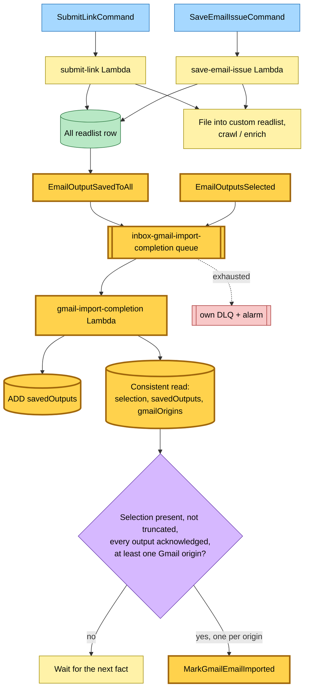

## 4. Labelling the Gmail original

Labelling is opt-in per sender mapping. The worker's first step is a gate: it reads the mapping for the origin's account and sender, and goes on only when the mapping carries `markImportedAt`. While the option is off it deletes the origin's update record if that record is still pending (completed and failed records are kept), returns `skipped`, and the handler logs it with no event and no metric. History origins now carry the sender, as forwarded ones already did, so the gate can find the mapping for both.

Past the gate the worker is unchanged. It records the update as pending (an account-prefixed record in the Gmail history-imports table) before it checks permission, then opens the mailbox through one credential snapshot: refresh token and granted scope read together, one access token minted from that token, and the mailbox's own address verified before any lookup or change. A history message is found by its Gmail id; a forwarded one by RFC Message-ID search with the sender and Message-ID verified, mutating only an unambiguous match. The `imported-to-readplace` label is reused or created (a creation conflict re-lists and reuses). One modify request adds the label and removes `UNREAD`, leaving other labels and inbox placement alone. Completion is recorded only after Gmail accepts it, and a completed record answers every later request; a failed record answers `already-failed`, with no event and no metric. The locate, label and modify steps live in a module the backfill (section 6) shares.

Only `ambiguous-original`, `gmail-rejected` and `dead-lettered` failures reach the alarm metric. An `original-not-found` failure — a reader who deleted the newsletter before it saved — still publishes `GmailEmailUpdateFailed` but is logged as a warning.


Mermaid source

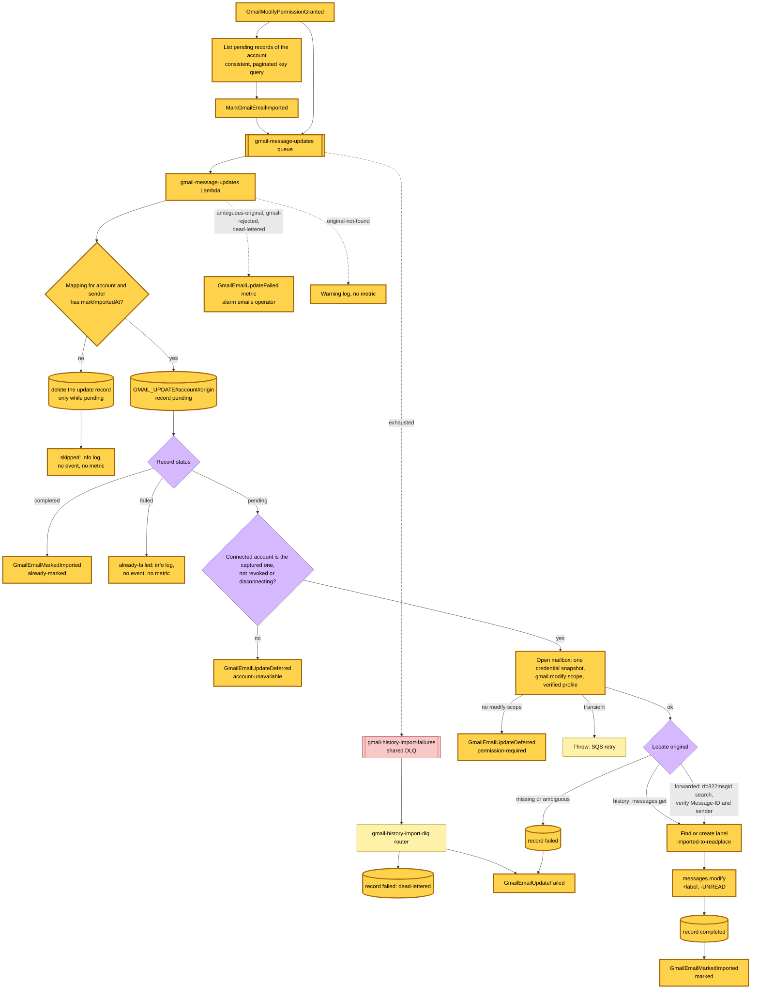

## 5. Opt-in and permission

### Turning the option on and off

The option is one timestamp, `markImportedAt`, on the sender mapping. It is off by default, and the "Mark imported emails as read and label them imported-to-readplace" checkbox shows it: ticked only while the timestamp is set. Each mapping card whose destination is a readlist carries the box in a form that submits itself when it is ticked or unticked (a no-JS "Apply" button submits it otherwise); the form's action is `mark-read/start` while the box is unticked and `mark-read/stop` while it is ticked, so a locked or read-only account can still untick. The new-mapping dialog has its own box, applied only to mappings that save creates. It is unticked until `gmail.modify` is granted and ticked by default after that; a hidden `mark=0` before it records an explicit untick, which the sender search carries along with the live ticks.

Ticking, on the card or in the dialog, sets the timestamp at once only when the stored grant already includes `gmail.modify`. Otherwise nothing is stored: the route begins Google consent for `gmail.modify` with the sender addresses in the signed OAuth state, and the callback sets the timestamp on those senders only when Google grants it (section "Permission: request and resume"). The box is disabled while unticked when the page should not offer a tick: the connection is revoked (the page offers Reconnect; a stale page's tick answers `mark_revoked`, or turns the option on when the stored grant still includes `gmail.modify`), modify is missing and the reader's plan cannot start consent (the box carries the Upgrade hint, and the dialog's box is disabled and unticked for that reader too), or the stored grant lacks `gmail.metadata` (the page offers its Reconnect for choosing senders). A save that ticks the dialog box for a revoked connection whose stored grant lacks `gmail.modify` answers `mark_revoked` too, unless an import error wins (with the grant still stored, the option turns on at once); one whose state would not fit the OAuth state cookie answers `mark_permission_needed` and leaves the option off, so each card's box can ask for its own sender. Setting it is `if_not_exists`, so a double submit does not start a new on-period, and the value identifies the on-period a backfill belongs to. The option survives a disconnect and a move of the mapping to another readlist.

Unticking removes the timestamp, deletes the sender's pending update records and cancels its backfill. A change already sent to Gmail when the option turns off still lands, though its update record is gone. Removing the sender does the same teardown with the reason `mapping-removed`. Turning the option off does not revoke `gmail.modify`: while every option is off nothing changes the mailbox, but the history import still reads mail under that grant when it is the only read scope granted. Completion tracking (sections 1–3) runs whatever the option says, because the backfill relies on the origins and selections it records.


Mermaid source

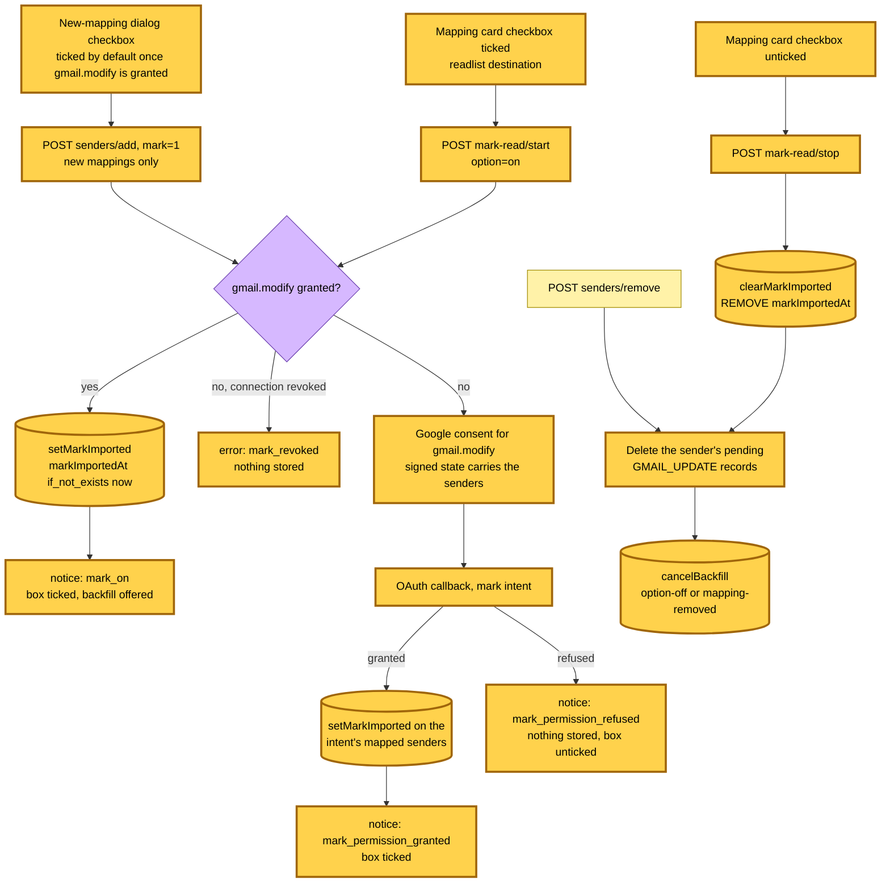

### Permission: request and resume

Connecting Gmail asks only for the settings and metadata scopes, and the import permission request asks only for `gmail.readonly`. Neither asks for `gmail.modify`. A separate `mark` OAuth intent asks for it and carries, in the signed state, the senders it will turn on. Three things begin it: ticking a card's box (`mark-read/start`, one sender), saving the new-mapping dialog with its box ticked (`senders/add`, every mapping that save created), both only while the grant lacks modify, and the "Allow in Gmail" button (`connect` with `intent=mark`, one sender). That button shows on a `permission-lost` card: the option is on but the stored grant no longer includes modify, because a reconnect or a re-consent replaced the grant after the option was turned on. The box stays ticked there, since the option really is on, with a hint; the button gives way to Upgrade when the reader's plan cannot start consent, and to the page's Reconnect while the connection is revoked. The card and dialog routes check that the reader's plan can start consent before they open the trace, and refuse a state whose URL-encoded cookie would exceed 3,800 bytes before it is recorded as issued or set as a cookie. The account-level "Allow labelling" card is gone. Incremental consent (`include_granted_scopes`) is kept on the import and mark intents, so Google's answer keeps earlier grants.

Whenever the stored grant includes `gmail.modify`, whatever the intent, the callback publishes `GmailModifyPermissionGranted`, which resumes every pending update for that account. Because pending work is persisted before permission is checked, a grant that lands concurrently with a completion is never missed. A granted mark intent sets `markImportedAt` on each of the intent's senders that is still a mapped newsletter with live readlist destinations owned by the reader (keyed by the session's user and the account Google just verified), then resumes every import waiting for read permission, since modify reads mail too. Imports the dialog save started come first, so an import waiting for permission resumes on that approval. A declined grant or a provider error on the mark intent stores nothing: a box ticked without permission stays unticked and the option stays off. From a `permission-lost` card the option stays on and the card keeps its hint: new saves keep recording pending updates and nothing changes in Gmail until the reader allows it or unticks the box.


Mermaid source

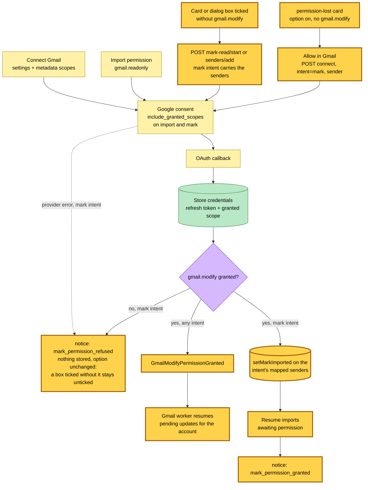

## 6. Backfill: marking emails Readplace already saved

Once the option is on and modify is granted, the row offers "Apply to earlier emails". That route starts a job row (`MARK_BACKFILL#account#sender` in the reader's history-imports partition, one per mapping) bound to the current on-period, and publishes `StartGmailMarkBackfillCommand` only when the job actually started; a failed or cancelled job in the same on-period restarts from its saved cursor with a new generation ("Try again").

The backfill Lambda pages backwards through the reader's inbox emails from the on-period's start, so later mail is left to the live path. Each page re-checks the job's generation and page, the connection, the mapping and the on-period, and on any change cancels only the generation it read, so a job restarted meanwhile is left alone. It then claims a 60-second lease, opens the mailbox and resolves the label once. It reads rows until 25 eligible emails are done, 400 rows are read, 40 seconds pass, or the rows run out. A classifier decides each row: only received Gmail mail from the mapped sender that Readplace saved to every output it selected is eligible. Rows with a frozen selection use the completion evidence; rows from before that evidence existed fall back to the extraction metadata, and a row with neither is left alone and not counted — mail from before 4 October 2026, and whole issues saved before 13 October 2026. Eligible emails go through the same pending-record and locate, label, modify steps as the worker, so a rerun counts as already marked. The option is re-checked before each eligible email.

A page that did not reach the end publishes `GmailMarkBackfillPageProcessedEvent` first and saves its cursor and counts second; the event comes back to the same queue and dispatches the next page with a 10-second delay. Per-email failures only change the job's counts — never a metric or an event. Losing permission or Gmail rejecting the label fails the job as a state the reader sees; an exhausted page message reaches the shared DLQ, whose new `markBackfill` route fails the job as `dead-lettered`.


Mermaid source

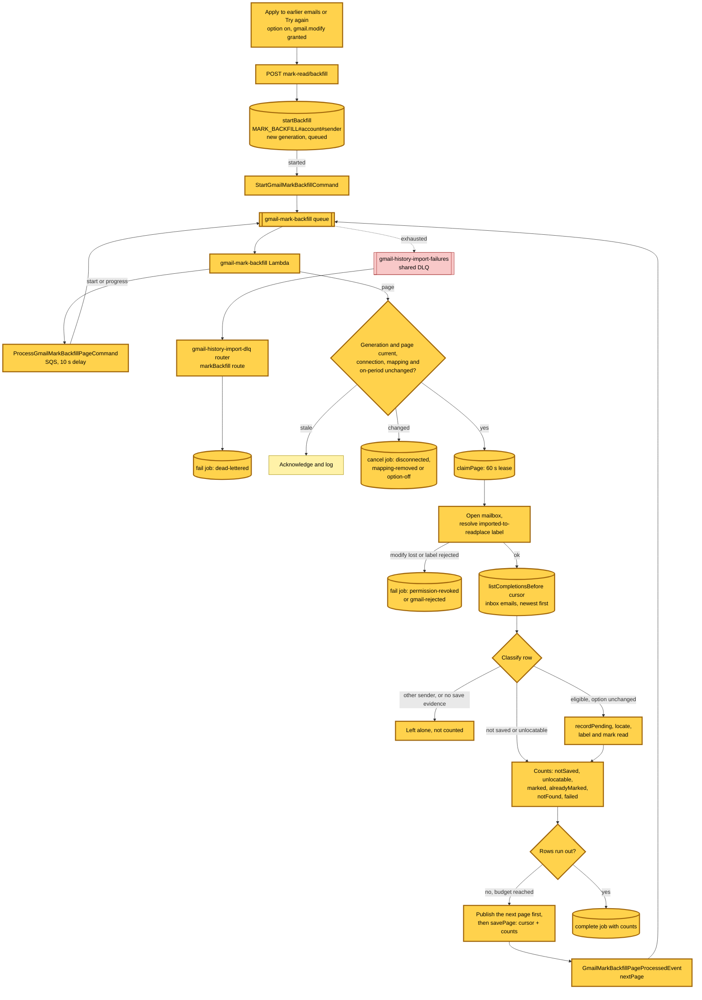

## 7. History pagination independent of read state

The history import lists the sender's mail in its fixed date window without `is:unread`, keeping the spam and trash exclusions, and checks `UNREAD` on each fetched message. Marking imported mail read therefore never shifts which messages a later page holds, including updates caused by concurrent forwarding; already-read messages cost one extra read each and are skipped.


Mermaid source

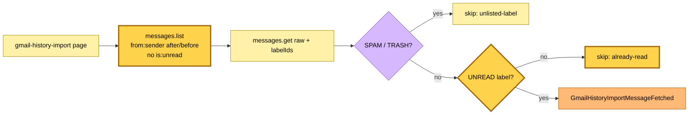

## Command → System → Event(s) reference

| Command / event | Handled by | Emits | Next |
|---|---|---|---|
| SES receipt (forwarded mail) | inbox receive-email Lambda | `EmailReceived`; on a duplicate, `MarkGmailEmailImported` if the canonical email is already in All | extract-email-links; Gmail worker |
| `GmailHistoryImportMessageFetched` | inbox ingest-gmail-import Lambda | `EmailReceived`, `GmailHistoryImportMessageIngested`; on a duplicate, `MarkGmailEmailImported` if already in All | extract-email-links; history outcomes; Gmail worker |
| `EmailReceived` | inbox extract-email-links Lambda | `SubmitLinkCommand` / `SaveEmailIssueCommand` (with `emailOutput` when tracked), `CrawlEmailLinkPreview`, `EmailLinksTriaged`, **`EmailOutputsSelected`** | save-link workers; preview crawler; custom-readlist filter; completion |
| `SubmitLinkCommand` | save-link submit-link Lambda | `LinkQueued`, `QueueEntryCreated`, **`EmailOutputSavedToAll`**, `TierContentExtracted` | inbox read model; completion; content selection |
| `SaveEmailIssueCommand` | save-link save-email-issue Lambda | **`EmailOutputSavedToAll`**, `TierContentExtracted` | completion; content selection |
| **`EmailOutputsSelected`** | inbox gmail-import-completion Lambda | `MarkGmailEmailImported` per Gmail origin when complete | Gmail worker |
| **`EmailOutputSavedToAll`** | inbox gmail-import-completion Lambda | `MarkGmailEmailImported` per Gmail origin when complete | Gmail worker |
| **`MarkGmailEmailImported`** | hutch gmail-message-updates Lambda | **`GmailEmailMarkedImported`** / **`GmailEmailUpdateDeferred`** / **`GmailEmailUpdateFailed`**; nothing when the mapping's option is off (`skipped`, pending record deleted) or the record already failed (`already-failed`, record kept) | — (facts) |
| **`GmailModifyPermissionGranted`** | hutch gmail-message-updates Lambda | `MarkGmailEmailImported` per pending update of the account | Gmail worker |
| Dead-lettered `MarkGmailEmailImported` | hutch gmail-history-import-dlq router | **`GmailEmailUpdateFailed`** (dead-lettered) | — |
| OAuth callback with `gmail.modify` | hutch web Lambda | **`GmailModifyPermissionGranted`**; for a `mark` intent, also sets `markImportedAt` on the intent's mapped senders and resumes imports awaiting permission | Gmail worker |
| POST `mark-read/start` (card box ticked), or `senders/add` with the mark checkbox | hutch web Lambda | — (sets `markImportedAt` when `gmail.modify` is already granted); otherwise Google consent for `gmail.modify` whose `mark` intent carries the sender(s), refused with `mark_revoked` while the connection is revoked | OAuth callback |
| POST `mark-read/stop` (card box unticked), or `senders/remove` | hutch web Lambda | — (clears the option, deletes the sender's pending updates, cancels its backfill) | — |
| POST `connect` with `intent=mark` ("Allow in Gmail" on a `permission-lost` card) | hutch web Lambda | Google consent for `gmail.modify` whose `mark` intent carries the card's sender; on return, if granted, the callback sets `markImportedAt` on the intent's mapped senders and publishes **`GmailModifyPermissionGranted`** | OAuth callback |
| POST `mark-read/backfill` | hutch web Lambda | **`StartGmailMarkBackfillCommand`** when a job started | backfill |
| **`StartGmailMarkBackfillCommand`** | hutch gmail-mark-backfill Lambda | **`ProcessGmailMarkBackfillPageCommand`** (SQS) for the job's page | backfill |
| **`ProcessGmailMarkBackfillPageCommand`** | hutch gmail-mark-backfill Lambda | **`GmailMarkBackfillPageProcessedEvent`** while rows remain; otherwise the job completes, fails or is cancelled | backfill |
| **`GmailMarkBackfillPageProcessedEvent`** | hutch gmail-mark-backfill Lambda | **`ProcessGmailMarkBackfillPageCommand`** (SQS, 10 s delay) for the next page | backfill |
| Dead-lettered backfill message | hutch gmail-history-import-dlq router (`markBackfill`) | — (job failed: `dead-lettered`) | — |
