# Render crawl: a headless-browser leg for JavaScript-only pages

Snapshot of the uncommitted working tree over `25719b8c6` (`main`), whose 2026-10-28 subject is **chore(@packages/check-failed-articles): exclude non-article and unreachable saves**. Generated 2026-10-29. Nothing here is committed yet: the drawing is of the working tree as it stood when the snapshot was taken.

The crawler never runs JavaScript. A page whose server HTML is only a loading shell (a single-page app, a client-rendered blog post, an ebook reader) therefore crawls "successfully" with zero words, and selection ends it `failed/parse-error`. About half of the failed-articles canary backlog had that cause. This change adds a last-resort crawl leg that renders such a page in headless Chromium. It is reached only after every cheap tier-1 leg has answered with a 2xx body, because a browser costs far more CPU and memory than a fetch.

- **A shell check at tier-1 crawl time.** The save-link crawl-and-finalize bundle now wraps the finalize wrapper with a deterministic check. It asks for the evaluation HTML and calls a fetched result a JavaScript shell when it is HTML, 2xx, under 25 words, holds no image, video, audio or iframe in the extracted article (the media rule selection's readability check uses) and carries at least one executable `<script>`. JSON-LD, JSON and template script types do not count. A shell becomes `unsupported { kind: javascript-required }`, a deferrable reason that already existed and that nothing produced before. Archive and wrapper fetches pass through untouched. The site-rule exemption is decided by the result, not the URL: a fetched body with no final URL was produced by a site rule and passes through, while a site rule that redirects to a normal fetch returns a final URL and is checked. The inbox link preview and the hutch dev providers do not use this bundle.
- **`SimpleCrawlUnsupportedEvent` gains an optional `unsupportedReason`** (`non-html-content`, `paywall` or `javascript-required`). All three emitters now fill it: the plain save and recrawl path, the save-with-capture path and the stale-check refresh. The tier-1 work result changes from the string `tier-1-deferred` to `{ deferred: <reason> }`, and the four sites that compare against it log the reason.
- **The deferral policy routes on the reason.** `javascript-required` dispatches the new `RenderCrawlCommand`. Any other reason, or an absent one from an event published before the deploy, dispatches `ComprehensiveCrawlCommand` as before. The two commands share one hoisted detail schema.
- **A new `render-crawl-command` Lambda** (container image, 3008 MB, 1 GiB `/tmp`, 300 s timeout) runs on its own queue: 600 s visibility, one receive, then the shared DLQ. It draws from its own budget window (`render-crawl#…` keys, 50 per hour in prod, 200 in staging). It renders the page with direct Lambda egress first. Only when that leg is blocked or fails does it render again through the residential proxy (the Bright Data unlocker already used by the crawler's proxied pass). The direct leg gets 30 s to navigate and the proxied leg 90 s; serialising the page and closing the browser are bounded too. A request filter in the browser aborts images, media, fonts, non-http(s) schemes and any host that resolves to a blocked address, and Chromium runs with its web security on.
- **The deferred-crawl commit is shared.** The comprehensive handler's "fetched body → tier-1 candidate → content-extracted event" path and its budget, blocked and unreadable terminals moved into one module. The comprehensive handler and the render handler both call it. The comprehensive keys keep the `paid-crawl` scope, so its budget rows are unchanged.
- **A render that commits no body still settles the row.** A rendered DOM over the crawler's HTML byte cap settles `unsupported content-too-large`. Two failed legs settle `fetch-failed`, whose failure reason gains an optional `detail` that names both legs' errors. On a refresh, every outcome that commits no body advances the freshness clock with the previous body hash, the backoff the stale check already uses, so the next view does not render the page again.
- **Selection is told the body was rendered.** The tier-1 candidate's metadata carries `renderedThrough` (`direct-egress` or `residential-proxy`). When selection finds nothing readable, the parse-error detail says `after render (<leg>)`, so the canary can tell "rendered, still not an article" apart from "never rendered". No selection rule changed, and a rendered DOM is a `live` candidate that is judged like any crawl copy.
- **Dead letters** from the render queue are routed by the shared DLQ router to a new render dead-letter handler, which marks the crawl exhausted, as the comprehensive one does.
- **A health-canary entry** for a client-rendered blog post keeps the render path under the daily Tier 1+ pipeline canary.

---

## Legend

Amber marks what this change adds or changes. Everything else is existing infrastructure shown for context.


[BPMN image](diagrams-bpmn/legend.png) · [Editable BPMN](diagrams-bpmn/legend.bpmn)

Mermaid source

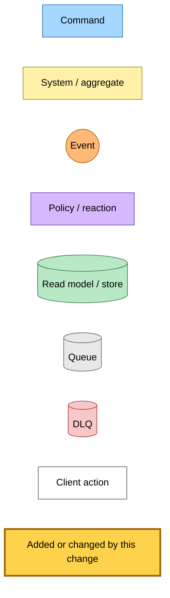

---

## 1. Tier-1 crawl: the shell check and the deferral

Five tier-1 workers crawl a URL directly: the save command, the anonymous save, the recrawl the admin starts, the submit-link worker and the stale-check refresh. Each calls the same crawl-and-finalize function from the save-link bundle. The crawler's own ladder runs first and is unchanged: two browser personas over the primary, HTTP/2 and curl-impersonate transports, with one retry after a 429. A second pass through the residential proxy runs only after a block-class status, a 429, a WAF or Fastly challenge, or a timeout. So a JavaScript shell reaches the new check only after every cheap leg has answered with a 2xx body. That is what keeps the render leg last: the order follows from where the check runs, not from a flag.

The check is a decorator on the wrapper. An archive or wrapper fetch (one with a fetch URL of its own) goes straight to the wrapper. Otherwise the decorator forces `includeEvaluationHtml` so it can count scripts. A fetched result with no final URL is one a site rule produced, and it passes through; a site rule that hands off to a normal fetch carries a final URL and is checked like any direct fetch. A body is a shell only when it is 2xx HTML under 25 words, the extracted article holds no `img`, `video`, `audio` or `iframe`, and the page carries an executable script. The decorator strips the evaluation HTML and status again when the caller did not ask for them, so every other caller sees the result it saw before. A shell becomes an `unsupported` result. The worker writes `comprehensive-fetching` before it emits the event, so the reader's progress bar moves at once. The save-with-capture path does not emit from inside the tier-1 work: it collects the reason from the work result and emits once, carrying the capture candidates.


[BPMN image](diagrams-bpmn/tier-1-shell-check.png) · [Editable BPMN](diagrams-bpmn/tier-1-shell-check.bpmn)

Mermaid source

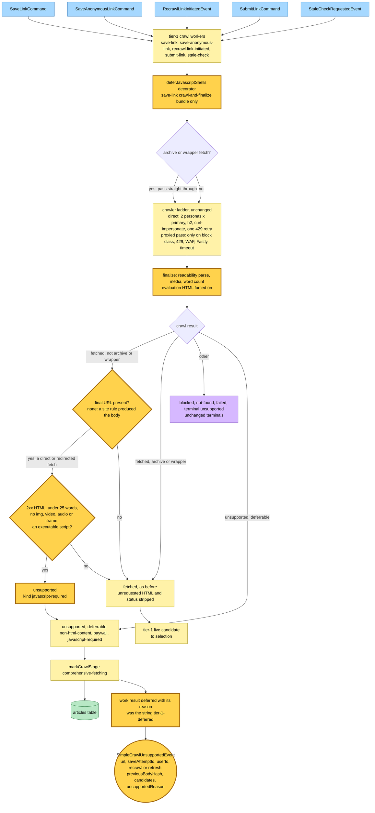

---

## 2. The deferral policy routes on the reason

The policy Lambda is the only subscriber to the deferral event. It forwards the same fields to whichever command the reason names. The routing table is typed against the event's reason enum, so a new deferrable reason that is not routed fails to compile. An absent reason, from an event published before the deploy, still goes to the comprehensive crawl. Nothing is stranded in the deploy window, whatever order the stacks deploy in.


[BPMN image](diagrams-bpmn/deferral-policy.png) · [Editable BPMN](diagrams-bpmn/deferral-policy.bpmn)

Mermaid source

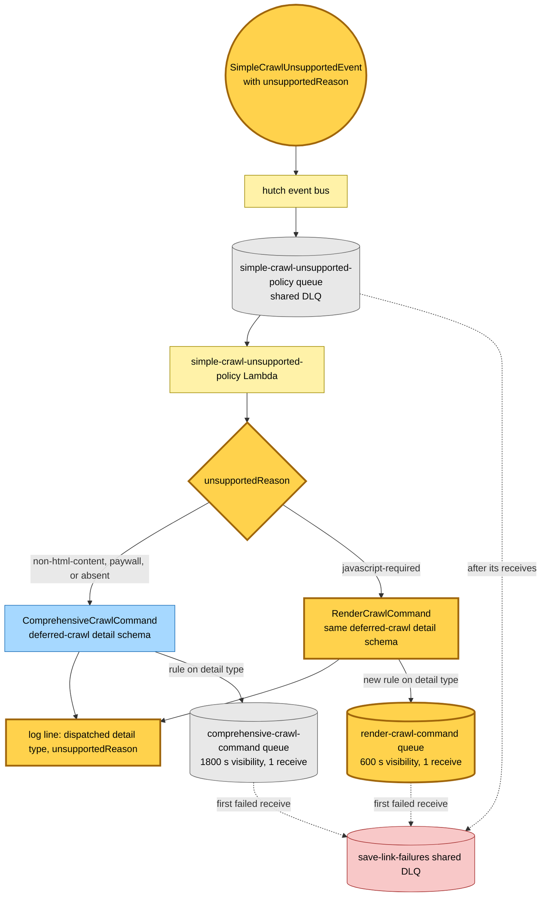

---

## 3. The comprehensive crawl, unchanged in behaviour

The comprehensive Lambda still handles PDFs, non-HTML bodies and paywalls. It now calls the shared deferred-crawl commit module instead of holding that code itself. Its budget keys keep the `paid-crawl` prefix through an explicit scope. Its terminals are unchanged: an unreadable fetched body is marked `parse-error` and then thrown to the DLQ, and a crawl failure throws.


[BPMN image](diagrams-bpmn/comprehensive-crawl.png) · [Editable BPMN](diagrams-bpmn/comprehensive-crawl.bpmn)

Mermaid source

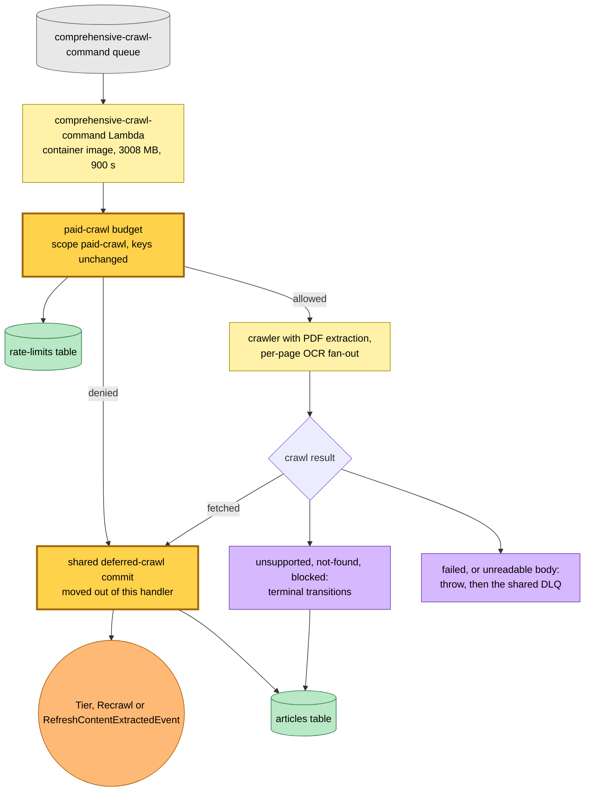

---

## 4. The render crawl: direct leg, then the residential-proxy leg

The render Lambda prepares the article identity and, when the URL has an archive source and no candidates were forwarded, captures the archive copy first, as the comprehensive handler does. It then takes one slot from its own budget window. A denied slot settles the row `blocked/spend-capped`, or, on a refresh, leaves the prior canonical in place and backs off the freshness clock. When the save forwarded capture candidates, they are sent on to selection instead.

**When the Bright Data residential proxy is used.** Every allowed render starts with leg 1: headless Chromium over the Lambda's own egress. Leg 2 runs only when leg 1 does not end `rendered`. Leg 1 ends `blocked` when the main document's status is block-class or 429, or when the response carries the AWS WAF challenge header or the Fastly challenge markers. It ends `failed` when any other status is outside 2xx (the failure keeps that status), when the browser throws, when a deadline passes, or when no main document answered. Leg 2 launches a fresh browser with the proxy as `--proxy-server`, ignores certificate errors because the unlocker terminates TLS, and authenticates with the credentials parsed from the existing crawl egress proxy secret. A leg-1 render that comes back 2xx is never retried through the proxy, even when it holds no article. That case goes to selection and ends `parse-error … after render (direct-egress)`.

Leg 1 gives the navigation 30 s and leg 2 gives it 90 s. A navigation that never goes idle in that time is still serialised from the DOM it has. Each leg launches its own browser, and nothing in it can hold the Lambda open: every DevTools call times out at the navigation timeout plus 10 s, serialising the page is cut off after 10 s as a failed leg, and closing the browser gets 5 s before the process is killed. Dialogs are dismissed. A popup, extra page, service worker or shared worker the page opens is closed, Chromium runs with `--block-new-web-contents`, and the page bypasses service workers. The sparticuz Chromium arguments are passed without `--disable-web-security`, so Chromium's same-origin and local-network protections apply. In both legs a request filter aborts images, media and fonts, any non-http(s) scheme, any literal host the crawler's SSRF guard rejects, and any name that resolves to a blocked address.

Outcomes:

- **Rendered on either leg, over the HTML byte cap.** A rendered DOM larger than the crawler's `MAX_HTML_BYTES` is not committed. With capture candidates they go to selection with `liveAttempt: no-body`; without them the row settles `unsupported content-too-large`, and the log names the leg and the size.
- **Rendered on either leg.** The handler commits the rendered HTML through the shared module as a tier-1 `live` candidate carrying `renderedThrough`, then publishes the content-extracted event. When there are no capture candidates and the HTML finalizes to nothing readable, the handler marks the crawl `parse-error` with detail `no readable article after render (<leg>)`. It does not throw, so the row is not relabelled `exhausted-retries`.
- **Neither leg rendered, with capture candidates.** The candidates go to selection with `liveAttempt: no-body`, so the reader's own capture can still be served.
- **Neither leg rendered, a leg blocked.** `markCrawlBlocked`, with the cause taken from the proxied leg's status, or from the direct leg's status when only that leg was blocked.
- **Both legs failed.** `markCrawlFailed fetch-failed` with the detail `render-failed: direct-egress: …; residential-proxy: …` and the proxied leg's HTTP status, or the direct leg's when the proxied leg had none. The parse-error log carries the same detail.
- **On a refresh.** The row is `ready`, and the blocked, failed and unsupported transitions are no-ops on a ready row, so the served canonical stays. After every outcome that commits no body (blocked, failed, unreadable, too large, capture candidates to selection, budget denied), the handler writes the freshness clock with the previous body hash, the backoff the stale-check worker applies to a failed or blocked refresh, so the next view does not render the page again.


[BPMN image](diagrams-bpmn/render-crawl-worker.png) · [Editable BPMN](diagrams-bpmn/render-crawl-worker.bpmn)

Mermaid source

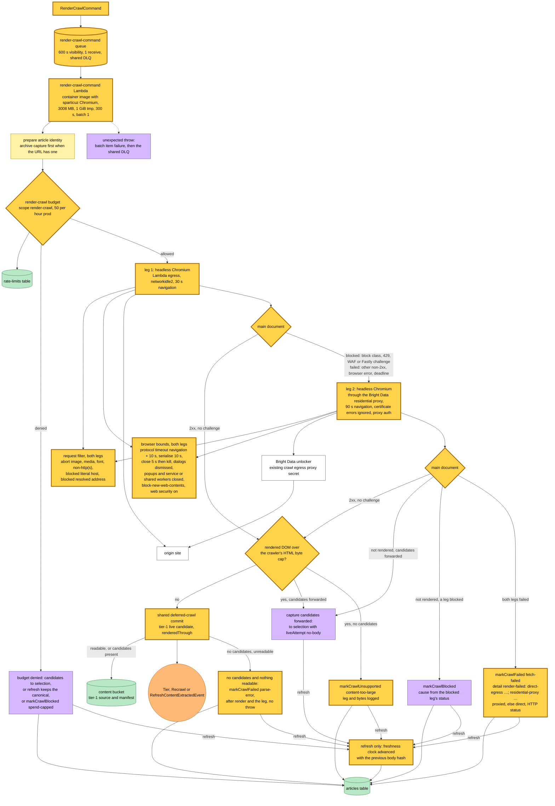

---

## 5. Selection after a render

No selection rule changed. The rendered DOM is a tier-1 `live` candidate, so neither own-capture rule applies to it, and it is judged like any crawl copy. The candidate's metadata schema now declares `renderedThrough`; the schema strips unknown keys, so without the declaration the marker would be lost. When selection finds nothing readable and nothing outranks the live candidate's status, the parse-error detail names the render leg.


[BPMN image](diagrams-bpmn/selection.png) · [Editable BPMN](diagrams-bpmn/selection.bpmn)

Mermaid source

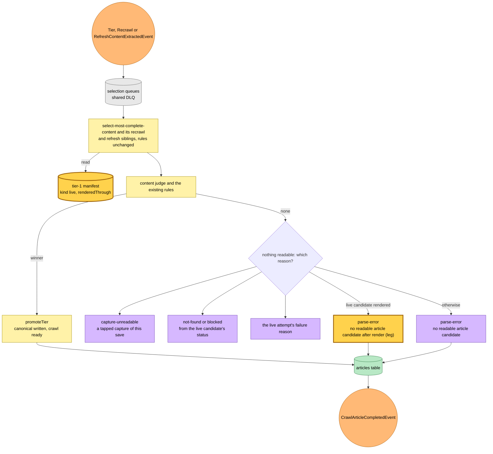

---

## 6. Dead letters

Both deferred-crawl queues allow one receive, because a retry would repeat the expensive work from scratch. A message the render Lambda fails on, for an unexpected throw or a timeout, goes to the shared DLQ. The shared DLQ's router now has a route for the render queue. The render dead-letter handler parses the render command and marks the crawl `exhausted-retries`. The shared DLQ's arrival alarm emails the operator, as it does for every other source queue.


[BPMN image](diagrams-bpmn/dead-letter.png) · [Editable BPMN](diagrams-bpmn/dead-letter.bpmn)

Mermaid source

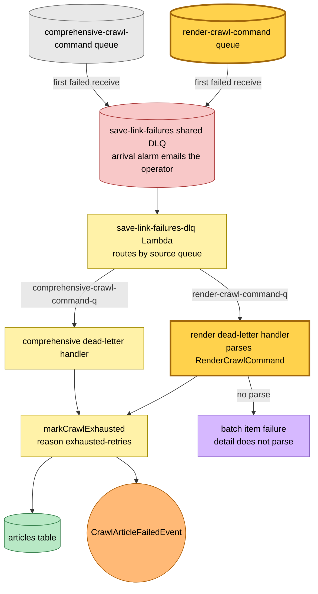

---

## Command → System → Event(s) reference

| Command or input | System and durable result | Emitted events or next actions |
|---|---|---|
| `SaveLinkCommand`, `SaveAnonymousLinkCommand`, `RecrawlLinkInitiatedEvent`, `SubmitLinkCommand` | tier-1 save-link workers crawl directly; **a 2xx HTML body under 25 words with no media and an executable script, not from an archive, a wrapper or a site rule, becomes `unsupported javascript-required`**; a deferrable result writes `comprehensive-fetching` | **`SimpleCrawlUnsupportedEvent` with `unsupportedReason`**; otherwise a tier-1 candidate to selection, or the existing terminals |
| `StaleCheckRequestedEvent` | stale-check worker re-fetches, with the same shell check | **`SimpleCrawlUnsupportedEvent` with `refresh` and `unsupportedReason`** when deferred |
| `SimpleCrawlUnsupportedEvent` | `simple-crawl-unsupported-policy` Lambda **routes on `unsupportedReason`** | **`RenderCrawlCommand` for `javascript-required`**; `ComprehensiveCrawlCommand` for `non-html-content`, `paywall` or an absent reason |
| `ComprehensiveCrawlCommand` | `comprehensive-crawl-command` Lambda, `paid-crawl` budget, PDF and OCR crawl, commit through the **shared deferred-crawl module** | `TierContentExtractedEvent`, `RecrawlContentExtractedEvent` or `RefreshContentExtractedEvent`; terminal transitions; a throw dead-letters |
| **`RenderCrawlCommand`** | **`render-crawl-command` Lambda**: `render-crawl` budget, leg 1 direct render, leg 2 residential-proxy render when leg 1 is blocked or fails, tier-1 `live` candidate with `renderedThrough` in the content bucket | `TierContentExtractedEvent`, `RecrawlContentExtractedEvent` or `RefreshContentExtractedEvent`; `markCrawlBlocked` (spend-capped or edge cause), `markCrawlUnsupported` (`content-too-large`), `markCrawlFailed` (`parse-error` after render, or `fetch-failed` with a detail naming both legs); on a refresh the freshness clock backs off with the previous body hash |
| Content-extracted events | selection Lambdas, unchanged rules; **parse-error detail names the render leg when the live candidate was rendered** | `CrawlArticleCompletedEvent`; `CanonicalContentChangedEvent` and `LinkSavedEvent` when the canonical changes |
| Dead-lettered `RenderCrawlCommand` | `save-link-failures-dlq` router → **render dead-letter handler** → `markCrawlExhausted` | `CrawlArticleFailedEvent` |

---

## Known gaps recorded with the change

- **The shell check reads the HTTP status only when the caller asked for the response body.** Otherwise it treats a `fetched` result as 2xx, on the premise that the crawler hands back a non-2xx body as `fetched` only to a caller that asked to retain it.
- **A leg-1 render that is 2xx but empty is not retried through the proxy.** A bot wall served with 200 and no challenge marker therefore ends `parse-error … after render (direct-egress)`, not `blocked`.
- **The two cohort rows the check cannot catch** (a placeholder feed above the word ceiling, and a privacy notice) are closed by hand as non-articles in a later change, not by this one.
- **The failed-articles report does not read the new detail.** It buckets `fetch-failed` by kind and HTTP status, so a render that failed on both legs is listed beside a crawl fetch failure with the same status. The leg errors are in the stored reason and in the parse-error log.
- **No reserved concurrency and no render-specific alarm.** The budget limits spend, and the shared DLQ alarm already pages.

---

## Source evidence at capture time

| Boundary | Evidence |
|---|---|
| Shell check | [JavaScript shell decorator](../../projects/save-link/src/runtime/domain/save-link/javascript-shell.ts), [crawl-and-finalize bundle](../../projects/save-link/src/runtime/dep-bundles/crawl-and-finalize.ts), [tier-1 work](../../projects/save-link/src/runtime/domain/save-link/save-link-work.ts), [save with candidates](../../projects/save-link/src/runtime/domain/save-link/crawl-save-candidates.ts), [stale check](../../projects/save-link/src/runtime/domain/stale-check/stale-check-handler.ts) |
| Wire format | [Event catalogue](../../src/packages/hutch-infra-components/src/events.ts), [emitter](../../projects/save-link/src/runtime/dep-bundles/events.ts), [Lambda names and log groups](../../src/packages/hutch-infra-components/src/save-link-lambdas.ts), [DLQ sources](../../src/packages/hutch-infra-components/src/dlq-source-queues.ts) |
| Policy | [Deferral policy](../../projects/save-link/src/runtime/domain/simple-crawl-unsupported-policy/simple-crawl-unsupported-policy-handler.ts) |
| Shared commit | [Deferred-crawl commit](../../projects/save-link/src/runtime/domain/crawl-article-state/commit-deferred-crawl.ts), [comprehensive handler](../../projects/save-link/src/runtime/domain/comprehensive-crawl/comprehensive-crawl-handler.ts) |
| Render crawl | [Render handler](../../projects/save-link/src/runtime/domain/render-crawl/render-crawl-handler.ts), [render ladder](../../projects/save-link/src/runtime/domain/render-crawl/render-ladder.ts), [browser wrapper](../../projects/save-link/src/runtime/providers/render-page/puppeteer-render-page.ts), [document classifier](../../projects/save-link/src/runtime/providers/render-page/classify-rendered-document.ts), [request filter](../../projects/save-link/src/runtime/providers/render-page/render-request-filter.ts), [composition root](../../projects/save-link/src/runtime/render-crawl-command.main.ts), [failure reason schema](../../src/packages/article-state-types/src/crawl-failure-reason.ts), [crawl terminal transitions](../../src/packages/domain/src/article-aggregate/transitions/), [budget](../../projects/save-link/src/runtime/providers/paid-crawl-budget/dynamodb-paid-crawl-budget.ts) |
| Selection | [Manifest schema](../../projects/save-link/src/runtime/domain/select-content/tier-source.types.ts), [candidate provenance](../../projects/save-link/src/runtime/domain/select-content/candidate-provenance.ts), [selection outcomes](../../projects/save-link/src/runtime/domain/select-content/select-content-work.ts) |
| Dead letters | [Render dead-letter handler](../../projects/save-link/src/runtime/domain/render-crawl/render-crawl-dlq-handler.ts), [shared DLQ router composition root](../../projects/save-link/src/runtime/save-link-failures-dlq.main.ts) |
| Infrastructure and build | [save-link infrastructure](../../projects/save-link/src/infra/index.ts), [image build](../../projects/save-link/tools/build-image.mjs), [pipeline health sources](../../src/packages/crawl-article/scripts/health-sources.ts) |
