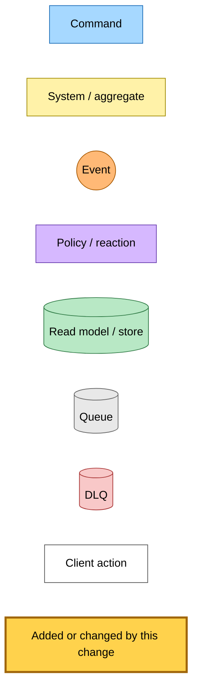
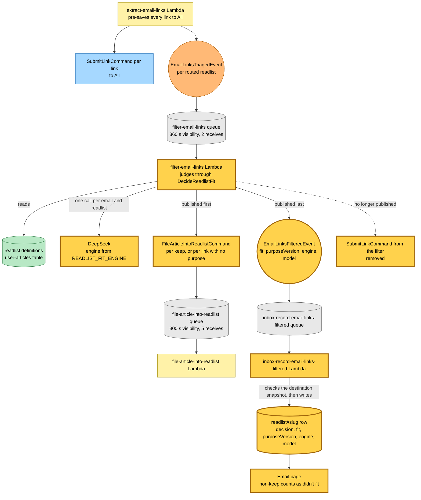
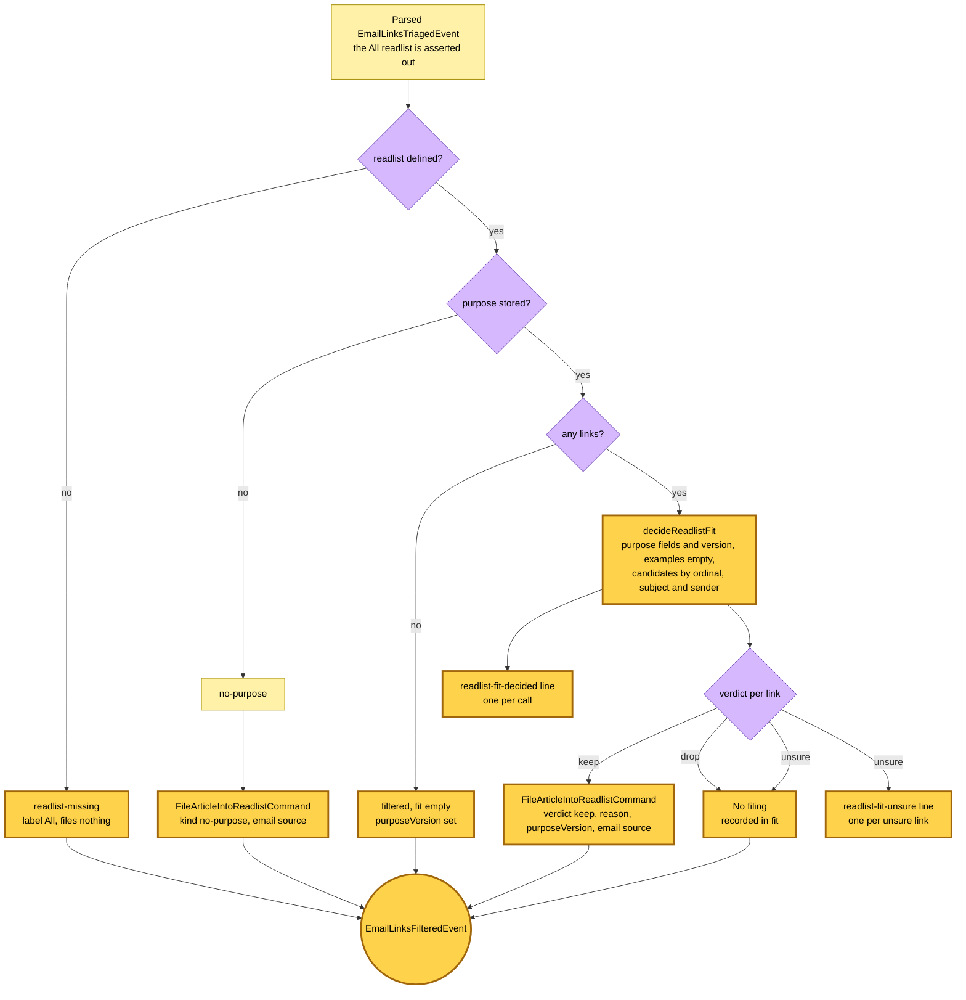
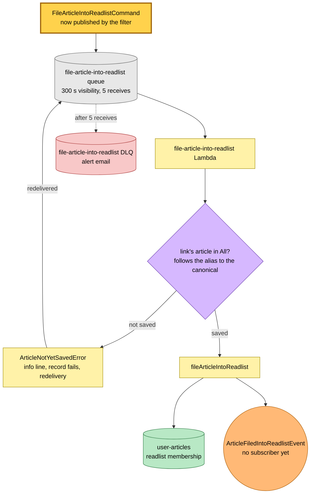
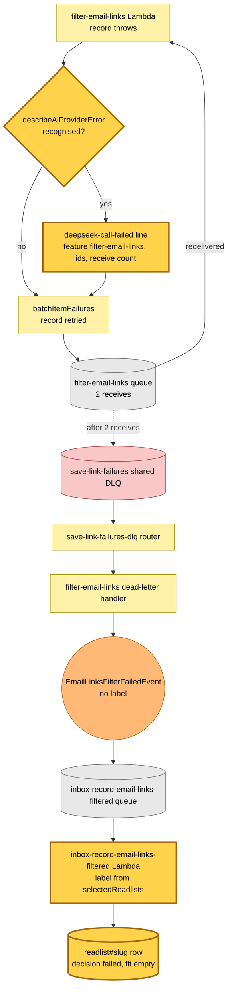

# Readlist fit: judge routed links on flash and file the fits

Snapshot of the uncommitted working tree over `10e7766c7` (`main`), whose 2026-11-02 subject is **fix(@packages/crawl-article): escalate an HTTP 400 to the next transport**. Generated 2026-11-02. Nothing here is committed yet: the drawing is of the working tree holding the edits of the commit `feat: judge routed links on flash and file the fits`, and it follows on from the render-crawl snapshot of 2026-10-28.

A Gmail or forwarded email's links are pre-saved to All by the extract step. For each other readlist the email is routed to, the filter Lambda decides which of those links belong there. Before this change it called its own decider and published a full `SubmitLinkCommand` per kept link, which ran the whole save a second time for a link already in All. After it:

- **The judge is `@packages/readlist-fit`.** `filter-email-links` calls the `DecideReadlistFit` port, on the engine `READLIST_FIT_ENGINE` names. Both stacks set `deepseek-flash`; `deepseek-v4-pro-thinking` is the rollback value. An unknown value fails Lambda init. The old decider, its prompt and its limits module are deleted.
- **The filter files; it no longer submits.** Each kept link, and every link of a readlist with no purpose, publishes `FileArticleIntoReadlistCommand` to the existing filing Lambda. Drop and unsure publish nothing. The filter never publishes `SubmitLinkCommand`.
- **A missing readlist files nothing.** The old branch submitted every link to All; the extract step has already put them there.
- **`EmailLinksFilteredEvent` is reshaped.** `savedTo` and `dropped` go. `fit` carries every verdict with its reason, alongside optional `purposeVersion`, `engine` and `model`.
- **`InboxReadlistOutcomeSchema` is reshaped to match.** `decision` is a flat enum with `failed`; `decision.state` and `dropped` go. The store writes the three optional fields only when defined.
- **The recorder's failed row takes its label from the snapshot.** `EmailLinksFilterFailedEvent` carries no label, so the row reads it from the email's `selectedReadlists`.
- **The email page's copy does not change.** Every `fit` entry whose verdict is not `keep` counts as "didn't fit", so unsure reads exactly like a drop.
- **Three operator log lines.** `readlist-fit-decided` once per call, `readlist-fit-unsure` once per unsure link, and `deepseek-call-failed` with `feature: "filter-email-links"` for a recognised provider failure. None carries a URL or anchor text.

No Pulumi resource changes: the filter Lambda already has `grantPublish`, and `READLIST_FIT_ENGINE` was already provisioned.

---

## Legend

Amber marks what this change adds or changes. Everything else is existing infrastructure shown for context.

[BPMN image](diagrams-bpmn/legend.png) · [Editable BPMN](diagrams-bpmn/legend.bpmn)

Mermaid source

---

## 1. From triage to the readlist row

The re-wired publish is the middle of this drawing: filings go out first, then one `EmailLinksFilteredEvent`, last, so a throw mid-filing retries the whole record before the outcome is recorded.

[BPMN image](diagrams-bpmn/end-to-end-flow.png) · [Editable BPMN](diagrams-bpmn/end-to-end-flow.bpmn)

Mermaid source

---

## 2. The filter's branches

Only the last branch calls the model. The no-call branches send token counts of 0, no engine and no model, and write only the existing `[filter-email-links] filtered` INFO line.

| Branch | Label | `fit` | Model call | Publishes before the event |
|---|---|---|---|---|
| `readlist-missing` | "All" | `[]` | no | nothing |
| `no-purpose` | readlist label | `[]` | no | one filing per link, `fit.kind: "no-purpose"` |
| empty links | readlist label | `[]` | no | nothing; `decision: "filtered"`, `purposeVersion` set |
| otherwise | readlist label | every verdict | yes | one filing per keep, with reason, `purposeVersion` and the email source |

[BPMN image](diagrams-bpmn/filter-branches.png) · [Editable BPMN](diagrams-bpmn/filter-branches.bpmn)

Mermaid source

---

## 3. Filing a fit

This Lambda already existed with no publisher; the filter is its first. It holds no change of its own. A filing can overtake the pre-save in All, so "not saved yet" fails the record on purpose and SQS redelivers it. The source on the command identifies the email and ordinal in that wait's log line.

[BPMN image](diagrams-bpmn/filing.png) · [Editable BPMN](diagrams-bpmn/filing.bpmn)

Mermaid source

---

## 4. Failure

The record fails either way. The new part is the structured line in the catch: `describeAiProviderError` recognises a provider failure, and a recognised one writes `deepseek-call-failed`. An error the describer cannot name writes only the existing `[filter-email-links] record failed` line. A failed row has `decision: "failed"` and an empty `fit`.

The per-call `AbortSignal` and a final-receive publish of `EmailLinksFilterFailedEvent` from the filter itself are out of this change. The dead-letter path below is what publishes that event today.

[BPMN image](diagrams-bpmn/failure.png) · [Editable BPMN](diagrams-bpmn/failure.bpmn)

Mermaid source

---

## Command → System → Event(s) reference

| Command or input | System and durable result | Emitted events or next actions |
|---|---|---|
| Email ready to extract | `extract-email-links` Lambda saves every link to All and records the frozen destination snapshot | `SubmitLinkCommand` per link; `EmailLinksTriagedEvent` per routed readlist |
| `EmailLinksTriagedEvent` | **`filter-email-links` Lambda** reads the readlist definition and, when it has a purpose and links, **judges through `DecideReadlistFit`** | **`FileArticleIntoReadlistCommand` per keep or per no-purpose link**, then **`EmailLinksFilteredEvent` with `fit`**; **no `SubmitLinkCommand`** |
| **`FileArticleIntoReadlistCommand`** | `file-article-into-readlist` Lambda files the reader's saved article; redelivers while it is not in All | `ArticleFiledIntoReadlistEvent` (no subscriber) |
| **`EmailLinksFilteredEvent`** | `inbox-record-email-links-filtered` Lambda writes the **reshaped** `readlist#<slug>` row | Email page reads the row |
| Dead-lettered `EmailLinksTriagedEvent` | `save-link-failures-dlq` router → filter dead-letter handler | `EmailLinksFilterFailedEvent` |
| `EmailLinksFilterFailedEvent` | `inbox-record-email-links-filtered` Lambda writes a `failed` row, **label from the destination snapshot** | Email page shows the failed line |

---

## Known gaps recorded with the change

- A revert works only while no new-shape `readlist#` row exists: the old schema rejects such a row on read.
- A new-shape filtered fact reaching the old recorder during the deploy fails its parse and dead-letters into the recorder's own queue, because save-link, inbox and hutch deploy in parallel.
- `callTimeoutMs` stays `null` on the filter's client and the outcome write's `attribute_not_exists(ordinal)` condition stays as it is; a later change handles both.
- Reasons and markers on the email page, overrides and examples come later: `examples` is always empty here and the page shows no reason.
- The `?feature=pref` toggle is untouched, so production sees this path only through a reader who routes an address and describes a readlist behind it.

---

## Source evidence at capture time

Paths are as they stood in the working tree over `10e7766c7`.

- `projects/save-link/src/runtime/domain/filter-email-links/filter-email-links-handler.ts` and `readlist-fit-log-lines.ts`
- `projects/save-link/src/runtime/filter-email-links.main.ts`
- `projects/save-link/src/runtime/domain/filter-email-links/filter-email-links-dlq-handler.ts`
- `projects/save-link/src/runtime/domain/file-article-into-readlist/file-article-into-readlist-command-handler.ts`
- `projects/save-link/src/infra/index.ts`, the filter and filing resources
- `projects/inbox/src/runtime/domain/inbox/record-email-links-filtered-handler.ts`
- `projects/inbox/src/runtime/web/pages/inbox/inbox-email-detail.viewmodel.ts`
- `src/packages/hutch-infra-components/src/events.ts`
- `src/packages/domain/src/inbox/inbox-email-link.schema.ts`
- `src/packages/inbox-store/src/dynamodb-inbox-email-link.ts`
- `src/packages/readlist-fit/src/readlist-fit-engine.ts`
