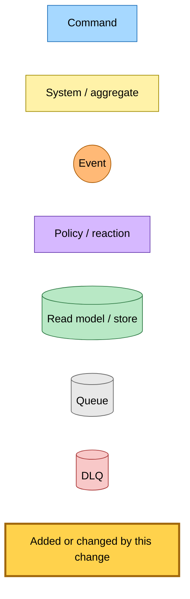
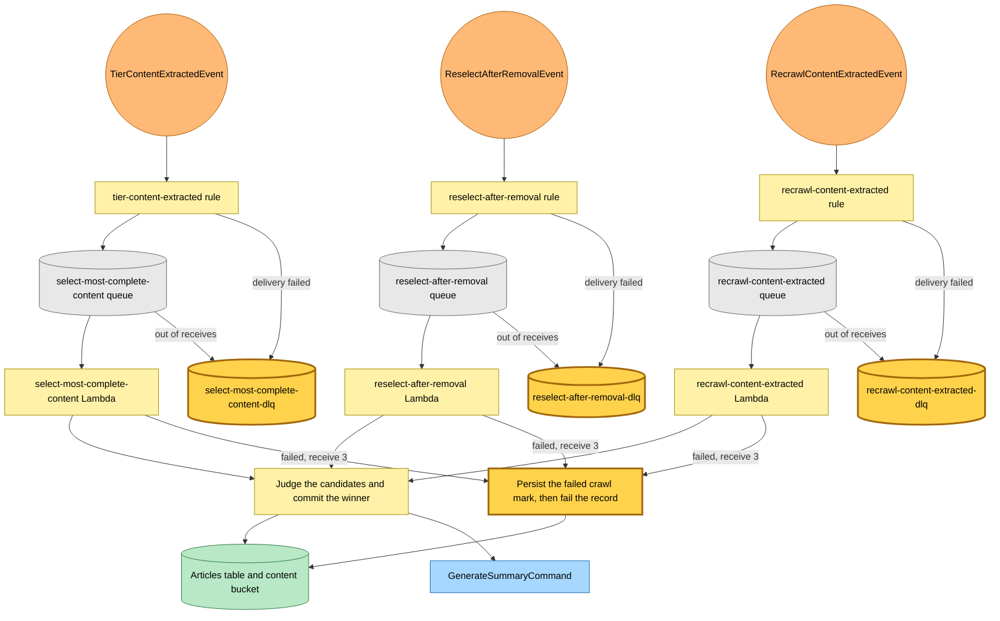
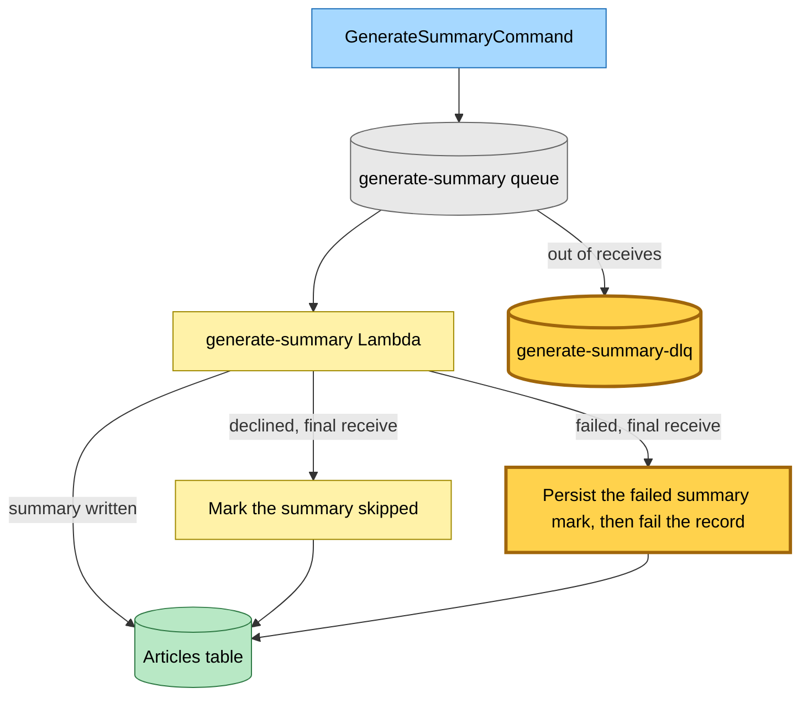
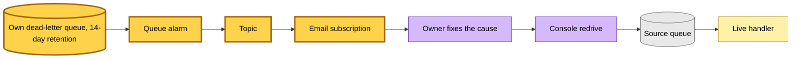
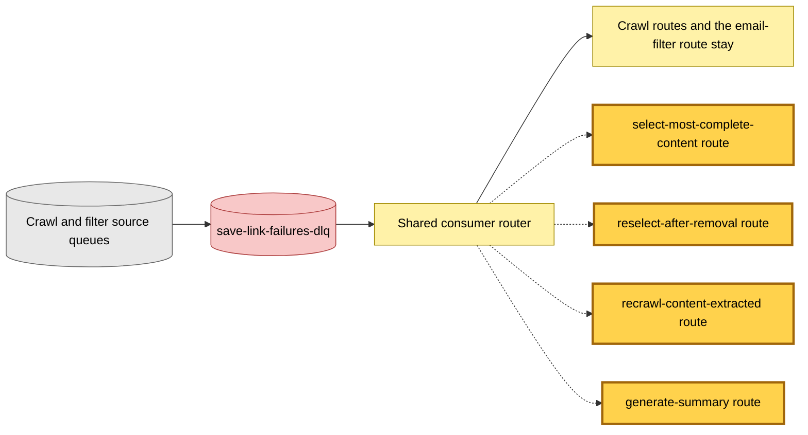

# Own dead-letter queues for the judge and summary queues

Snapshot of the uncommitted working tree over `27cbb47b6` (`main`), whose 2026-11-02 subject is **docs: link the rescan that replaced the canary tracking snapshot**. Generated 2026-11-02.

A dead letter on the three judge queues or the summary queue used to land in the shared failures queue, whose consumer marked the article failed and deleted the message, so nothing was left to redrive. The failed mark now happens in the live handler on the final receive, and each of the four queues keeps its dead letters in a queue of its own.

- **Four own dead-letter queues.** `select-most-complete-content`, `reselect-after-removal`, `recrawl-content-extracted` and `generate-summary` each gain a dead-letter queue with 14-day retention, a topic, an email subscription and an alarm. Nothing consumes these queues: a message waits there until an operator redrives it.
- **The rule's own failed delivery goes the same way.** The three event rules that feed the judge queues point their dead-letter target at the new queue, with a queue policy that lets the rule send to it. `GenerateSummaryCommand` is sent directly by its producers, so it has no rule and no policy.
- **The final receive marks the row.** On the third receive the handler persists the failed mark and still fails the record, so the reader sees the failed state at once and the message moves to the dead-letter queue.
- **The refresh queue is not one of the four.** It already has its own dead-letter queue, and its handler keeps the row on the final receive.
- **Four routes leave the shared consumer.** The routes and their handlers go in a later commit, once these queues have stopped feeding the shared queue and it has drained. Until then the routes stay and receive nothing new.

Queue names and receive counts do not change. No Lambda code or environment changes with the queues.

---

## Legend

Amber marks what this change adds or changes. Everything else is existing infrastructure shown for context.

[BPMN image](diagrams-bpmn/legend.png) · [Editable BPMN](diagrams-bpmn/legend.bpmn)

Mermaid source

---

## 1. The judge queues

A crawl, save or removal publishes an event; a rule routes it to the queue, and the shared selection handler runs the judge. A failed delivery from the rule and a message out of receives both reach the same own dead-letter queue.

[BPMN image](diagrams-bpmn/judge-queues.png) · [Editable BPMN](diagrams-bpmn/judge-queues.bpmn)

Mermaid source

---

## 2. The summary queue

Producers send `GenerateSummaryCommand` straight to the queue, so no rule or queue policy is involved.

[BPMN image](diagrams-bpmn/summary-queue.png) · [Editable BPMN](diagrams-bpmn/summary-queue.bpmn)

Mermaid source

---

## 3. The alert and the redrive

The first message into an own dead-letter queue raises its alarm and emails the owner. Nothing reads the queue until the cause is fixed and the owner starts a redrive, which sends the message back to its source queue.

[BPMN image](diagrams-bpmn/alert-and-redrive.png) · [Editable BPMN](diagrams-bpmn/alert-and-redrive.bpmn)

Mermaid source

---

## 4. What leaves the shared consumer

The four routes are shown amber because the next commit removes them. The router fails any record whose source has no route, so they stay until the shared queue reads empty in both accounts. The crawl routes and the email-filter route stay.

[BPMN image](diagrams-bpmn/shared-consumer.png) · [Editable BPMN](diagrams-bpmn/shared-consumer.bpmn)

Mermaid source

---

## Command → System → Event(s) reference

| Trigger | System | Emits or writes | On failure |
|---|---|---|---|
| `TierContentExtractedEvent` | `select-most-complete-content` Lambda | Canonical content, article row, `GenerateSummaryCommand` | Failed crawl mark on receive 3, then `select-most-complete-content-dlq` |
| `ReselectAfterRemovalEvent` | `reselect-after-removal` Lambda | Canonical content, article row, `GenerateSummaryCommand` | Failed crawl mark on receive 3, then `reselect-after-removal-dlq` |
| `RecrawlContentExtractedEvent` | `recrawl-content-extracted` Lambda | Canonical content, article row, `GenerateSummaryCommand` | Failed crawl mark on receive 3, then `recrawl-content-extracted-dlq` |
| `GenerateSummaryCommand` | `generate-summary` Lambda | Summary on the article row | Failed summary mark on the final receive, then `generate-summary-dlq` |
| Message in an own dead-letter queue | Queue alarm, topic, email subscription | Email to the owner | The message waits up to 14 days for a redrive |
