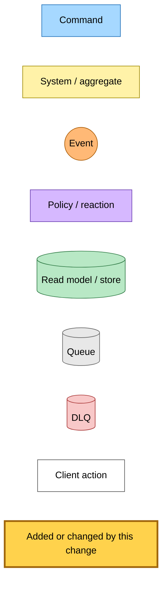
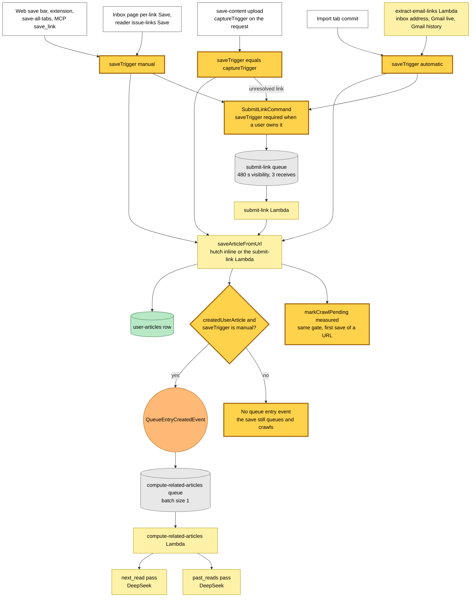
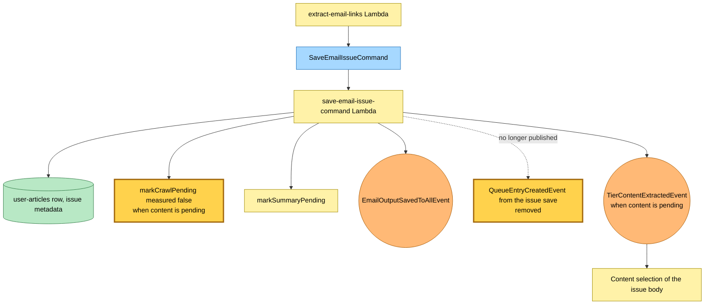
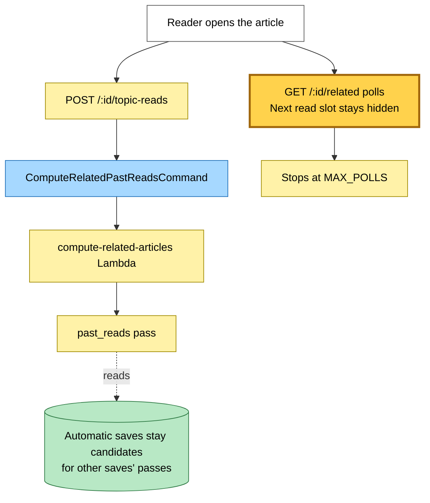
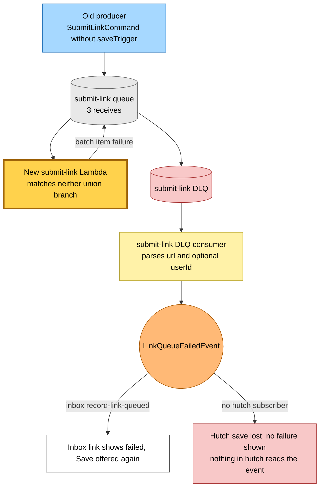

# Save trigger: related passes only run for a link a person picked

Snapshot of the uncommitted working tree over `2aad162c1` (`main`), whose 2026-11-02 subject is **revert: retry a blocked wrapper hop through curl-impersonate**. Generated 2026-11-02. Nothing here is deployed yet.

`QueueEntryCreatedEvent` starts both related passes, `next_read` and `past_reads`, at two DeepSeek calls per new save. Before this change the gate read the provenance kind, so every email link paid for both. Provenance cannot express the rule, because the inbox page and the reader's issue links let a person tap Save on a link that also carries `email` provenance.

- **A save states who picked the link.** `saveTrigger` is required on the user branch of `SubmitLinkCommand` and on the save parameters. `manual` publishes the event, `automatic` never does. The provenance table is gone.
- **Email links are automatic.** Inbox-address, Gmail live and Gmail history links are `automatic`, as is the import tab, which already skipped the passes.
- **A tap on a newsletter link is manual.** The inbox page per-link Save and the reader's issue-links Save keep both passes.
- **save-content takes the capture's trigger.** A tapped upload publishes, and an automatic heal or rescue does not, on both the resolved inline branch and the unresolved branch that queues a `SubmitLinkCommand`.
- **The issue save publishes nothing.** Its publish, dependency and wiring are removed.
- **The crawl-latency flag rides the same gate.** A save that publishes no event has no worker waiting on its crawl, so `measured` is false.
- **A tap on a row an automatic save created publishes nothing.** The gate needs a created row, so that row stays `pending`, as import rows have since `e5b700358`. Past reads still fill on open.
- **An automatic save's reader is not browser-cached.** Its related status stays `pending`, so the reader is served `private, no-cache` rather than `private, max-age=1800`, and every reopen revalidates and is answered 304 after a full render, as import rows and every `?v`-less open already are.
- **The filter is not on this path.** It files with `FileArticleIntoReadlistCommand` since `6dca0016a`, which never publishes the event.

No Pulumi resource changes: the event, its subscription and the bus grants all stay.

---

## Legend

Amber marks what this change adds or changes. Everything else is existing infrastructure shown for context.

[BPMN image](diagrams-bpmn/legend.png) · [Editable BPMN](diagrams-bpmn/legend.bpmn)

Mermaid source

---

## 1. From every save surface to the related passes

Each surface now states who picked the link. The gate reads that one fact, plus whether the save created the reader's row.

[BPMN image](diagrams-bpmn/end-to-end-flow.png) · [Editable BPMN](diagrams-bpmn/end-to-end-flow.bpmn)

Mermaid source

---

## 2. The newsletter issue save

The issue save never reads a trigger, because only the extract step publishes it. Its publish is removed, and its crawl goes unmeasured on every save.

[BPMN image](diagrams-bpmn/email-issue.png) · [Editable BPMN](diagrams-bpmn/email-issue.bpmn)

Mermaid source

---

## 3. What still computes after an automatic save

Past reads still fill on first open. Next read has no on-open path, so an automatic save never gets one.

[BPMN image](diagrams-bpmn/past-reads-on-open.png) · [Editable BPMN](diagrams-bpmn/past-reads-on-open.bpmn)

Mermaid source

---

## 4. A record in flight at deploy

hutch, inbox and save-link deploy in parallel with no ordering. A user-owned command from an old producer has no `saveTrigger`, so the new consumer refuses it after three receives at 480 s visibility, about 24 minutes. An inbox link then shows failed with Save offered again, because inbox subscribes to `LinkQueueFailedEvent`. Nothing in hutch reads that event, so an unresolved save from hutch's old bundle (web, extension, MCP, import) is lost with no failure shown. A dead-lettered record with `emailOutput` also never publishes `EmailOutputSavedToAllEvent`, so a Gmail import's completion can stay `not-saved`. The reverse order is harmless, because the old consumer strips the unknown key.

[BPMN image](diagrams-bpmn/deploy-drain.png) · [Editable BPMN](diagrams-bpmn/deploy-drain.bpmn)

Mermaid source

---

## Command → System → Event(s) reference

| Command or event | System | Emits | Next |
|---|---|---|---|
| `SubmitLinkCommand` with `saveTrigger` | submit-link Lambda | `LinkQueued`, `QueueEntryCreatedEvent` when manual and new, `LinkSaved` on the new branch | Crawl and summary, compute-related-articles when the event fires |
| `SubmitLinkCommand` without `saveTrigger`, user-owned | submit-link Lambda refuses it | Dead letter, then `LinkQueueFailedEvent` | Inbox link shows failed; a hutch save is lost silently |
| Inline save from a hutch route | hutch | `LinkQueued`, `QueueEntryCreatedEvent` when manual and new | compute-related-articles when the event fires |
| `SaveEmailIssueCommand` | save-email-issue-command Lambda | `EmailOutputSavedToAllEvent`, `TierContentExtractedEvent` when content is pending | Content selection of the issue body |
| `QueueEntryCreatedEvent` | compute-related-articles Lambda | Related rows | `next_read` and `past_reads` passes |
| `ComputeRelatedPastReadsCommand`, on first open | compute-related-articles Lambda | Related rows | `past_reads` pass only |
