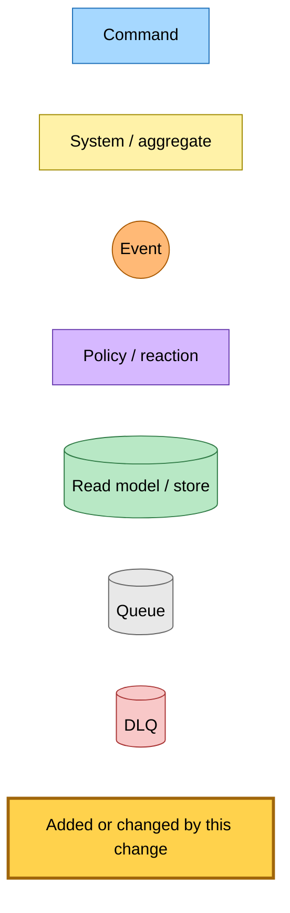
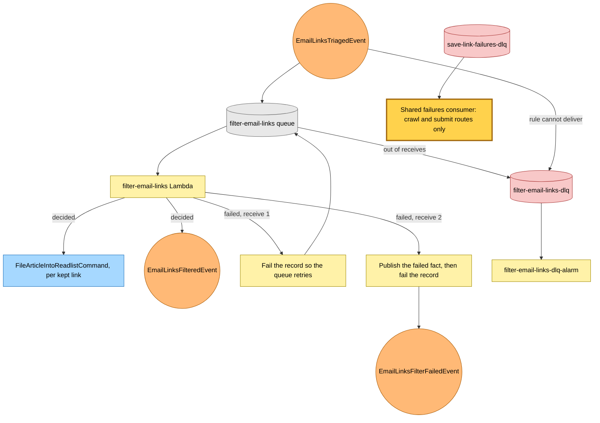

# The shared failures consumer drops the email filter route

Snapshot of the uncommitted working tree over `c5f048768` (`main`), whose 2026-11-02 subject is **feat(save-link): give the email filter queue its own dead-letter queue**. Generated 2026-11-02.

Since the previous commit, the email filter queue and the triaged rule's target dead-letter into `filter-email-links-dlq`, so no new filter message reaches the shared failures queue. The shared queue read empty in both accounts. The shared consumer's filter route and its handler are deleted now, and the filter handler is the only publisher of the failed fact.

- **One publisher.** The filter handler publishes `EmailLinksFilterFailedEvent` on its final receive. Nothing else publishes it.
- **The other routes stay.** The shared consumer still routes every crawl and submit queue that dead-letters into it.
- **The queue name stays.** The source-queue table still names the filter queue, because every key in it is required.

Only the consumer Lambda's code changes.

---

## Legend

Amber marks what this change adds or changes. Everything else is existing infrastructure shown for context.

[BPMN image](diagrams-bpmn/legend.png) · [Editable BPMN](diagrams-bpmn/legend.bpmn)

Mermaid source

---

## 1. Where a filter failure goes

The first failure retries. The second publishes the failed fact and fails the record, and the message moves to its own dead-letter queue, where it waits to be redriven. The shared failures consumer no longer has a filter route.

[BPMN image](diagrams-bpmn/filter-failure-route.png) · [Editable BPMN](diagrams-bpmn/filter-failure-route.bpmn)

Mermaid source

---

## Command → System → Event(s) reference

| Command or event | System | Emits | Triggers next |
|---|---|---|---|
| `EmailLinksTriagedEvent` | filter-email-links Lambda | `EmailLinksFilteredEvent`, or `EmailLinksFilterFailedEvent` on the final receive | `FileArticleIntoReadlistCommand` per kept link |
| Message out of receives | `filter-email-links-dlq` | none | `filter-email-links-dlq-alarm` |
| Message from a crawl or submit queue | Shared failures consumer | That queue's failure handling | Unchanged |
