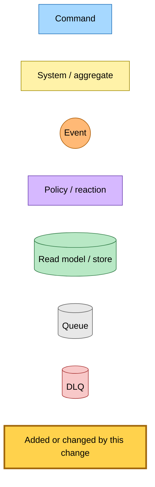
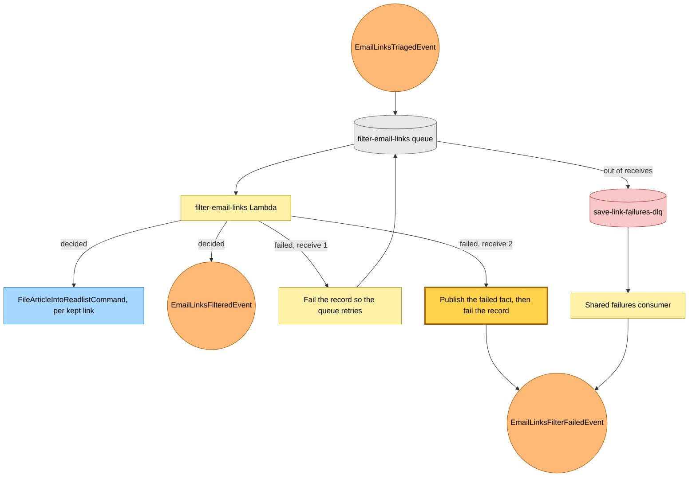
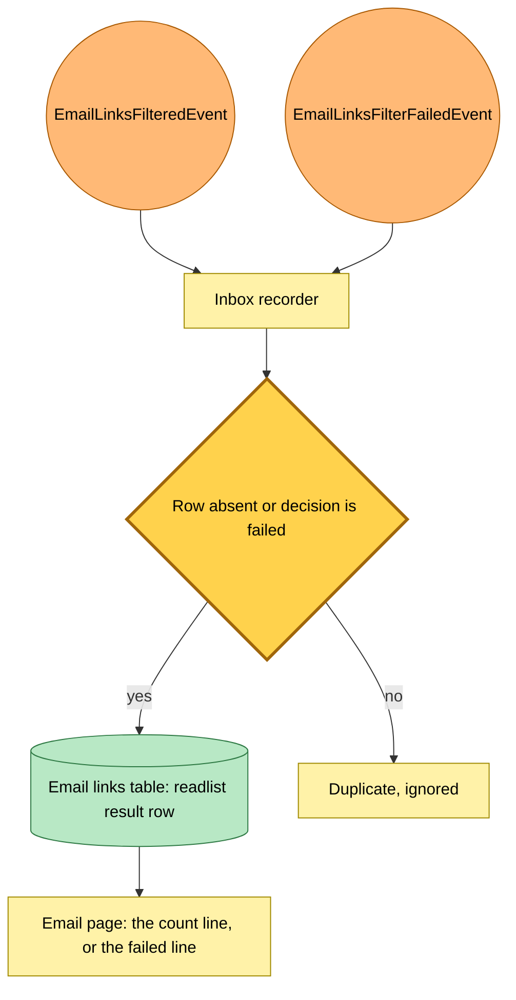

# The email filter marks a failed decision on its last receive

Snapshot of the uncommitted working tree over `c8d116bc3` (`main`), whose 2026-11-02 subject is **docs: say why a DeepSeek dead letter is kept and how to redrive it**. Generated 2026-11-02.

When the filter ran out of receives, the only thing that told the reader the decision had failed was the shared failures queue's consumer, which published the failure and deleted the message. The live handler now publishes the failure on its final receive, and a later decision can replace a failed result.

- **The final receive publishes the failure.** On the second receive the filter handler publishes `EmailLinksFilterFailedEvent` and still fails the record. It reads the ids from the record body loosely, so a record with a malformed ordinal still marks the decision failed.
- **Decided replaces failed.** The result row used to be write-once. A decided write may now replace a failed row, and any write over a decided row stays a duplicate that the recorder ignores.
- **The shared consumer is still a second publisher.** The filter queue still dead-letters into the shared failures queue until a later commit, so the same failure is published a second time. Writing failed over failed is harmless.

No queue, rule or Lambda configuration changes.

---

## Legend

Amber marks what this change adds or changes. Everything else is existing infrastructure shown for context.

[BPMN image](diagrams-bpmn/legend.png) · [Editable BPMN](diagrams-bpmn/legend.bpmn)

Mermaid source

---

## 1. The filter's receives

The triage rule delivers each routed email to the filter queue. A decision files the kept links and announces the result. A failure on the first receive only retries. A failure on the second also publishes the failed fact, and the message then moves to the shared failures queue, whose consumer publishes the same fact again.

[BPMN image](diagrams-bpmn/filter-receives.png) · [Editable BPMN](diagrams-bpmn/filter-receives.bpmn)

Mermaid source

---

## 2. The result row

The inbox recorder writes each fact to the email's result row for that readlist. A decided fact replaces a failed row, and a fact arriving after a decided one changes nothing.

[BPMN image](diagrams-bpmn/result-row.png) · [Editable BPMN](diagrams-bpmn/result-row.bpmn)

Mermaid source

---

## Command → System → Event(s) reference

| Command or event | System | Emits | Triggers next |
|---|---|---|---|
| `EmailLinksTriagedEvent` | filter-email-links Lambda | `EmailLinksFilteredEvent`, or `EmailLinksFilterFailedEvent` on the final receive | `FileArticleIntoReadlistCommand` per kept link |
| `EmailLinksFilterFailedEvent` | Inbox recorder | none | A failed row, unless a decided one exists |
| `EmailLinksFilteredEvent` | Inbox recorder | none | A decided row, replacing a failed one |
| Message out of receives | Shared failures consumer | `EmailLinksFilterFailedEvent` | The same failed write, harmless |
