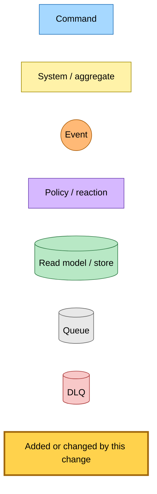
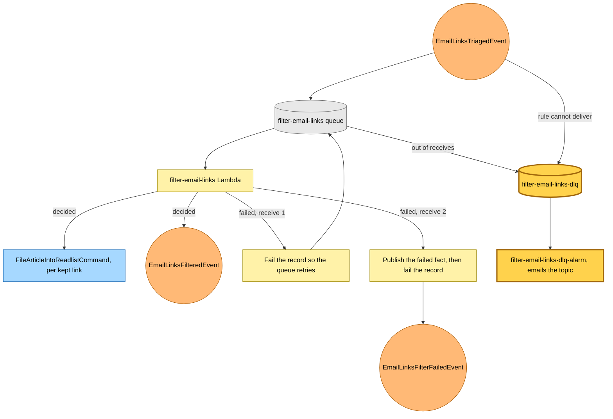
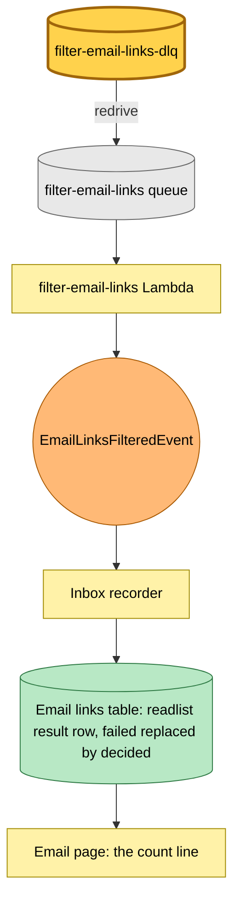

# The email filter gets its own dead-letter queue

Snapshot of the uncommitted working tree over `c8e198a68` (`main`), whose 2026-11-02 subject is **PLAN-3: readlist actions and the unlisted /developers page (#1250)**. Generated 2026-11-02.

A filter message that ran out of receives moved to the shared failures queue, and its consumer published the failure and deleted the message. There was nothing left to redrive once the cause was fixed. The queue and the triaged rule's target now dead-letter into `filter-email-links-dlq`, which nothing consumes, so a redrive can replace the failed decision.

- **Failed messages stay.** The handler already publishes the failed fact on the final receive, so nothing needs to consume the new queue. The message waits there to be redriven.
- **The rule's own failures move too.** The triaged rule's target pointed its dead-letter config at the same shared queue. It now points at the new one, which needs a queue policy that lets EventBridge send to it.
- **The shared consumer gets no new messages.** Its filter route stays until messages already in the shared queue drain. A later commit removes the route.
- **An alarm emails on the first dead letter.** The new queue has its own topic, email subscription and alarm.

Created in each account: the queue, topic, subscription, alarm and queue policy. Updated in place: the filter queue's redrive policy and the rule target's dead-letter config. No Lambda code changes.

---

## Legend

Amber marks what this change adds or changes. Everything else is existing infrastructure shown for context.

[BPMN image](diagrams-bpmn/legend.png) · [Editable BPMN](diagrams-bpmn/legend.bpmn)

Mermaid source

---

## 1. Where a filter failure goes

The first failure retries. The second publishes the failed fact and fails the record, and the message moves to its own dead-letter queue. A delivery failure at the rule goes to the same queue, and the alarm emails on the first message.

[BPMN image](diagrams-bpmn/filter-failure-route.png) · [Editable BPMN](diagrams-bpmn/filter-failure-route.bpmn)

Mermaid source

---

## 2. Healing after the fix

Once the cause is fixed, someone reads the readlist's purpose and the account's write access, then redrives the message to the source queue. The handler decides again under today's purpose, and a decided result replaces the failed row.

[BPMN image](diagrams-bpmn/filter-redrive.png) · [Editable BPMN](diagrams-bpmn/filter-redrive.bpmn)

Mermaid source

---

## Command → System → Event(s) reference

| Command or event | System | Emits | Triggers next |
|---|---|---|---|
| `EmailLinksTriagedEvent` | filter-email-links Lambda | `EmailLinksFilteredEvent`, or `EmailLinksFilterFailedEvent` on the final receive | `FileArticleIntoReadlistCommand` per kept link |
| Message out of receives | `filter-email-links-dlq` | none | `filter-email-links-dlq-alarm` |
| Delivery failure at the triaged rule | `filter-email-links-dlq` | none | `filter-email-links-dlq-alarm` |
| Redrive of a kept message | filter-email-links Lambda | `EmailLinksFilteredEvent` | A decided row, replacing the failed one |
