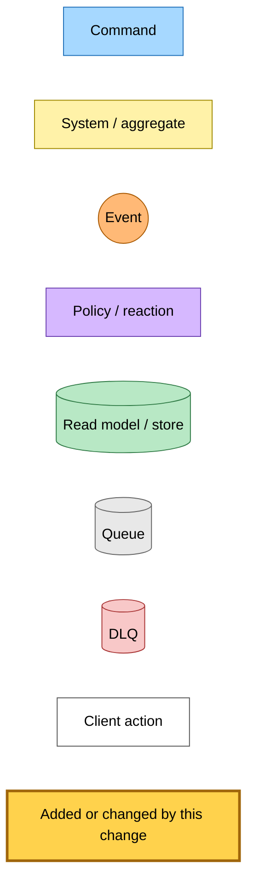
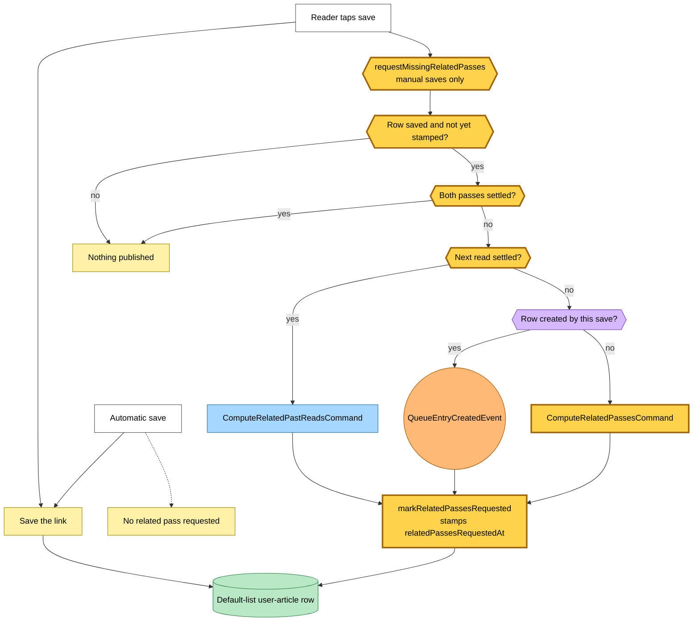
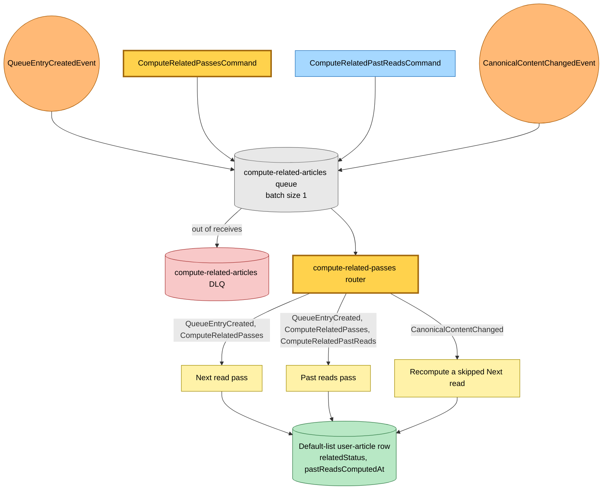

# Related passes on tap: a save of an automatically queued link now runs them

Snapshot of the uncommitted working tree over `30543dc44` (`main`), whose 2026-11-03 subject is **fix(hutch): quote the inbox name on the Stop sending button**

Automatic saves skip Next read and Past reads, to save two DeepSeek calls per link. When a reader later tapped save on a link an automatic save had already queued, nothing asked for those passes, because the only trigger needed a newly created row. This change asks on the tap.

- **Only a manual save asks.** Automatic saves still run no related pass.
- **A row asks at most once.** A request stamps `relatedPassesRequestedAt` on the reader's default-list row, so tapping again publishes nothing. Deleting the row removes the stamp, so a later re-save asks again.
- **A new command covers a row that already exists.** `ComputeRelatedPassesCommand` runs both passes on an existing row. A newly created row still publishes `QueueEntryCreatedEvent`, and an existing row whose Next read has settled publishes `ComputeRelatedPastReadsCommand`.
- **A row with both passes settled asks for nothing.**
- **The router treats the new command like the event.** Both reach the Next read pass and the Past reads pass. A failed record is retried whole, because both passes are idempotent.

The Pulumi change is one more detail type on the `compute-related-articles` subscription. The queue, its DLQ and the Lambda stay.

---

## Legend

Amber marks what this change adds or changes. Everything else is existing infrastructure shown for context.

[BPMN image](diagrams-bpmn/legend.png) · [Editable BPMN](diagrams-bpmn/legend.bpmn)

Mermaid source

---

## 1. What a save asks for

The decision runs after the save, on the reader's row. An automatic save leaves the row without a stamp, so the tap that follows still asks.

[BPMN image](diagrams-bpmn/save-asks-for-passes.png) · [Editable BPMN](diagrams-bpmn/save-asks-for-passes.bpmn)

Mermaid source

---

## 2. How the requests reach the passes

Four detail types share one queue. The router sends each record to the passes it needs.

[BPMN image](diagrams-bpmn/compute-related-routing.png) · [Editable BPMN](diagrams-bpmn/compute-related-routing.bpmn)

Mermaid source

---

## Command → System → Event(s) reference

| Command or event | System | Emits | Next |
|---|---|---|---|
| Manual save, row newly created | Save path | `QueueEntryCreatedEvent`, stamps `relatedPassesRequestedAt` | Next read and Past reads passes |
| Manual save, existing row, no stamp, Next read not settled | Save path | `ComputeRelatedPassesCommand`, stamps `relatedPassesRequestedAt` | Next read and Past reads passes |
| Manual save, existing row, no stamp, Next read settled, Past reads not settled | Save path | `ComputeRelatedPastReadsCommand`, stamps `relatedPassesRequestedAt` | Past reads pass only |
| Manual save, row stamped or both passes settled | Save path | Nothing | Stops |
| Automatic save | Save path | Nothing related | Row stays unstamped until a tap |
| `ComputeRelatedPassesCommand` | compute-related-articles Lambda | Related rows | Next read and Past reads passes |
| `ComputeRelatedPastReadsCommand` | compute-related-articles Lambda | Related rows | Past reads pass only |
| `QueueEntryCreatedEvent` | compute-related-articles Lambda | Related rows | Next read and Past reads passes |
| `CanonicalContentChangedEvent` | compute-related-articles Lambda | Related rows | Replaces a skipped Next read |
