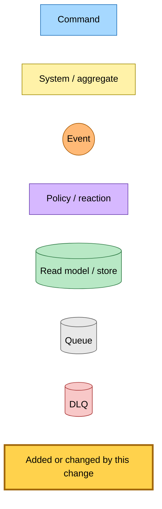
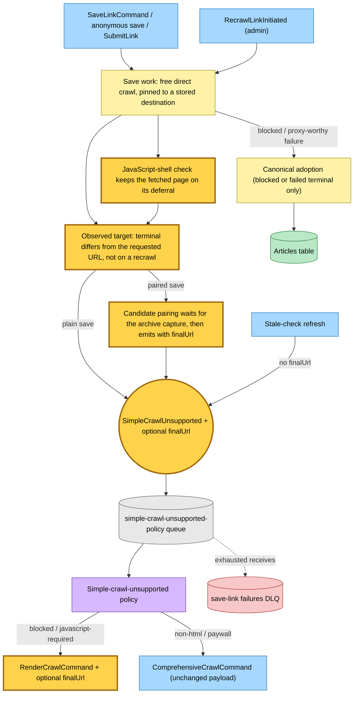
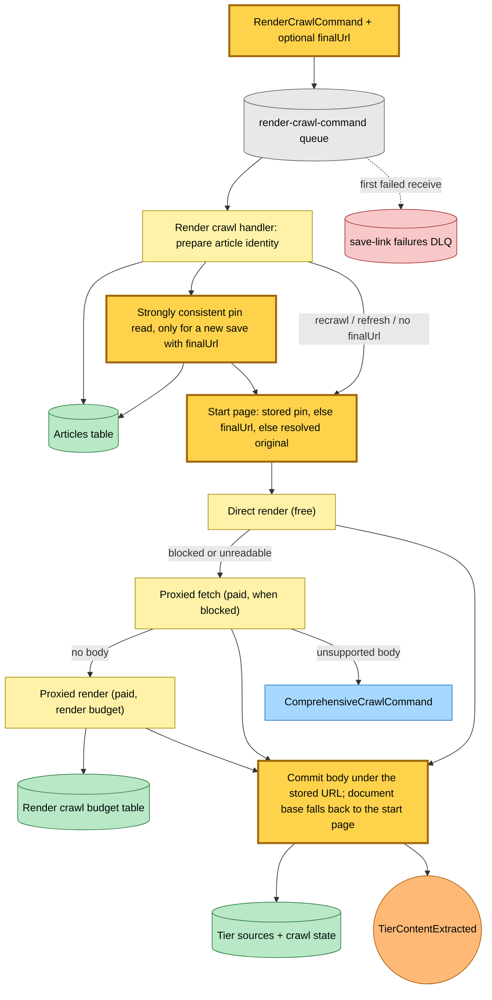

# The render crawl starts at the page the free crawl reached

Snapshot of the uncommitted working tree over `3d047fa` (`rp/magical-thompson-pee53k`), whose 2026-11-03 subject is **fix(save-link): ask the judge once more after an invalid reply**. Generated 2026-11-03.

A new save first runs the free, direct-egress crawl. When that crawl follows a redirect (a newsletter tracker, for example) and then has to hand the save to the render crawl, the deferral now carries the page the free crawl reached as `finalUrl`. The render crawl starts its direct render, its paid proxied fetch and its paid proxied render at that page instead of at the tracker again.

- **Identity is unchanged.** `url` stays the stored article's key. Tier sources, fetch timestamps, crawl states and the selection hand-off are all written under it, with the same save attempt.
- **Only a changed page is carried.** A terminal equal to the requested URL after ordinary URL parsing is left out. A failure with no response carries nothing. A known hop before an ordinary timeout is kept.
- **A stored pin wins.** When `finalUrl` is present, the render crawl reads the article's stored destination pin with a strongly consistent read. If one exists, every leg uses the article's resolved original, as before.
- **Recrawl and refresh are unchanged.** Admin recrawls carry no `finalUrl`, and the render crawl ignores one on a recrawl or a refresh.
- **The comprehensive crawl is unchanged.** The policy forwards `finalUrl` only on its render branch.
- **Document base.** A proxied body whose crawl reports no terminal is finalized against the page the render crawl started at. Its relative links, images and candidate source then resolve against the publisher, not the tracker.

No queue, subscription, Lambda resource, DLQ route, budget or environment value changes. The field is optional on both wire schemas, so a message queued before the deploy still parses and takes today's path.

---

## Legend

Amber marks what this change adds or changes. Everything else is existing infrastructure shown for context.

[BPMN image](diagrams-bpmn/legend.png) · [Editable BPMN](diagrams-bpmn/legend.bpmn)

Mermaid source

---

## 1. The free crawl defers a save and names the page it reached

The save-link, anonymous save and submit-link workers run the free crawl through the shared save work. A blocked response, a proxy-worthy transport failure or a JavaScript shell defers the save. The deferral carries `finalUrl` when the crawl reached a different page. A paired save (live crawl beside an archive capture) returns the deferral to the candidate pairing, which emits it once the capture finishes. The admin recrawl and the stale-check refresh publish the same event without `finalUrl`. The policy forwards `finalUrl` to the render command only.

[BPMN image](diagrams-bpmn/free-crawl-deferral.png) · [Editable BPMN](diagrams-bpmn/free-crawl-deferral.bpmn)

Mermaid source

---

## 2. The render crawl picks one page to start from

The render crawl prepares the article's identity as before. A new save that carries `finalUrl` reads the stored destination pin, strongly consistently. With no pin, the observed page becomes the start of all three legs. With a pin, or with no `finalUrl`, or on a recrawl or refresh, the legs start at the resolved original, as before. Every write stays keyed by the article's stored URL. An unsupported proxied body still goes on to the comprehensive crawl.

[BPMN image](diagrams-bpmn/render-start.png) · [Editable BPMN](diagrams-bpmn/render-start.bpmn)

Mermaid source

---

## Command → System → Event(s) reference

| Command / trigger | System | Event(s) emitted | Next command(s) |
|---|---|---|---|
| SaveLinkCommand, anonymous save, SubmitLink | Save work (free crawl) | SimpleCrawlUnsupported with `finalUrl` when the crawl reached another page; otherwise as before | Policy below |
| Paired save (live + archive capture) | Candidate pairing | SimpleCrawlUnsupported with the live crawl's `finalUrl` and the capture as a candidate | Policy below |
| RecrawlLinkInitiated | Save work (free crawl) | SimpleCrawlUnsupported without `finalUrl` | Policy below |
| Stale-check refresh | Stale check | SimpleCrawlUnsupported without `finalUrl` | Policy below |
| SimpleCrawlUnsupported (blocked, javascript-required) | Simple-crawl-unsupported policy | — | RenderCrawlCommand with `finalUrl` forwarded |
| SimpleCrawlUnsupported (non-html, paywall, none) | Simple-crawl-unsupported policy | — | ComprehensiveCrawlCommand, unchanged |
| RenderCrawlCommand | Render crawl | TierContentExtracted, RecrawlContentExtracted or RefreshContentExtracted as before, keyed by the stored URL | ComprehensiveCrawlCommand when the proxied body is unsupported |
| Render or policy queue exhausted | Save-link failures DLQ consumer | Failure facts as before | — |
