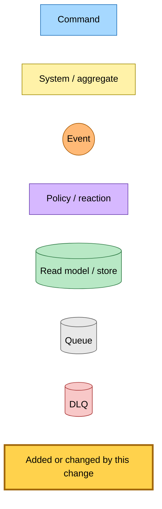
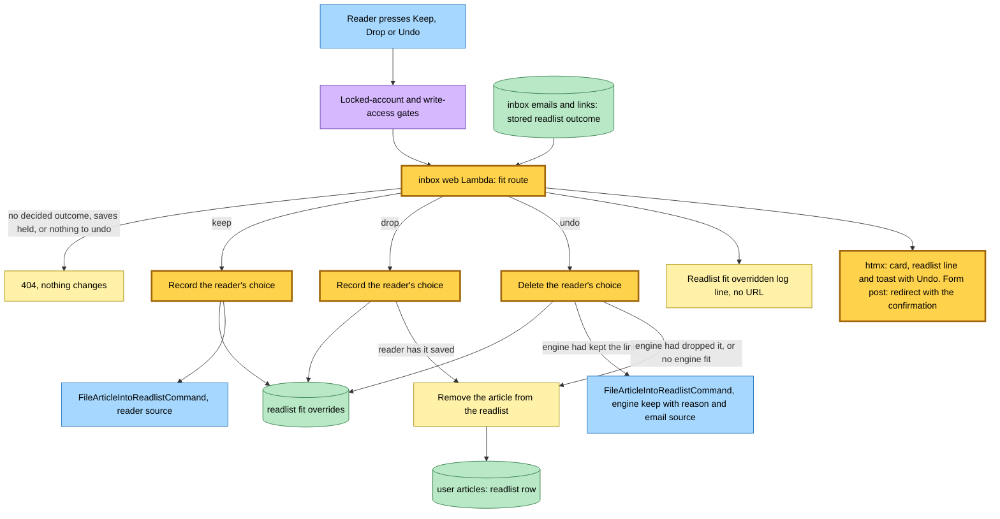
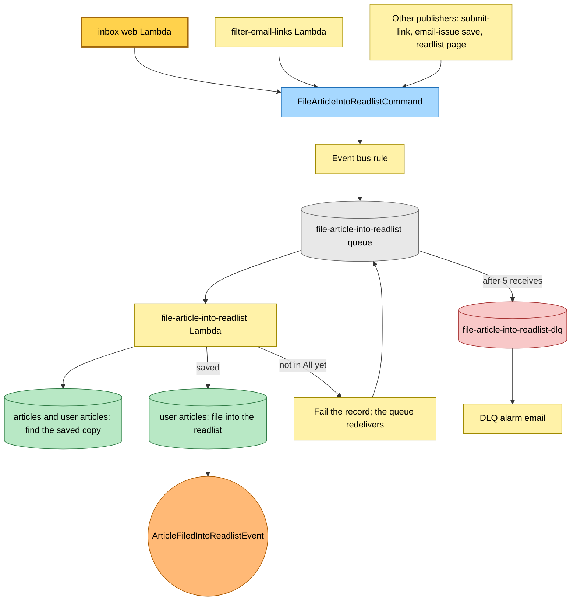

# The reader reverses a readlist call from the email page

Snapshot of the uncommitted working tree over `e91b68fb8` (`main`), whose 2026-11-03 subject is **feat: remember a reader's readlist choices**. Generated 2026-11-03.

The email filter decides, per readlist, which of an email's links fit. The email page now shows that call on each card and lets the reader reverse it, with Undo. The inbox web Lambda becomes a publisher of `FileArticleIntoReadlistCommand`, beside the filter handler, the submit-link handler, the email-issue save and the hutch readlist page.

- **Keep.** The route records the reader's choice and publishes `FileArticleIntoReadlistCommand` with a reader source. The existing file-article-into-readlist Lambda files the article.
- **Drop.** The route records the choice and removes the article from that readlist directly, when the reader has it saved. Nothing is published.
- **Undo.** The route deletes the choice. When the engine had kept the link, it republishes the engine's keep with its reason, purpose version and email source; otherwise it removes the article from the readlist.
- **Guards.** The route sits behind the locked-account and write-access gates. A link the filter did not decide for that readlist, an email whose saves are held, or an Undo with no choice to reverse answers 404 and changes nothing.

Only the inbox web Lambda's code changes. Its bus grant, table grants and the command's subscription already exist.

---

## Legend

Amber marks what this change adds or changes. Everything else is existing infrastructure shown for context.

[BPMN image](diagrams-bpmn/legend.png) · [Editable BPMN](diagrams-bpmn/legend.bpmn)

Mermaid source

---

## 1. The reader's choice on a card

The reader presses Keep, Drop or Undo on a card. The route checks the email's stored outcome for that readlist, then records or deletes the reader's choice and either publishes the filing command or removes the article from the readlist. An htmx request gets the card, the readlist line and a toast back; a plain form post is redirected to the email page with a confirmation that shows the toast.

[BPMN image](diagrams-bpmn/fit-choice.png) · [Editable BPMN](diagrams-bpmn/fit-choice.bpmn)

Mermaid source

---

## 2. Filing a reader's keep

The command goes over the bus to the existing file-article-into-readlist queue. The worker finds the reader's saved copy and files it into the readlist, then publishes the filed fact. When the article is not in All yet, it fails the record and waits for redelivery.

[BPMN image](diagrams-bpmn/filing.png) · [Editable BPMN](diagrams-bpmn/filing.bpmn)

Mermaid source

---

## Command → System → Event(s) reference

| Command or event | System | Emits | Triggers next |
|---|---|---|---|
| Reader's Keep on a card | inbox web Lambda, fit route | `FileArticleIntoReadlistCommand` with a reader source; a fit override row; a log line | file-article-into-readlist Lambda |
| Reader's Drop on a card | inbox web Lambda, fit route | A fit override row; the readlist row removed when saved; a log line | none |
| Reader's Undo of a keep the engine made | inbox web Lambda, fit route | `FileArticleIntoReadlistCommand` with the engine's reason and email source; the override deleted | file-article-into-readlist Lambda |
| Reader's Undo of any other call | inbox web Lambda, fit route | The readlist row removed; the override deleted | none |
| `FileArticleIntoReadlistCommand` | file-article-into-readlist Lambda | `ArticleFiledIntoReadlistEvent`, or a failed record while the article is not in All | none; the event has no subscriber |
| Message out of receives | `file-article-into-readlist-dlq` | none | DLQ alarm email |
