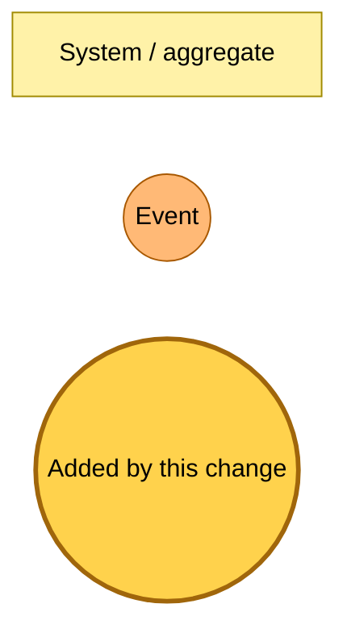
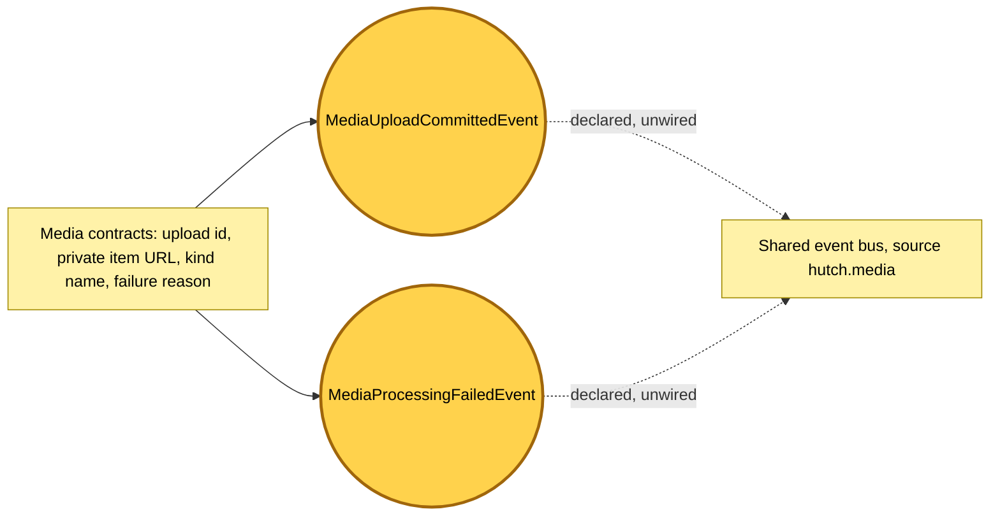

# Media upload events are declared

Snapshot of the uncommitted working tree over `1403d332c` (`main`), whose 2026-11-04 subject is **feat(@packages/hutch-infra-components): filter subscriptions by detail**. Generated 2026-11-04.

The shared event catalogue gains its first two `hutch.media` events. This is the complete current state of media upload messaging: nothing publishes either event and no rule subscribes to it, so the bus routes nothing new.

- **`MediaUploadCommittedEvent`.** Declares that a reader's upload is committed and ready to process. Its `attempt` is part of the detail so a later retry can republish without changing a key.
- **`MediaProcessingFailedEvent`.** Declares that a commit's processing ended in failure, with a reason from the media contracts and the notice the reader will see.

Every Lambda bundle that imports the catalogue now carries the media contracts, so a deploy updates Lambda code in place. No rule, queue or table changes.

---

## Legend

Amber marks what this change adds. Everything else is existing infrastructure shown for context.

[BPMN image](diagrams-bpmn/legend.png) · [Editable BPMN](diagrams-bpmn/legend.bpmn)

Mermaid source

---

## Declared events

Both events are declared and unwired: the dashed lines show the bus they will travel on once a later change publishes them.

[BPMN image](diagrams-bpmn/declared-events.png) · [Editable BPMN](diagrams-bpmn/declared-events.bpmn)

Mermaid source

---

## Command → System → Event(s) reference

| Command or event | Detail | System | Emits | Triggers next |
|---|---|---|---|---|
| `MediaUploadCommittedEvent` | `uploadId`, `kind`, `url`, `userId`, `saveAttemptId`, `etag`, `attempt` | none yet | nothing | none; no rule subscribes |
| `MediaProcessingFailedEvent` | `uploadId`, `kind`, `url`, `saveAttemptId`, `attempt`, `reason`, `notice` | none yet | nothing | none; no rule subscribes |
