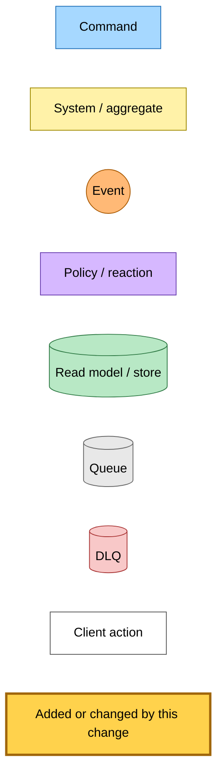
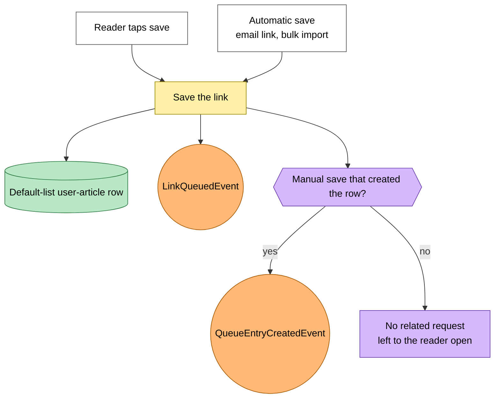
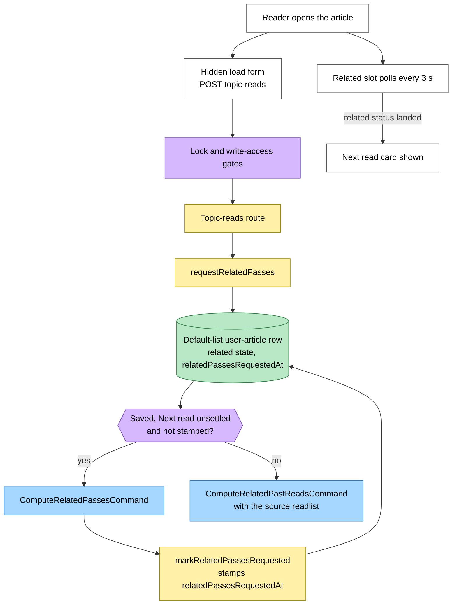
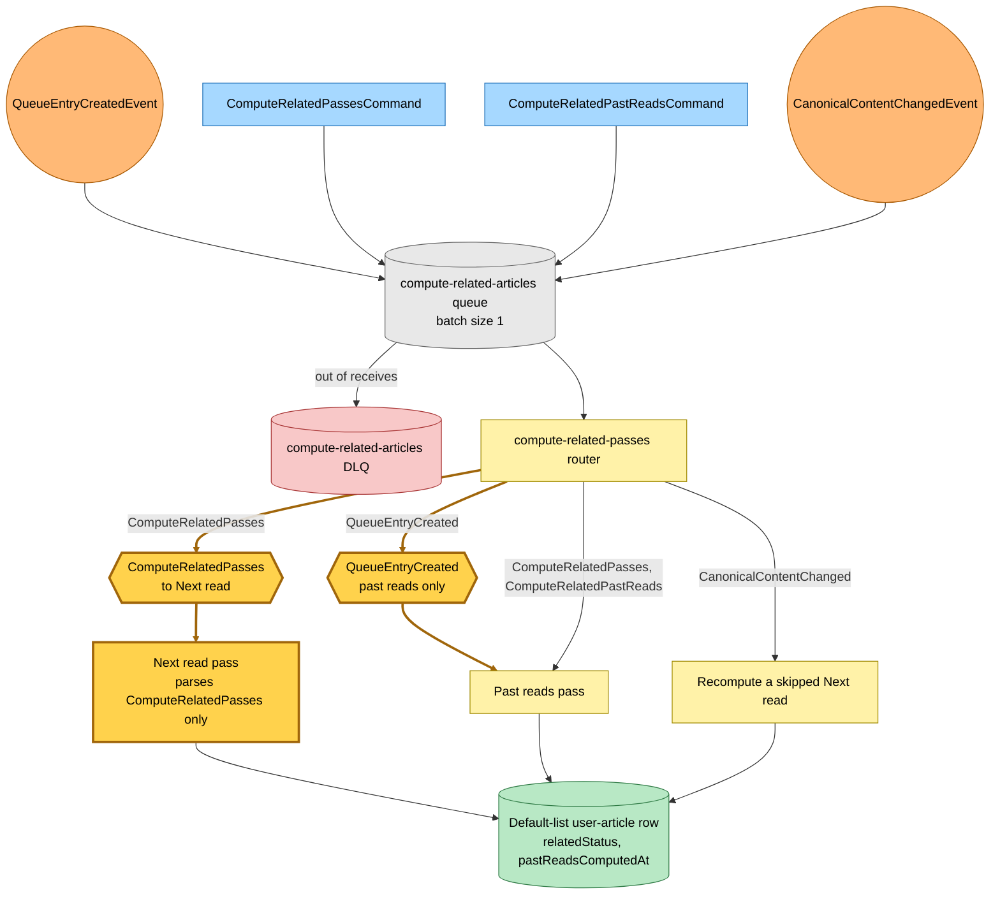

# Next read on open: the worker router stops running Next read on save

Snapshot of the uncommitted working tree over `af99460ff` (`main`), whose 2026-11-04 subject is **ci(android): stop calling the Play publish job until the app exists in Play Console**

This is the second push of the Next-read-on-open change. The first push moved the Next read request to the reader open: opening an article publishes `ComputeRelatedPassesCommand` once per row, and no save asks for Next read explicitly. A manual save that created the row still published `QueueEntryCreatedEvent`, and the worker router still ran Next read on it. This push trims the router so that event runs Past reads alone.

- **Next read runs only on `ComputeRelatedPassesCommand`.** The router sends a `QueueEntryCreatedEvent` record only to the Past reads pass.
- **Past reads is unchanged.** It still takes `QueueEntryCreatedEvent`, `ComputeRelatedPassesCommand` and `ComputeRelatedPastReadsCommand`.
- **The recompute pass is unchanged.** `CanonicalContentChangedEvent` still goes only to the pass that replaces a skipped Next read.
- **The Next read pass parses one detail shape.** It reads the `ComputeRelatedPassesCommand` detail alone; the union with the `QueueEntryCreatedEvent` detail is gone.

No infrastructure changes. The `compute-related-articles` subscription, queue, DLQ and Lambda are as they were, and `QueueEntryCreatedEvent` still reaches the queue for Past reads.

---

## Legend

Amber marks what this change adds or changes. Everything else is existing infrastructure shown for context.

[BPMN image](diagrams-bpmn/legend.png) · [Editable BPMN](diagrams-bpmn/legend.bpmn)

Mermaid source

---

## 1. What a save asks for

Unchanged by this change. Only a manual save that creates the row publishes anything related, and that event now precomputes Already read alone. Every other save leaves the related passes to the reader open.

[BPMN image](diagrams-bpmn/save-asks-for-past-reads.png) · [Editable BPMN](diagrams-bpmn/save-asks-for-past-reads.bpmn)

Mermaid source

---

## 2. What opening the article asks for

Unchanged by this change. The reader page fires the hidden load form on open. The topic-reads route decides between both passes and Past reads alone from the row's related state. This is now the only request that runs Next read for a saved row.

[BPMN image](diagrams-bpmn/reader-open-asks-for-passes.png) · [Editable BPMN](diagrams-bpmn/reader-open-asks-for-passes.bpmn)

Mermaid source

---

---

## 3. How the requests reach the passes

Four detail types still share one queue. The router now sends a `QueueEntryCreatedEvent` record to Past reads alone, and runs Next read only for `ComputeRelatedPassesCommand`.

[BPMN image](diagrams-bpmn/compute-related-routing.png) · [Editable BPMN](diagrams-bpmn/compute-related-routing.bpmn)

Mermaid source

---

## Command → System → Event(s) reference

| Command or event | System | Emits | Next |
|---|---|---|---|
| Manual save, row newly created | Save path | `LinkQueuedEvent`, `QueueEntryCreatedEvent` | Past reads pass only |
| Manual save, existing row | Save path | `LinkQueuedEvent` | Nothing related until the reader opens it |
| Automatic save | Save path | `LinkQueuedEvent` | Nothing related until the reader opens it |
| Reader open, row saved, Next read unsettled, not stamped | Topic-reads route | `ComputeRelatedPassesCommand`, then stamps `relatedPassesRequestedAt` | Next read and Past reads passes |
| Reader open, row stamped or Next read settled | Topic-reads route | `ComputeRelatedPastReadsCommand` with the source readlist | Past reads pass only |
| Reader open, row not saved | Topic-reads route | `ComputeRelatedPastReadsCommand` | Past reads pass only |
| `ComputeRelatedPassesCommand` | compute-related-articles Lambda | Related rows | Next read and Past reads passes |
| `ComputeRelatedPastReadsCommand` | compute-related-articles Lambda | Related rows | Past reads pass only |
| `QueueEntryCreatedEvent` | compute-related-articles Lambda | Related rows | Past reads pass only (no longer Next read) |
| `CanonicalContentChangedEvent` | compute-related-articles Lambda | Related rows | Replaces a skipped Next read |
| Related slot poll | Reader | Next read card once the related status lands | Stops polling |
