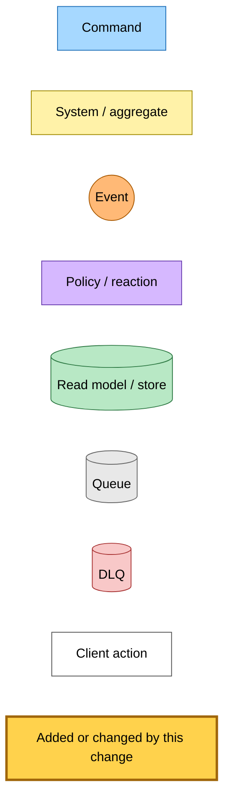
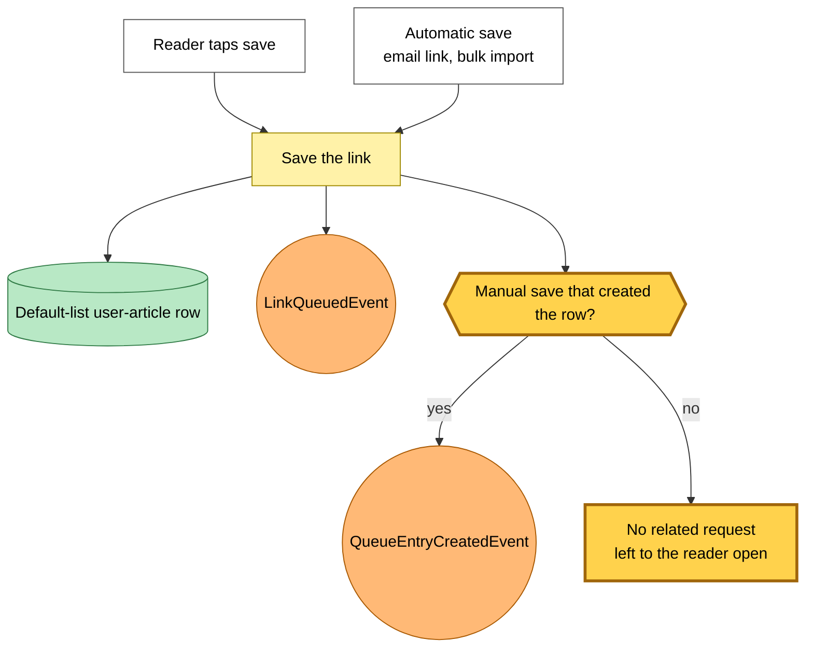
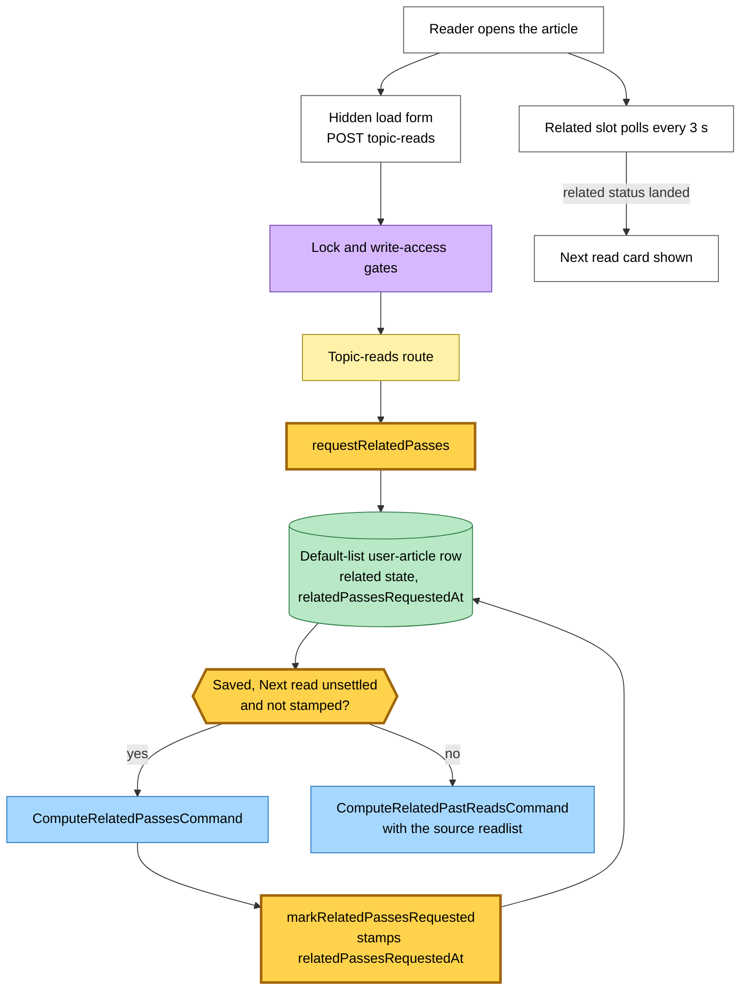
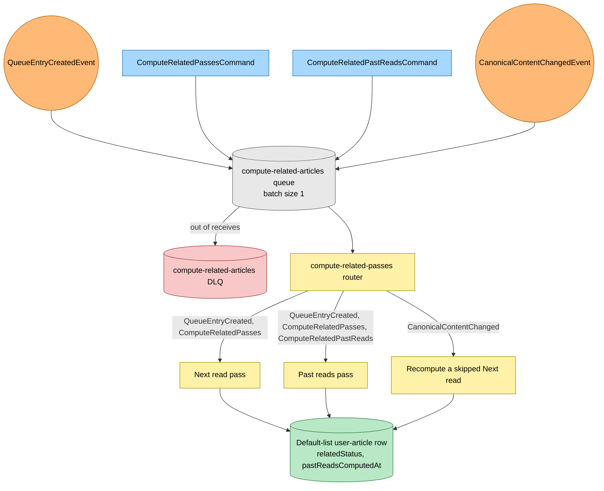

# Next read on open: the reader asks for it, the save no longer does

Snapshot of the uncommitted working tree over `cc94b6873` (`main`), whose 2026-11-04 subject is **fix(hutch): name the apps in the privacy policy and list deletion steps publicly**

Next read used to be requested at save time, and only by a manual save. An automatic save (an email link, a bulk import) asked for nothing, so opening such an article in the reader polled for a Next read card that never came. This change moves the Next read request to the reader open, the same request Already read already used.

- **No save asks for Next read explicitly.** A manual save that creates the row still publishes `QueueEntryCreatedEvent`, which precomputes Already read; until the worker router is trimmed in the next push, the worker also runs Next read on that event. An existing row and every automatic save publish nothing related.
- **Opening the article asks.** The hidden load form on the reader posts the topic-reads request, behind the same lock and write-access gates. When the row is saved, Next read has not settled and the row is not stamped, it publishes `ComputeRelatedPassesCommand` and then stamps `relatedPassesRequestedAt`. Otherwise it publishes `ComputeRelatedPastReadsCommand`, carrying the source readlist as before.
- **Publish before stamp.** A failed publish leaves the row unstamped, so the next open asks again.
- **The card arrives through the existing poll.** The reader already polls the related slot every 3 seconds until the row's related status lands, so the card appears without a reload.
- **The stamp now means Next read was requested.** Rows stamped by the earlier save-time request had Next read requested or settled, so they take the Past reads branch.

No infrastructure changes. The `compute-related-articles` subscription, queue, DLQ, Lambda and router are as they were.

---

## Legend

Amber marks what this change adds or changes. Everything else is existing infrastructure shown for context.

[BPMN image](diagrams-bpmn/legend.png) · [Editable BPMN](diagrams-bpmn/legend.bpmn)

Mermaid source

---

## 1. What a save asks for

Only a manual save that creates the row publishes anything related, and that event precomputes Already read. Every other save leaves the related passes to the reader open.

[BPMN image](diagrams-bpmn/save-asks-for-past-reads.png) · [Editable BPMN](diagrams-bpmn/save-asks-for-past-reads.bpmn)

Mermaid source

---

## 2. What opening the article asks for

The reader page fires the hidden load form on open. The topic-reads route decides between both passes and Past reads alone from the row's related state.

[BPMN image](diagrams-bpmn/reader-open-asks-for-passes.png) · [Editable BPMN](diagrams-bpmn/reader-open-asks-for-passes.bpmn)

Mermaid source

---

## 3. How the requests reach the passes

Unchanged by this change. Four detail types share one queue, and the router sends each record to the passes it needs.

[BPMN image](diagrams-bpmn/compute-related-routing.png) · [Editable BPMN](diagrams-bpmn/compute-related-routing.bpmn)

Mermaid source

---

## Command → System → Event(s) reference

| Command or event | System | Emits | Next |
|---|---|---|---|
| Manual save, row newly created | Save path | `LinkQueuedEvent`, `QueueEntryCreatedEvent` | Next read and Past reads passes |
| Manual save, existing row | Save path | `LinkQueuedEvent` | Nothing related until the reader opens it |
| Automatic save | Save path | `LinkQueuedEvent` | Nothing related until the reader opens it |
| Reader open, row saved, Next read unsettled, not stamped | Topic-reads route | `ComputeRelatedPassesCommand`, then stamps `relatedPassesRequestedAt` | Next read and Past reads passes |
| Reader open, row stamped or Next read settled | Topic-reads route | `ComputeRelatedPastReadsCommand` with the source readlist | Past reads pass only |
| Reader open, row not saved | Topic-reads route | `ComputeRelatedPastReadsCommand` | Past reads pass only |
| `ComputeRelatedPassesCommand` | compute-related-articles Lambda | Related rows | Next read and Past reads passes |
| `ComputeRelatedPastReadsCommand` | compute-related-articles Lambda | Related rows | Past reads pass only |
| `QueueEntryCreatedEvent` | compute-related-articles Lambda | Related rows | Next read and Past reads passes |
| `CanonicalContentChangedEvent` | compute-related-articles Lambda | Related rows | Replaces a skipped Next read |
| Related slot poll | Reader | Next read card once the related status lands | Stops polling |
