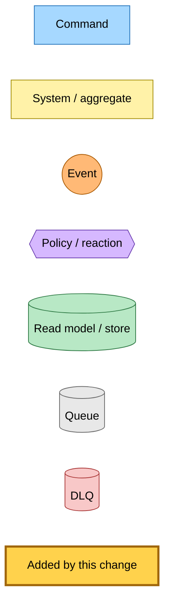
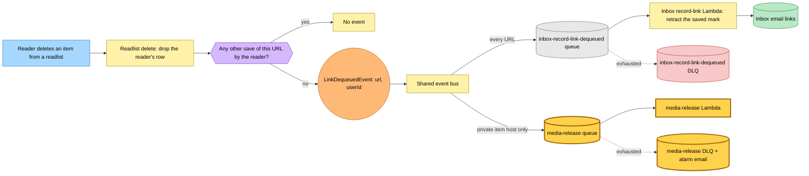
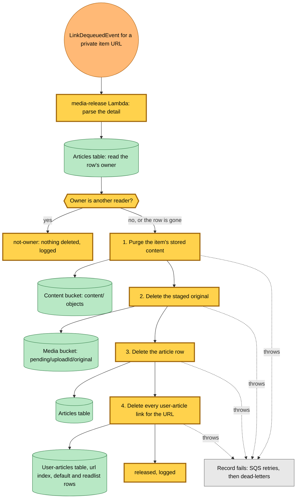

# A private item is released when its owner dequeues it

Snapshot of the uncommitted working tree over `1088d9c6a` (`main`), whose 2026-11-05 subject is **feat(hutch): withhold a private item on /view and its polls**. Generated 2026-11-05.

`LinkDequeuedEvent` gains its second subscriber. A reader who removes a link from their last readlist still publishes the same fact, and the inbox still retracts its "saved" mark for every URL. A new rule passes only private item URLs (the reserved upload host) to a new `media-release` queue and Lambda, which releases the item when the reader who dequeued it is its owner:

- **Owner check.** The Lambda reads the article row's owner. Another reader holding the URL changes nothing. A row that is already gone lets every step run, so a retry after a partial release finishes the job.
- **Release steps, in order.** Purge the item's stored content, delete the staged original under `pending/<uploadId>/original` in the media bucket, delete the article row, then delete every user-article link for the URL, in the default and readlist partitions.
- **Failure.** A step that throws fails the record; the queue retries it and then dead-letters it, and the DLQ alarm emails the alert address.

The hutch stack now names the media bucket in its configuration, and the Lambda's grants cover deleting only under that bucket's `pending/` prefix.

---

## Legend

Amber marks what this change adds. Everything else is existing infrastructure shown for context.

[BPMN image](diagrams-bpmn/legend.png) · [Editable BPMN](diagrams-bpmn/legend.bpmn)

Mermaid source

---

## Every LinkDequeued flow

The readlist delete publishes the fact once the reader's last save of the URL is gone. The bus carries it to two rules: `inbox-record-link-dequeued` with no filter, and the new `hutch-media-release`, filtered to URLs starting `https://uploads.readplace.invalid/`.

[BPMN image](diagrams-bpmn/link-dequeued-fan-out.png) · [Editable BPMN](diagrams-bpmn/link-dequeued-fan-out.bpmn)

Mermaid source

---

## Releasing the private item

[BPMN image](diagrams-bpmn/media-release-handler.png) · [Editable BPMN](diagrams-bpmn/media-release-handler.bpmn)

Mermaid source

---

## Command → System → Event(s) reference

| Command or event | Detail | System | Emits | Triggers next |
|---|---|---|---|---|
| Reader deletes an item from a readlist | readlist, article id | hutch readlist delete | `LinkDequeuedEvent` when no other save of the URL by that reader remains | both rules below |
| `LinkDequeuedEvent` (rule `inbox-record-link-dequeued`) | `url`, `userId` | inbox record-link Lambda | nothing | retracts the link's saved mark in the inbox |
| `LinkDequeuedEvent` (rule `hutch-media-release`, new) | `url` with the private item host prefix, `userId` | `media-release` Lambda (new) | nothing | owner: purge content, delete the staged original, the article row and every user-article link; another reader: nothing |
