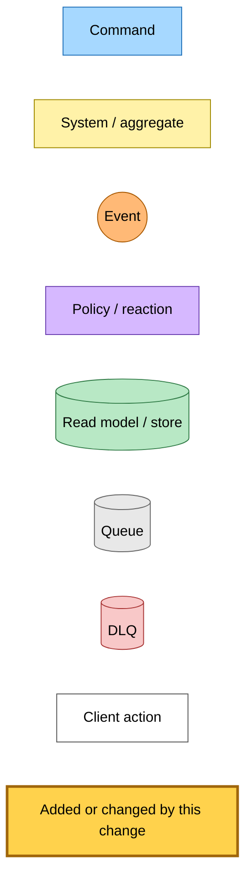
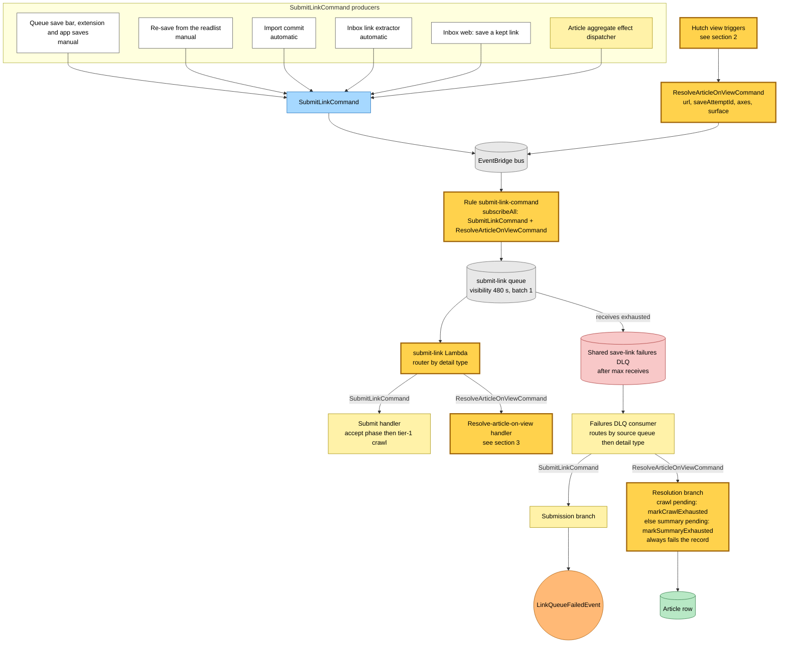
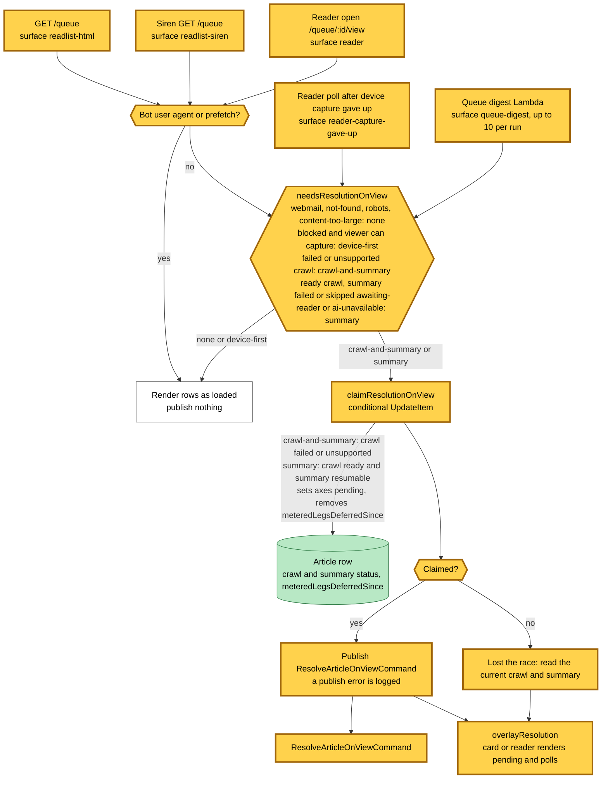
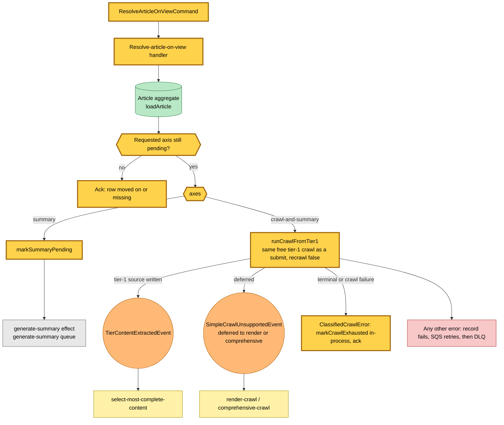
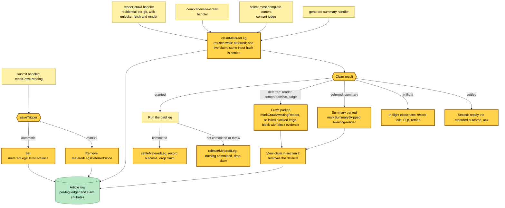

# Metered legs on view: an automatic save waits for a reader before it spends

Snapshot of the uncommitted working tree over `814fb0f06` (`main`), whose 2026-11-05 subject is **refactor(save-link): run Next read only on ComputeRelatedPasses, not on QueueEntryCreated**

An automatic save (an email link, a bulk import) used to run every paid leg of the pipeline as soon as it landed: the render ladder, the comprehensive crawl, the content judge and the summary. Most automatic saves are never opened. This change defers those metered legs until a reader looks at the article, and makes sure each leg runs at most once per input when they do.

- **An automatic save marks its row deferred.** The submit handler's pending write stamps `meteredLegsDeferredSince` when the save trigger is automatic, and removes it when the save is manual.
- **Every metered leg claims a ledger slot first.** The render legs, the comprehensive crawl, the content judge and the summary each make a conditional claim on the article row, keyed by leg and input hash. A deferred row refuses the claim, so the leg parks the row: the crawl as `awaiting-reader` (or `failed{blocked, edge-block}` when the free crawl saw block evidence), the summary as `skipped{awaiting-reader}`. A granted claim runs the leg and settles it with its outcome, or releases it when nothing was committed. A claim held by another record is retried; a settled claim with the same input replays its outcome without paying again.
- **Viewing the article resumes it.** The readlist HTML listing, the Siren listing, the reader open, the reader poll after a device capture gave up, and the queue digest each check the rows they show. A row that a reader could resolve is claimed with one conditional update that flips its axes back to pending and clears the deferral, and only the request that won the claim publishes `ResolveArticleOnViewCommand`. Bots and prefetches claim nothing; a blocked row viewed from a device that can capture is left to the device first.
- **The command rides the submit-link queue.** One EventBridge rule now carries both `SubmitLinkCommand` and `ResolveArticleOnViewCommand` to the same queue and Lambda, whose router sends each detail type to its own handler. No new Lambda, queue, DLQ, environment variable or Pulumi config.
- **A dead letter fails the pending axis.** The shared failures DLQ consumer routes a dead-lettered resolution to a new branch that marks the still-pending crawl or summary exhausted, and always fails the record so the message stays redrivable.

---

## Legend

Amber marks what this change adds or changes. Everything else is existing infrastructure shown for context.

[BPMN image](diagrams-bpmn/legend.png) · [Editable BPMN](diagrams-bpmn/legend.bpmn)

Mermaid source

---

## 1. Where the two commands come from and how they reach the submit-link Lambda

Every producer of `SubmitLinkCommand` is unchanged. `ResolveArticleOnViewCommand` is new; it is published only by the hutch web tier and the queue digest after they win a claim. One rule carries both detail types to the submit-link queue, and the Lambda routes by detail type.

[BPMN image](diagrams-bpmn/submit-link-queue-routing.png) · [Editable BPMN](diagrams-bpmn/submit-link-queue-routing.bpmn)

Mermaid source

---

## 2. Viewing an article claims it and publishes the command

Five surfaces call the same request. Each decides per row what a reader could resolve, claims the row with one conditional write, and publishes only for the rows it claimed. The claimed state is overlaid on the page, so the card or reader renders pending at once and polls.

[BPMN image](diagrams-bpmn/view-claims-and-publishes.png) · [Editable BPMN](diagrams-bpmn/view-claims-and-publishes.bpmn)

Mermaid source

---

## 3. The resolve-article-on-view handler

The handler runs inside the submit-link Lambda. It resolves only a row whose requested axis is still pending, so a redelivered or stale command changes nothing.

[BPMN image](diagrams-bpmn/resolve-article-on-view-handler.png) · [Editable BPMN](diagrams-bpmn/resolve-article-on-view-handler.bpmn)

Mermaid source

---

## 4. The ledger gates on every metered leg

A save sets or clears the deferral; each metered leg claims its ledger slot on the article row before it spends. The view claim in section 2 is what removes the deferral, so the next claim is granted.

[BPMN image](diagrams-bpmn/metered-leg-ledger-gates.png) · [Editable BPMN](diagrams-bpmn/metered-leg-ledger-gates.bpmn)

Mermaid source

---

## Command → System → Event(s) reference

| Command / event | System that handles it | Emits | Triggers next |
|---|---|---|---|
| `SubmitLinkCommand` | submit-link Lambda, submit handler | Accept-phase rows; `TierContentExtractedEvent`, `SimpleCrawlUnsupportedEvent`, `StaleCheckRequestedEvent`, or an in-process crawl failure | select-most-complete-content; render-crawl or comprehensive-crawl; the stale-check pipeline |
| `ResolveArticleOnViewCommand` (new) | submit-link Lambda, resolve-article-on-view handler | Crawl axis: `TierContentExtractedEvent` or `SimpleCrawlUnsupportedEvent`, or `markCrawlExhausted`. Summary axis: `markSummaryPending` with its generate-summary effect | select-most-complete-content; render-crawl or comprehensive-crawl; generate-summary |
| Dead-lettered `SubmitLinkCommand` | save-link failures DLQ consumer, submission branch | `LinkQueueFailedEvent` | The saved-link read model |
| Dead-lettered `ResolveArticleOnViewCommand` (new) | save-link failures DLQ consumer, resolution branch | `markCrawlExhausted` or `markSummaryExhausted` on the pending axis; the record always fails | None; the message stays for a redrive |
| `TierContentExtractedEvent` | select-most-complete-content, content-judge leg gated by the ledger (changed) | `LinkSaved` and `CrawlArticleCompleted`, or `markCrawlAwaitingReader` when deferred with nothing selected | generate-summary |
| `SimpleCrawlUnsupportedEvent` → `RenderCrawlCommand` / `ComprehensiveCrawlCommand` | render-crawl and comprehensive-crawl, each paid leg gated by the ledger (changed) | `TierContentExtractedEvent`, or `markCrawlAwaitingReader` / `failed{blocked, edge-block}` when deferred | select-most-complete-content |
| generate-summary queue message | generate-summary handler, summary leg gated by the ledger (changed) | Ready summary, or `skipped{awaiting-reader}` when deferred | None |
| View of a parked row (new) | Readlist HTML and Siren listing, reader open, reader gave-up poll, queue digest | `ResolveArticleOnViewCommand` for each claimed row | The resolve-article-on-view handler |
