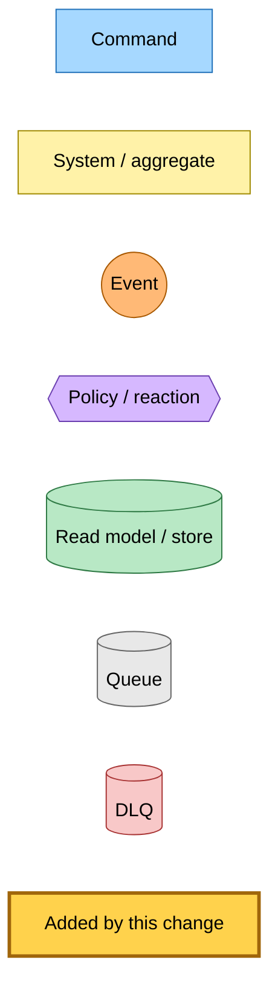
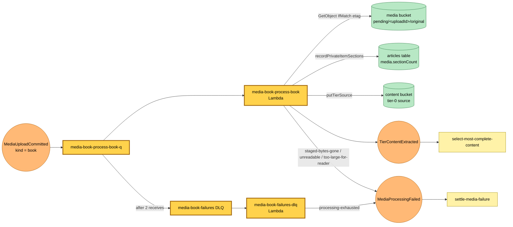

# An uploaded EPUB becomes a private tier-0 source

Snapshot of the uncommitted working tree over `9696da7db` (`main`), whose 2026-11-05 subject is **feat(hutch): settle a failed media upload on its card**. Generated 2026-11-05.

A new deployable, `media-book`, subscribes to `MediaUploadCommitted` for the `book` kind. Nothing in this tree publishes that event yet; the upload route that does lands in a later change.

- **Process.** The `media-book-process-book` Lambda reads the committed upload from the media bucket's `pending/<uploadId>/original`, conditional on the committed ETag. It refuses a DRM-protected book and a file that is not an EPUB, builds one reader body (a table of contents, then one `section-ch-N` heading per chapter, images dropped), and refuses a body over the reader's byte limit.
- **Record.** It records the chapter count on the private item row. When the row is gone or tombstoned the item was released while the book was processing: it writes nothing more and publishes nothing.
- **Announce.** Otherwise it writes the tier-0 source, bound to this save's attempt, and publishes `TierContentExtracted`, which content selection already consumes.
- **Fail.** Each refusal publishes `MediaProcessingFailed` with its reason and notice, which `settle-media-failure` settles on the card. A message that fails two receives lands in the `media-book-failures` DLQ, whose router publishes `MediaProcessingFailed` with reason `processing-exhausted`.

---

## Legend

Amber marks what this change adds. Everything else is existing infrastructure shown for context.

[BPMN image](diagrams-bpmn/legend.png) · [Editable BPMN](diagrams-bpmn/legend.bpmn)

Mermaid source

---

## Processing a book

The bus carries `MediaUploadCommittedEvent` to the new rule, filtered to the `book` kind. The Lambda takes one message at a time.

[BPMN image](diagrams-bpmn/process-book.png) · [Editable BPMN](diagrams-bpmn/process-book.bpmn)

Mermaid source

---

## Command → System → Event(s) reference

| Command or event | Detail | System | Emits | Triggers next |
|---|---|---|---|---|
| `MediaUploadCommittedEvent` (rule for `media-book-process-book`, new, kind `book`) | `uploadId`, `kind`, `url`, `userId`, `saveAttemptId`, `etag`, `attempt` | `media-book-process-book` Lambda (new) | `TierContentExtracted`, or `MediaProcessingFailed` with `staged-bytes-gone`, `unreadable` or `too-large-for-reader` | content selection, or `settle-media-failure` |
| Private item row gone or tombstoned | — | `media-book-process-book` Lambda (new) | nothing | the record is acknowledged |
| Malformed message or a throwing step | — | `media-book-process-book` queue | nothing | retried, then the `media-book-failures` DLQ |
| `media-book-failures` DLQ message | the original command | `media-book-failures-dlq` Lambda (new) | `MediaProcessingFailed` with `processing-exhausted` | `settle-media-failure` |
| `TierContentExtracted` | tier-0 source bound to the save attempt | `select-most-complete-content` | existing selection events | existing selection chain |
| `MediaProcessingFailed` | `reason`, `notice` | `settle-media-failure` | nothing | marks the card failed with the notice |
