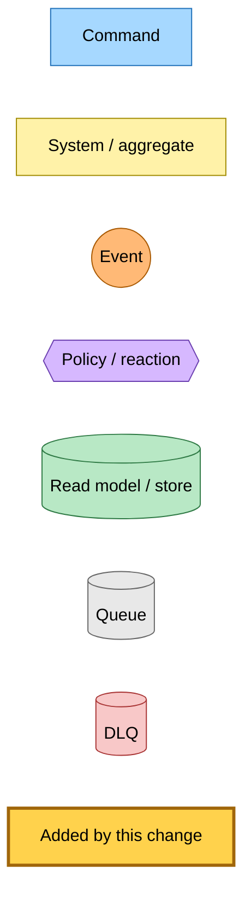
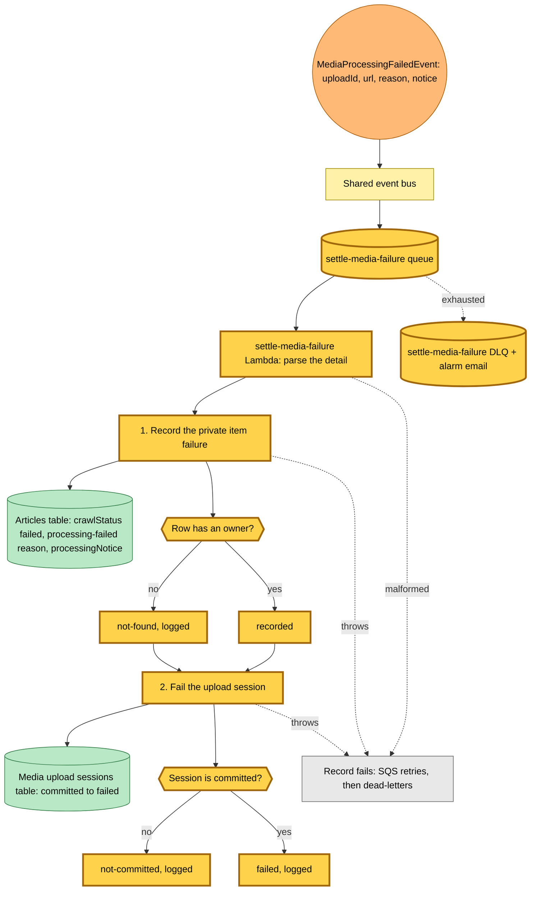
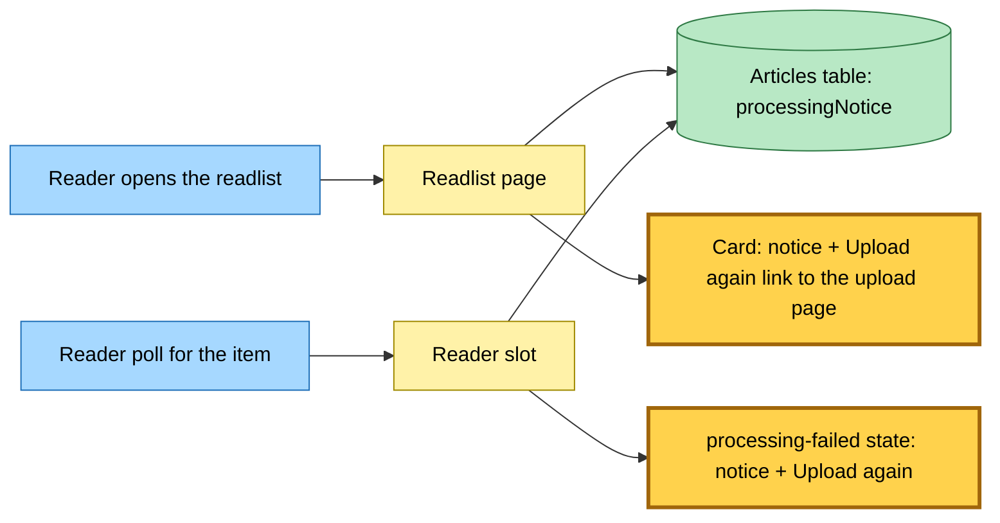

# A failed media upload is settled on its card

Snapshot of the uncommitted working tree over `c2228541f` (`main`), whose 2026-11-05 subject is **feat(hutch): provision the media upload sessions table and pending grant**. Generated 2026-11-05.

`MediaProcessingFailedEvent` gains its first subscriber. Nothing in this tree publishes the event yet; the media processing stage that does lands in a later change. A new rule sends every such fact to a new `settle-media-failure` queue and Lambda, which settles the failure in two places:

- **The private item row.** The Lambda marks the item's article row failed, records a `processing-failed` reason carrying the notice, and stores the notice on the row. The write is conditional on the row having an owner, so a row that is gone or is not a private item answers `not-found`, which is logged and acknowledged.
- **The upload session.** The Lambda moves the upload session from `committed` to `failed` with one conditional update. A session in any other state answers `not-committed`, which is logged and acknowledged.
- **Failure.** A malformed message or a step that throws fails the record; the queue retries it and then dead-letters it, and the DLQ alarm emails the alert address.

The reader sees the result on the next read: the readlist card shows the notice with an "Upload again" link to the upload page (tracked as a queue-card, failed-card link), and the reader poll renders the processing-failed state with the same notice and link.

The upload sessions table gets its DynamoDB store in this change. Every session transition is one conditional update; a new session expires 24 hours after it is created, and a lookup by another user finds nothing.

---

## Legend

Amber marks what this change adds. Everything else is existing infrastructure shown for context.

[BPMN image](diagrams-bpmn/legend.png) · [Editable BPMN](diagrams-bpmn/legend.bpmn)

Mermaid source

---

## Settling the failure

The bus carries `MediaProcessingFailedEvent` (source `hutch.media`) to the new rule with no filter. The Lambda takes one message at a time.

[BPMN image](diagrams-bpmn/settle-media-failure.png) · [Editable BPMN](diagrams-bpmn/settle-media-failure.bpmn)

Mermaid source

---

## Reading the failed item

[BPMN image](diagrams-bpmn/failed-card-read.png) · [Editable BPMN](diagrams-bpmn/failed-card-read.bpmn)

Mermaid source

---

## Command → System → Event(s) reference

| Command or event | Detail | System | Emits | Triggers next |
|---|---|---|---|---|
| `MediaProcessingFailedEvent` (rule for `settle-media-failure`, new) | `uploadId`, `kind`, `url`, `saveAttemptId`, `attempt`, `reason`, `notice` | `settle-media-failure` Lambda (new) | nothing | marks the private item row failed with the notice, then moves the upload session from committed to failed |
| Reader opens the readlist | readlist | hutch readlist page | nothing | renders the stored notice on the card with an "Upload again" link |
| Reader poll for the item | article id | hutch reader slot | nothing | renders the processing-failed state with the notice and "Upload again" |
