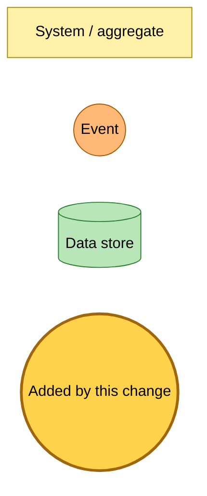
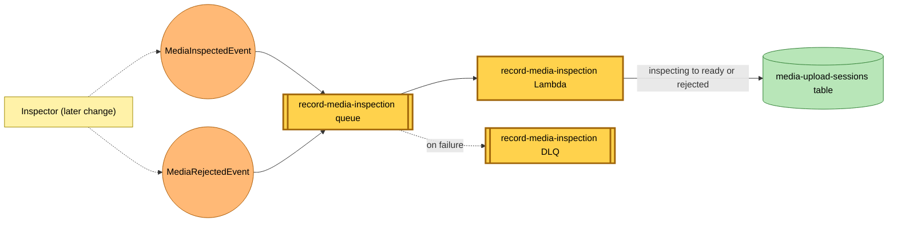
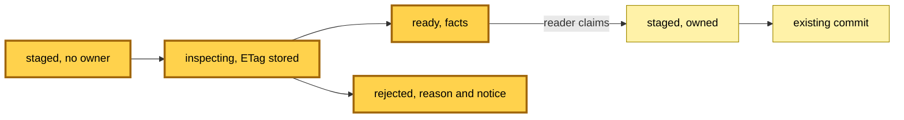

# An upload's inspection is recorded on its session

Snapshot of the uncommitted working tree over `07fbd301c` (`main`), whose 2026-11-06 subject is **fix(hutch): shrink the EPUB image budget as the body grows**. Generated 2026-11-06.

A new `record-media-inspection` Lambda takes the inspection events declared in the previous snapshot off the bus and writes the verdict onto the upload session row. Nothing publishes those events yet, so the new rules match nothing until the inspector lands.

- **`record-media-inspection` queue and Lambda.** EventBridge rules `media-inspected-rule` and `media-rejected-rule` route `MediaInspectedEvent` and `MediaRejectedEvent` to an SQS queue (30-second visibility, batch size 1) with its own dead-letter queue and alert email. The Lambda moves a row from `inspecting` to `ready` with the book's facts, or to `rejected` with the reason and notice. A redelivery that finds the row no longer `inspecting` is logged and acknowledged.
- **Upload session table, guest rows.** The existing media-upload-sessions table gains rows with no `userId`: created `staged`, marked `inspecting` with the stored ETag, then `ready` or `rejected`. A reader claims a `ready` guest row by writing their `userId` on it, which sets it back to `staged` for the existing commit. Every write is conditional on the row's status. The Lambda holds `dynamodb:UpdateItem` on that table only.
- **Web app.** The production providers gain the guest-session functions and an EventBridge publisher for `MediaUploadStagedEvent`. No route calls them yet.

No table, index or existing rule changes. Deploying creates one Lambda, two queues, two rules and a queue policy.

---

## Legend

Amber marks what this change adds. Everything else is existing infrastructure shown for context.

[BPMN image](diagrams-bpmn/legend.png) · [Editable BPMN](diagrams-bpmn/legend.bpmn)

Mermaid source

---

## Recording an inspection

An inspection's verdict reaches the session row through its own queue. The dashed lines are the inspector's publishes, which a later change adds.

[BPMN image](diagrams-bpmn/record-inspection.png) · [Editable BPMN](diagrams-bpmn/record-inspection.bpmn)

Mermaid source

---

## A guest upload's session

The states a guest row moves through. Each arrow is a write conditioned on the state it leaves.

[BPMN image](diagrams-bpmn/guest-session.png) · [Editable BPMN](diagrams-bpmn/guest-session.bpmn)

Mermaid source

