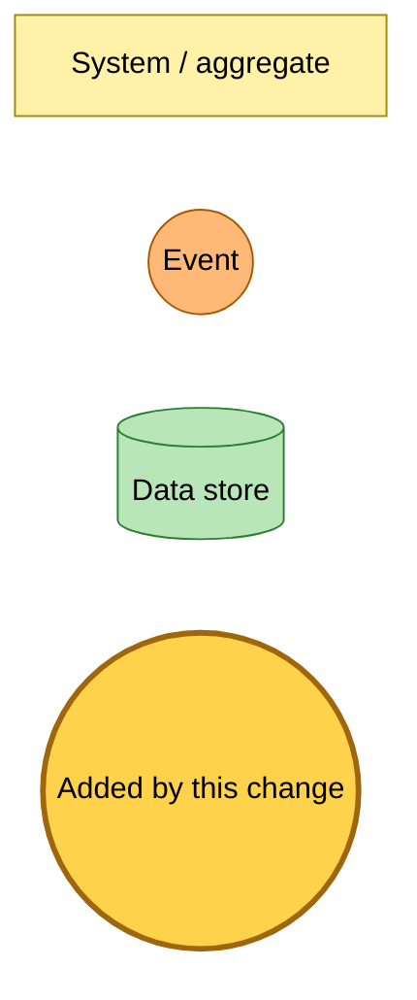
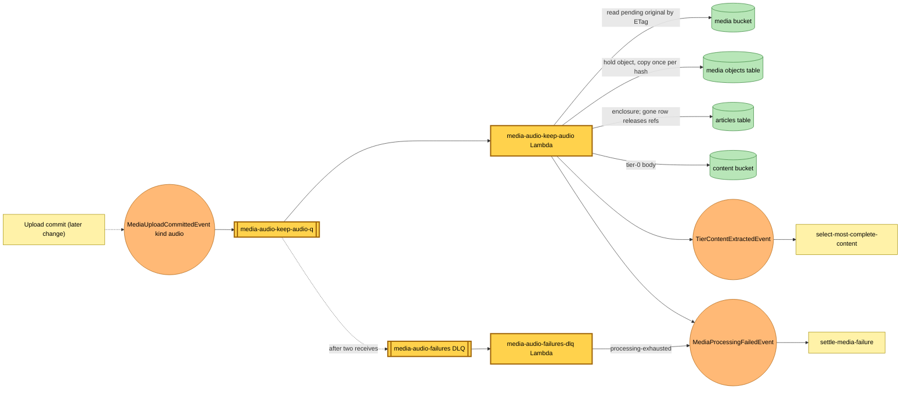

# An uploaded audio file is kept and becomes a private tier-0 source

Snapshot of the uncommitted working tree over `07fbd301c` (`main`), whose 2026-11-06 subject is **fix(hutch): shrink the EPUB image budget as the body grows**. Generated 2026-11-06.

A new `media-audio` deployable subscribes to `MediaUploadCommittedEvent` for the `audio` kind. Nothing publishes an audio commit yet, so the new rule matches nothing until the upload route accepts audio.

- **`media-audio-keep-audio` rule, queue and Lambda.** An EventBridge rule filtered to `kind: audio` sends the commit to `media-audio-keep-audio-q` (visibility twice the 120-second timeout, batch size 1, two receives) and the `media-audio-keep-audio` Lambda (1024 MB). The Lambda reads the private item; a row that is gone releases the upload's object references and stops. It reads the staged original under the media bucket's `pending/` prefix by its ETag, probes it (MP3 or M4A with a duration and no video), and holds the bytes as a content-addressed object under `objects/`, copying them only when no other upload already holds that hash. It records the enclosure (object key, media type, duration) on the private item, writes a short tier-0 body (title, length in minutes, file name) to the content store and publishes `TierContentExtractedEvent` with that one candidate.
- **Failures.** Bytes gone or an unreadable file publish `MediaProcessingFailedEvent` with a reason and notice, which the existing settle-media-failure flow puts on the card. A throwing step fails the record; after its second receive the message moves to the new `media-audio-failures` dead-letter queue, whose consumer publishes `MediaProcessingFailedEvent` with `processing-exhausted`. The dead-letter queue emails the alert address.
- **Grants.** Read on the media bucket's `pending/` prefix, read and write on its `objects/` prefix, read and write on the content bucket, the media objects table and `GetItem`/`UpdateItem` on the articles table, and publish on the bus.

No table, index or existing rule changes. Deploying the new stack creates two Lambdas, a queue, a dead-letter queue with its alarm, one rule and a queue policy.

---

## Legend

Amber marks what this change adds. Everything else is existing infrastructure shown for context.

[BPMN image](diagrams-bpmn/legend.png) · [Editable BPMN](diagrams-bpmn/legend.bpmn)

Mermaid source

---

## Keeping an audio upload

The dashed line is the audio commit, which a later change publishes.

[BPMN image](diagrams-bpmn/keep-audio.png) · [Editable BPMN](diagrams-bpmn/keep-audio.bpmn)

Mermaid source

---

## Command → System → Event(s) reference

| Command / event | Handled by | Emits | Triggers next |
|---|---|---|---|
| `MediaUploadCommittedEvent` (kind `audio`) | `media-audio-keep-audio` Lambda via `media-audio-keep-audio-q` | `TierContentExtractedEvent`, or `MediaProcessingFailedEvent` (`staged-bytes-gone`, `unreadable`), or nothing when the item was released | Content selection, or settle-media-failure |
| Dead-lettered commit | `media-audio-failures-dlq` Lambda | `MediaProcessingFailedEvent` (`processing-exhausted`) | settle-media-failure |
| `TierContentExtractedEvent` | `select-most-complete-content` (existing) | Existing selection events | Existing |
| `MediaProcessingFailedEvent` | settle-media-failure (existing) | none | none |
