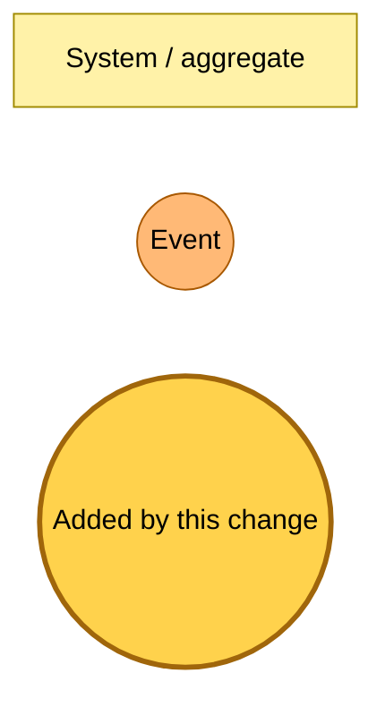
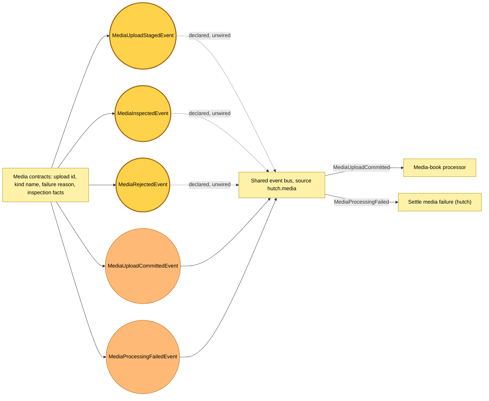

# Upload review and inspection events are declared

Snapshot of the uncommitted working tree over `07fbd301c` (`main`), whose 2026-11-06 subject is **fix(hutch): shrink the EPUB image budget as the body grows**. Generated 2026-11-06.

The shared event catalogue gains three `hutch.media` events for reviewing an upload before it is committed. Nothing publishes them and no rule subscribes to them, so the bus routes nothing new. The commit and failure events declared earlier, and the media-book processor that consumes the commit, are unchanged.

- **`MediaUploadStagedEvent`.** Declares that an upload's original is stored and waiting to be inspected, with its media type, file name, size, ETag and the time it was stored.
- **`MediaInspectedEvent`.** Declares what an inspection read from the file: for a book, its title, authors and section titles, from the media contracts' inspection facts.
- **`MediaRejectedEvent`.** Declares that an inspection refused the file, with a reason from the media failure reasons and the notice the reader will see.

The media-book dead-letter names gain an inspect-book source and its queue name, and the shared components hold the inspect-book timeout of 120 seconds. No Pulumi program reads either yet. Every Lambda bundle that imports the catalogue carries the new schemas, so a deploy updates Lambda code in place. No rule, queue or table changes.

---

## Legend

Amber marks what this change adds. Everything else is existing infrastructure shown for context.

[BPMN image](diagrams-bpmn/legend.png) · [Editable BPMN](diagrams-bpmn/legend.bpmn)

Mermaid source

---

## Declared events

The three review events are declared and unwired: the dashed lines show the bus they will travel on once a later change publishes them. The commit event already reaches the media-book processor.

[BPMN image](diagrams-bpmn/declared-events.png) · [Editable BPMN](diagrams-bpmn/declared-events.bpmn)

Mermaid source

---

## Command → System → Event(s) reference

| Command or event | Detail | System | Emits | Triggers next |
|---|---|---|---|---|
| `MediaUploadStagedEvent` | `uploadId`, `kind`, `mediaType`, `fileName`, `size`, `etag`, `stagedAt` | none yet | nothing | none; no rule subscribes |
| `MediaInspectedEvent` | `uploadId`, `kind`, `facts` (book: `title`, `authors`, `sectionTitles`) | none yet | nothing | none; no rule subscribes |
| `MediaRejectedEvent` | `uploadId`, `kind`, `reason`, `notice` | none yet | nothing | none; no rule subscribes |
| `MediaUploadCommittedEvent` | unchanged | media-book processor | `TierContentExtracted` or `MediaProcessingFailedEvent` | unchanged |
| `MediaProcessingFailedEvent` | unchanged | settle-media-failure | nothing | unchanged |
