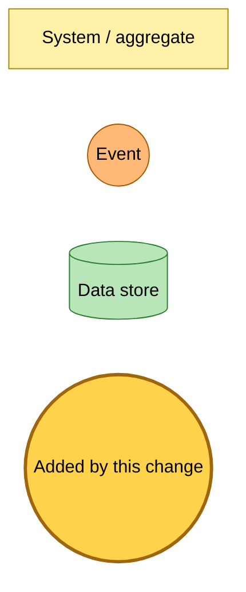
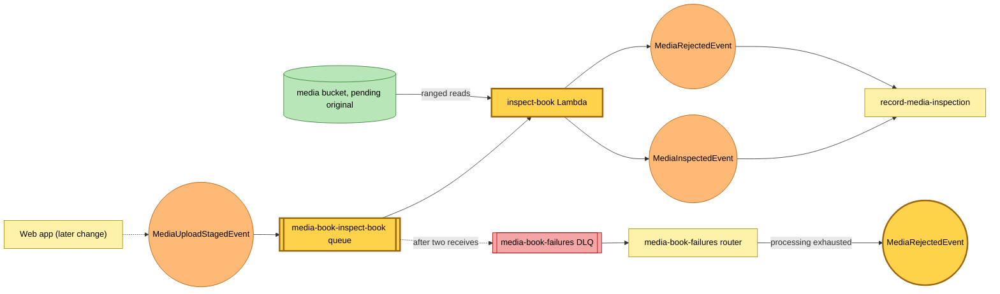

# A staged book is inspected with ranged reads

Snapshot of the uncommitted working tree over `615c1094a` (detached, on top of `main`), whose subject is **wip s04-c9**. Generated 2026-11-06.

The media-book stack gains an inspector for an upload that has been staged but not yet committed. It reads only the EPUB's end record, its central directory and a few small entries from the stored original, never the whole file, and publishes the verdict the session consumer from the previous snapshot records. Nothing publishes `MediaUploadStagedEvent` yet, so the new rule matches nothing until the logged-out upload lands.

- **`media-book-inspect-book` queue and Lambda.** An EventBridge rule routes `MediaUploadStagedEvent` for books to an SQS queue (240-second visibility, two receives, batch size 1). The Lambda (1024 MB, 120-second timeout) reads byte ranges of the pending original under the ETag the event carries, so a replaced or deleted original is refused as gone. It publishes `MediaInspectedEvent` with the book's title, authors and section titles, or `MediaRejectedEvent` with a reason and notice for a DRM-locked book, a file that is not an EPUB, or bytes that are gone. It holds read access to the pending prefix only.
- **Shared media-book dead-letter queue.** The inspector's exhausted messages land in the existing `media-book-failures` dead-letter queue. Its router gains an inspect-book route that publishes `MediaRejectedEvent` with the processing-exhausted reason, so a poison file ends on a refusal rather than a page that keeps polling.

No table, bucket or existing rule changes. Deploying creates one Lambda, one queue, one rule and a queue policy.

---

## Legend

Amber marks what this change adds. Everything else is existing infrastructure shown for context.

[BPMN image](diagrams-bpmn/legend.png) · [Editable BPMN](diagrams-bpmn/legend.bpmn)

Mermaid source

---

## Inspecting a staged book

The dashed line from the web app is the staging publish, which a later change turns on.

[BPMN image](diagrams-bpmn/inspect-book.png) · [Editable BPMN](diagrams-bpmn/inspect-book.bpmn)

Mermaid source

