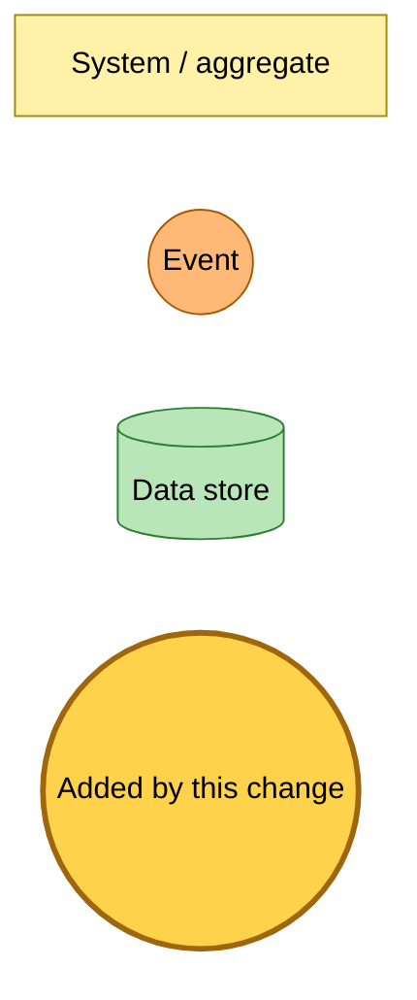
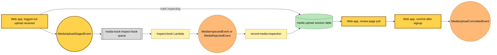

# A logged-out book upload is staged for review

Snapshot of the uncommitted working tree over `be1020cea` (detached, on top of `main`), whose subject is **wip s03-c4**. Generated 2026-11-06.

The web app now publishes `MediaUploadStagedEvent`. A visitor who is not signed in can upload a book. When the upload is received, the web app marks the session inspecting and publishes the staged event. The media-book inspector from the previous snapshot then reads the book. The review page polls the session until it records the verdict. The book is saved to a queue only after the visitor signs up and commits the review. That commit publishes `MediaUploadCommittedEvent`, just as a signed-in upload does.

- **Staging publish turned on.** A received upload from a logged-out session marks the session inspecting and publishes `MediaUploadStagedEvent` with the upload id, kind, media type, file name, size, ETag and staged time. A second `received` on a session that is already inspecting publishes nothing. A signed-in upload still commits directly and publishes `MediaUploadCommittedEvent`.
- **Commit after signup.** The anonymous review's commit route claims the session for the signed-in reader, saves the item and publishes `MediaUploadCommittedEvent` once.

No queue, rule, Lambda, table or bucket changes. The web app already publishes to the event bus, so deploying changes only its code.

---

## Legend

Amber marks what this change adds. Everything else is existing infrastructure shown for context.

[BPMN image](diagrams-bpmn/legend.png) · [Editable BPMN](diagrams-bpmn/legend.bpmn)

Mermaid source

---

## Staging a logged-out book for review

[BPMN image](diagrams-bpmn/stage-for-review.png) · [Editable BPMN](diagrams-bpmn/stage-for-review.bpmn)

Mermaid source

