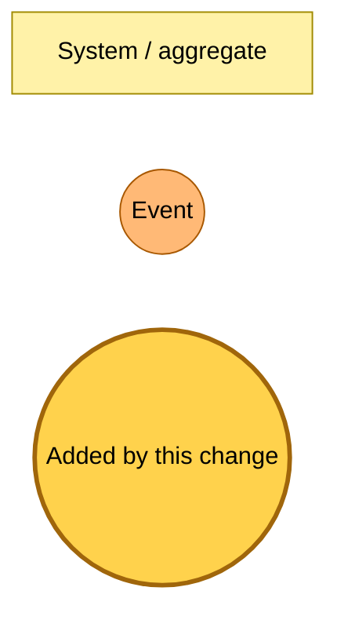
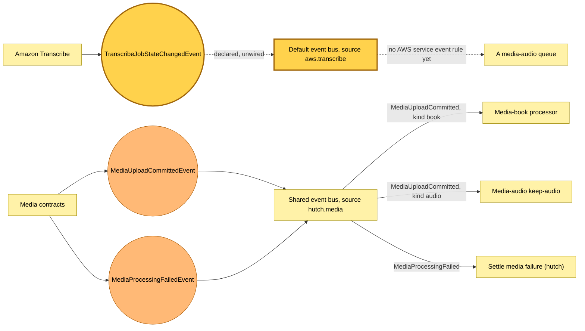

# The Transcribe job event, the media image repository and the transcripts lifecycle are declared

Snapshot of the uncommitted working tree over `d1626d358`, a local series over `07fbd301c` (`main`), whose 2026-11-06 subject is **fix(hutch): shrink the EPUB image budget as the body grows**. Generated 2026-11-06.

The shared event catalogue gains its first AWS-owned event, and the shared components gain a rule that subscribes a queue to an AWS service event on the default bus. Nothing uses either yet, so no rule is created and the buses route nothing new. The platform stack gains an image repository and a lifecycle rule that nothing writes to yet.

- **`TranscribeJobStateChangedEvent`.** Declares Amazon Transcribe's job state change (`aws.transcribe`, `Transcribe Job State Change`) with the job name and a `COMPLETED` or `FAILED` status. AWS publishes it to the account's default bus, not to the shared Readplace bus.
- **`AwsServiceEventRule`.** A rule on the default bus (it names no bus) that sends the matched event to a queue, sends failed deliveries to that queue's dead-letter queue, and lets only that rule write to the queue and to its own dead-letter queue.
- **`hutch-media-lambda` image repository.** An ECR repository on the platform stack, named by `platform:mediaLambdaRepositoryName`, keeping the last 200 images.
- **`transcripts/` lifecycle.** The media bucket's lifecycle gains a 14-day expiry on `transcripts/`, beside the 2-day expiry on `pending/`.

The media-audio dead-letter names gain prepare-transcription and render-transcript sources and their queue names. No Pulumi program reads them yet. Every Lambda bundle that imports the catalogue carries the new schema, so a deploy updates Lambda code in place.

---

## Legend

Amber marks what this change adds. Everything else is existing infrastructure shown for context.

[BPMN image](diagrams-bpmn/legend.png) · [Editable BPMN](diagrams-bpmn/legend.bpmn)

Mermaid source

---

## Declared events

The Transcribe event is declared and unwired: the dashed line shows the default bus it will arrive on once a later change subscribes a queue with the AWS service event rule. The media events on the shared bus are unchanged.

[BPMN image](diagrams-bpmn/declared-events.png) · [Editable BPMN](diagrams-bpmn/declared-events.bpmn)

Mermaid source

---

## Command → System → Event(s) reference

| Command or event | Detail | System | Emits | Triggers next |
|---|---|---|---|---|
| `TranscribeJobStateChangedEvent` | `TranscriptionJobName`, `TranscriptionJobStatus` (`COMPLETED` or `FAILED`) | Amazon Transcribe, on the default bus | nothing | none; no rule subscribes |
| `MediaUploadCommittedEvent` | unchanged | media-book processor, media-audio keep-audio | `TierContentExtracted` or `MediaProcessingFailedEvent` | unchanged |
| `MediaProcessingFailedEvent` | unchanged | settle-media-failure | nothing | unchanged |
