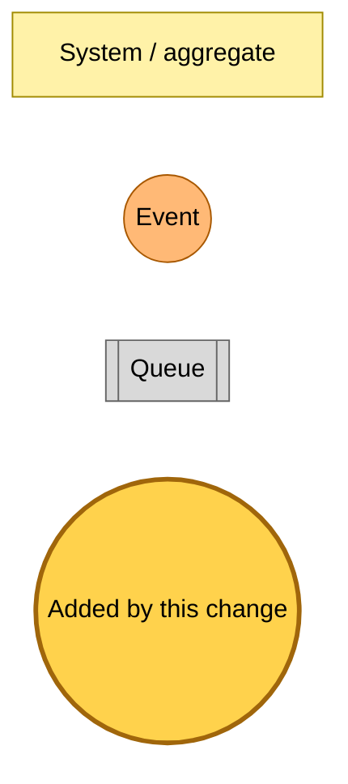
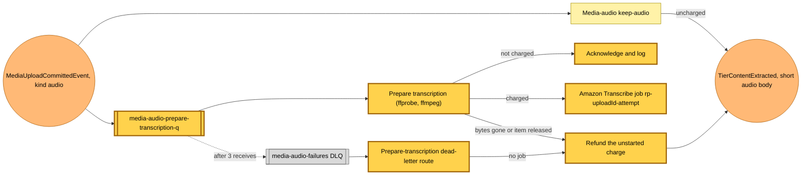

# A charged audio upload is prepared for transcription

Snapshot of the uncommitted working tree over `4317b82ab`, a local series over `07fbd301c` (`main`), whose 2026-11-06 subject is **fix(hutch): shrink the EPUB image budget as the body grows**. Generated 2026-11-06.

The media-audio deployable gains a container image with ffmpeg and a second subscriber to `MediaUploadCommitted` (kind audio). Nothing publishes a charged upload yet: the charge fields arrive with a later change, so today the new Lambda acknowledges and logs every event.

- **`media-audio-prepare-transcription` queue and Lambda.** A container image Lambda (1769 MB, 600 s, 2 GB of `/tmp`) behind its own queue, with three receives before the shared media-audio dead-letter queue. For a charged upload it reads the staged original through a presigned GET pinned to its ETag, probes it with ffprobe, trims it with ffmpeg to the charged seconds, writes the input file and a job request under `transcripts/<uploadId>/`, marks the charge started and starts an Amazon Transcribe job named `rp-<uploadId>-<attempt>`.
- **Refund paths.** Staged bytes that are gone, or an item released before the job starts, refund the unstarted charge. A refund that closes writes the short keep-audio body, so the reader still has the file's length.
- **keep-audio.** A charged upload keeps its audio and enclosure and stops before writing the body, since the transcript will replace it. The short body writer is shared with the new paths.
- **Dead-letter route.** The media-audio failures router gains a prepare-transcription route: if Transcribe holds no job for the attempt, it refunds the charge and writes the short body from the job request, or deletes the attempt's files when the item is gone.

---

## Legend

Amber marks what this change adds. Everything else is existing infrastructure shown for context.

[BPMN image](diagrams-bpmn/legend.png) · [Editable BPMN](diagrams-bpmn/legend.bpmn)

Mermaid source

---

## Prepare transcription

[BPMN image](diagrams-bpmn/prepare-transcription.png) · [Editable BPMN](diagrams-bpmn/prepare-transcription.bpmn)

Mermaid source

---

## Command → System → Event(s) reference

| Command or event | Detail | System | Emits | Triggers next |
|---|---|---|---|---|
| `MediaUploadCommittedEvent` (kind audio) | unchanged; a charged one will carry `chargedSeconds` and `chargedDay` | keep-audio, prepare-transcription | `TierContentExtracted` for an uncharged upload; a Transcribe job for a charged one | Transcribe's job state change, not yet subscribed |
| prepare-transcription dead letter | the committed event | media-audio failures router | `TierContentExtracted` after a refund | none |
