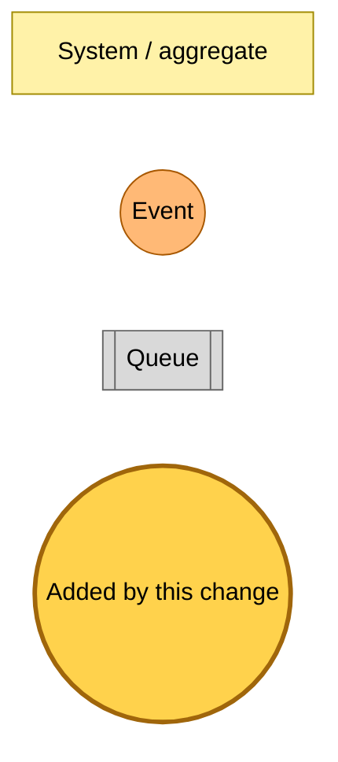
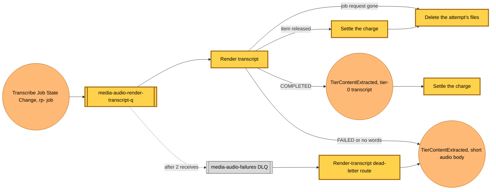

# A finished transcription job becomes the audio item's transcript

Snapshot of the uncommitted working tree over `b56db4115`, a local series on `main`. Generated 2026-11-06.

The media-audio deployable gains a subscriber to Amazon Transcribe's job state changes. No charged upload is published yet, so no `rp-` job runs and the new Lambda receives nothing until the charge fields arrive.

- **`media-audio-render-transcript` rule, queue and Lambda.** An EventBridge rule on the default bus matches `Transcribe Job State Change` for jobs named `rp-…` that ended `COMPLETED` or `FAILED`, and feeds its own queue (two receives before the shared media-audio dead-letter queue). The zip Lambda (1024 MB, 120 s) handles one record at a time.
- **Release check first.** With the job request gone it deletes the attempt's files. With the item gone or released it settles the charge, then deletes the files.
- **COMPLETED.** It reads Transcribe's output, renders paragraphs with seek links and a timestamp heading every five minutes, writes a tier-0 source (site name "Audio", read time from the duration), publishes `TierContentExtracted` and settles the charge. A transcript with no words writes the short audio body instead, then settles.
- **FAILED.** It writes the short audio body and leaves the charge alone.
- **Dead-letter route.** The failures router gains a render-transcript route: after the same release check it writes the short body so the item stays playable, then settles.

---

## Legend

Amber marks what this change adds. Everything else is existing infrastructure shown for context.

[BPMN image](diagrams-bpmn/legend.png) · [Editable BPMN](diagrams-bpmn/legend.bpmn)

Mermaid source

---

## Render transcript

[BPMN image](diagrams-bpmn/render-transcript.png) · [Editable BPMN](diagrams-bpmn/render-transcript.bpmn)

Mermaid source

---

## Command → System → Event(s) reference

| Command or event | Detail | System | Emits | Triggers next |
|---|---|---|---|---|
| `Transcribe Job State Change` | `COMPLETED` or `FAILED`, job name `rp-<uploadId>-<attempt>` | render-transcript | `TierContentExtracted` with the transcript, or the short audio body | content selection, which serves the transcript as first content |
| render-transcript dead letter | the job state change | media-audio failures router | `TierContentExtracted` with the short audio body | none |
