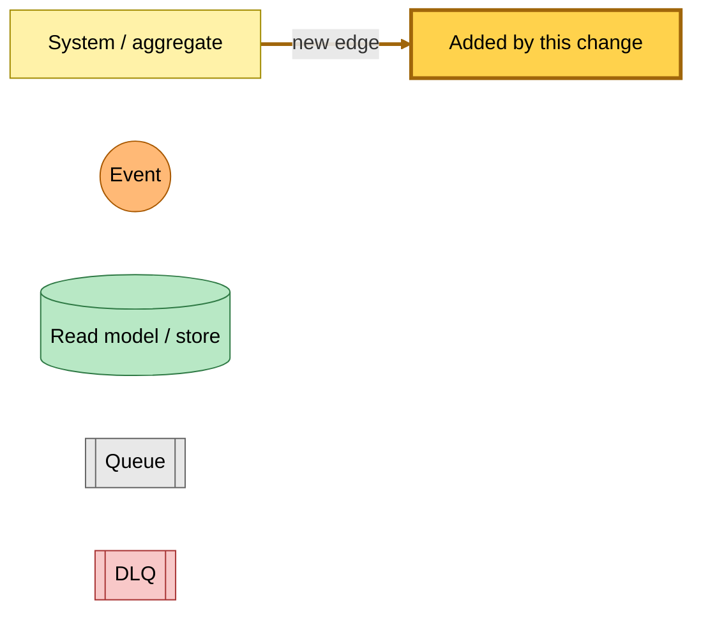
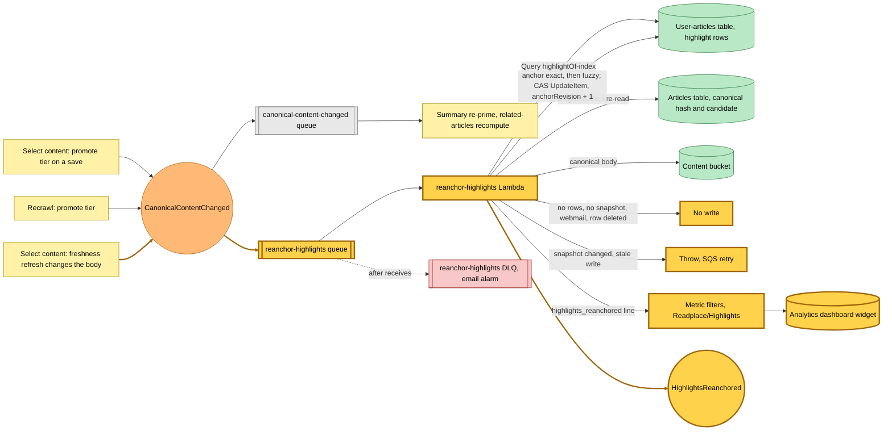

# Highlights are re-anchored when an article's canonical text changes

Snapshot of the uncommitted working tree over `f173b0b0a`, a local series on `main`. Generated 2026-11-07.

A new hutch Lambda, `reanchor-highlights`, subscribes to `CanonicalContentChanged` and anchors every reader's highlights of that URL against the new canonical text, so a recrawl or a freshness refresh no longer leaves marks pointing at text that moved.

- **Wider publisher.** `CanonicalContentChanged` was published by tier promotion on a save and on a recrawl. A freshness refresh that changes the canonical body, or revokes its candidate, now publishes it too, in place of queueing the summary directly. The existing save-link subscriber (summary re-prime, related-articles recompute) therefore also runs on such a refresh.
- **New subscriber.** The event feeds the `reanchor-highlights` queue (its own dead-letter queue with an email alarm) and Lambda, batch size one.
- **Consistent read.** The Lambda lists every highlight of the URL through the user-articles table's new `highlightOf-index`, reads the canonical snapshot (content hash and candidate id) from the articles table, reads the body from the content bucket only, then reads the snapshot again; a change between the two reads throws and SQS retries.
- **Anchoring.** The body is turned into the same text the reader marks, and each highlight is anchored exact first, then fuzzy. A row already on both the hash and the candidate gets no write. A passage that changed too much stays orphaned, keeping its order.
- **Compare-and-swap write.** Each row is written with a condition on its `anchorRevision`, which the write bumps; the bump changes the owner reader's article version, so the next open revalidates onto the new marks. A row deleted meanwhile is skipped; a row another write won throws, and redelivery re-reads the rows.
- **Skips.** No highlights, a legacy body with no canonical snapshot (one log line), and a webmail URL each end with no write.
- **Reporting.** Each run with highlights logs one `highlights_reanchored` line (anchored, moved, orphaned, skipped), which three metric filters turn into `Readplace/Highlights` counts on a new analytics-dashboard widget, and publishes `HighlightsReanchored`, which nothing subscribes to yet.

---

## Legend

Gold marks what this change adds, and the thick gold arrows are the two new event edges. Everything else is existing infrastructure shown for context.

[BPMN image](diagrams-bpmn/legend.png) · [Editable BPMN](diagrams-bpmn/legend.bpmn)

Mermaid source

---

## Re-anchor highlights

[BPMN image](diagrams-bpmn/reanchor-highlights.png) · [Editable BPMN](diagrams-bpmn/reanchor-highlights.bpmn)

Mermaid source

---

## Command → System → Event(s) reference

| Command or event | Detail | System | Emits | Triggers next |
|---|---|---|---|---|
| Tier promotion on a save or a recrawl | the canonical body changes | select-content, recrawl | `CanonicalContentChanged` | summary re-prime, related articles, re-anchor |
| Freshness refresh | the body hash changed or the candidate was revoked; new publisher | select-content, refresh mode | `CanonicalContentChanged` (was a direct summary command) | summary re-prime, related articles, re-anchor |
| `CanonicalContentChanged` | `{url}` | save-link canonical-content-changed | summary pending, related-articles pass | `GenerateSummary`, related-articles compute |
| `CanonicalContentChanged` | `{url}`; new subscriber | reanchor-highlights | each changed row written with `anchorRevision + 1`; `highlights_reanchored` log line | `HighlightsReanchored` |
| reanchor-highlights, nothing to do | no highlight rows, no canonical snapshot (one log line), webmail URL | reanchor-highlights | none | none |
| reanchor-highlights, race | the snapshot changed between reads, or a row's revision moved | reanchor-highlights | none; throws | SQS retry, then the DLQ and its email alarm |
| reanchor-highlights, row deleted | the conditional write finds no row | reanchor-highlights | counted as skipped | none |
| `HighlightsReanchored` | `{url, anchored, moved, orphaned}` | none yet | — | — |
