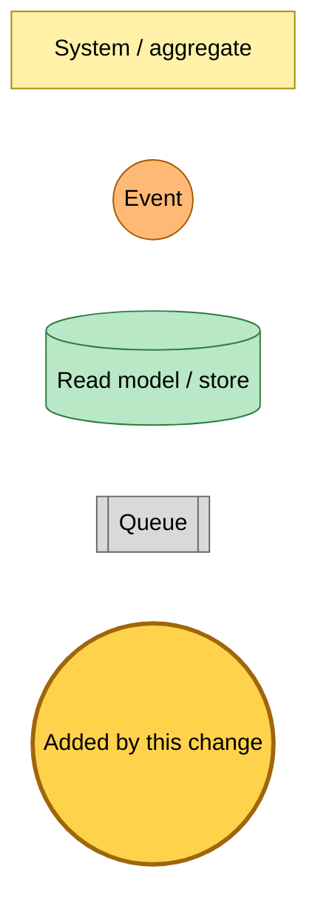
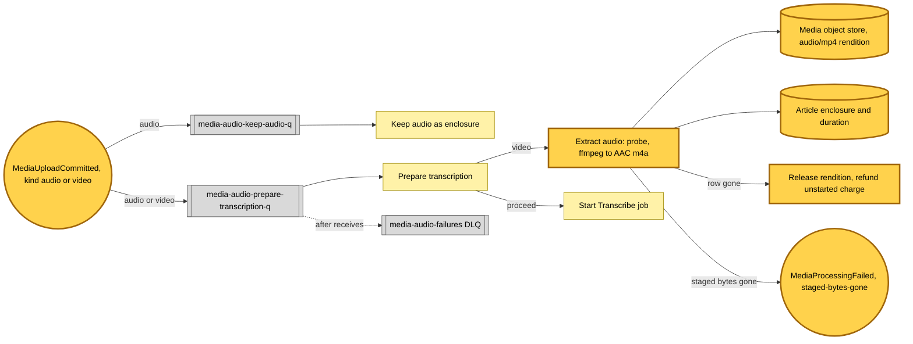

# An uploaded video's audio is extracted before transcription

Snapshot of the uncommitted working tree over `283394bb7`, a local series on `main`. Generated 2026-11-07.

The media-audio prepare-transcription Lambda now accepts video uploads as well as audio. No video upload is committed yet, so the video pre-step runs on nothing until uploads accept MP4.

- **Widened subscription.** The prepare-transcription rule matches `MediaUploadCommitted` for both `audio` and `video`. Keep-audio still subscribes to `audio` only, so a video's original is never kept as the enclosure.
- **Per-kind pre-step.** Before the charge is marked started, an audio upload proceeds as before. A video upload probes the staged file, rejects one with no audio stream, and runs ffmpeg into a mono AAC `.m4a` rendition (copied when the source is already AAC).
- **Rendition as enclosure.** The rendition is hashed and referenced in the media object store as `audio/mp4`, its duration is probed, and the article's enclosure is recorded. The temporary file is always removed.
- **Gone paths.** When the article row is gone the rendition is released and the unstarted charge refunded. When the staged bytes are gone the charge is refunded and `MediaProcessingFailed` (`staged-bytes-gone`) is published. A dequeued item now also releases every object its upload holds.

---

## Legend

Amber marks what this change adds. Everything else is existing infrastructure shown for context.

[BPMN image](diagrams-bpmn/legend.png) · [Editable BPMN](diagrams-bpmn/legend.bpmn)

Mermaid source

---

## Extract audio

[BPMN image](diagrams-bpmn/extract-audio.png) · [Editable BPMN](diagrams-bpmn/extract-audio.bpmn)

Mermaid source

---

## Command → System → Event(s) reference

| Command or event | Detail | System | Emits | Triggers next |
|---|---|---|---|---|
| `MediaUploadCommitted` | kind `audio` | keep-audio and prepare-transcription | enclosure recorded; Transcribe job started | Transcribe Job State Change |
| `MediaUploadCommitted` | kind `video` | prepare-transcription, extract-audio pre-step | AAC rendition recorded as the enclosure; Transcribe job started | Transcribe Job State Change |
| extract-audio, row gone | the article row was deleted | prepare-transcription | none; rendition released, charge refunded | none |
| extract-audio, staged bytes gone | the staged upload expired | prepare-transcription | `MediaProcessingFailed` with `staged-bytes-gone` | the failure notice on the item |
