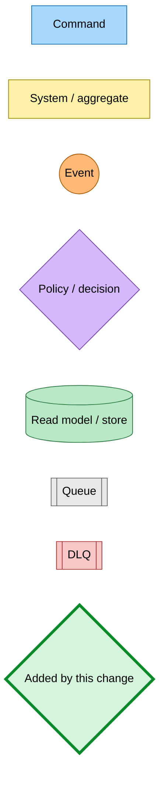
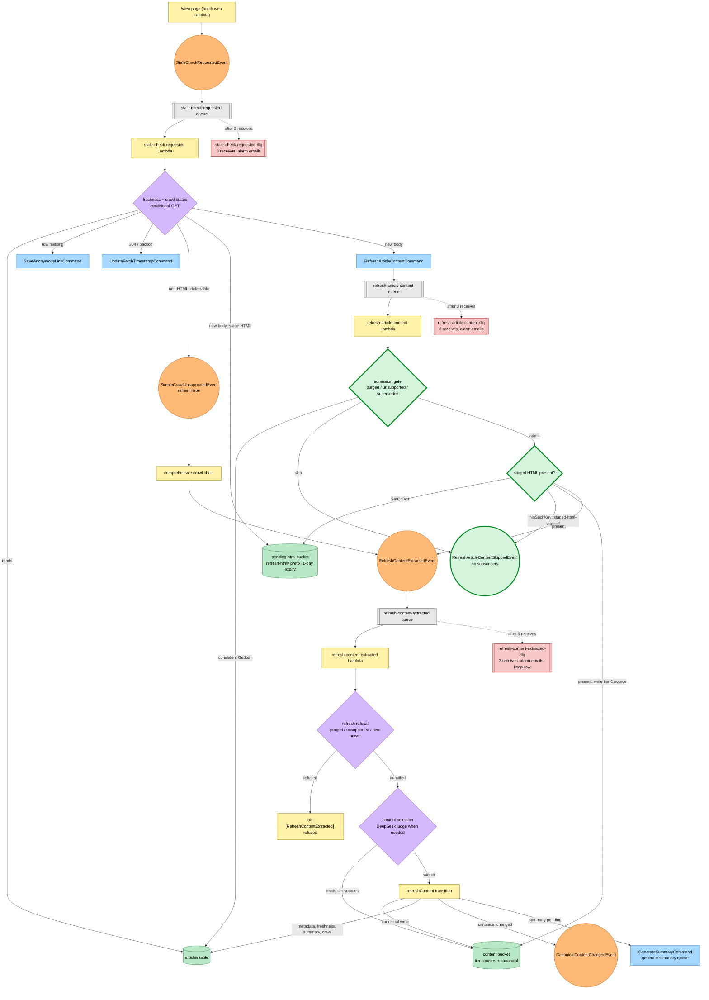
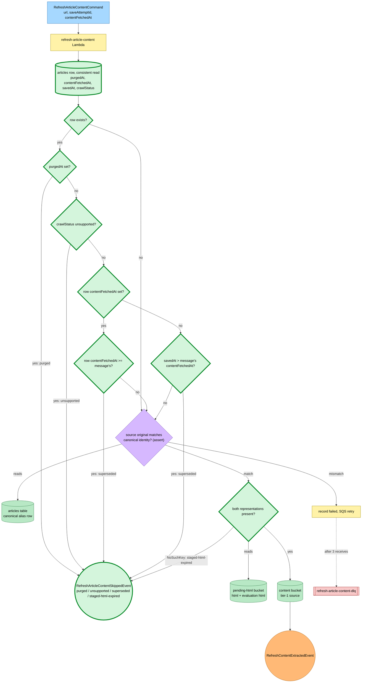

# A stale article's refresh is admitted only while it still applies

Snapshot of the uncommitted working tree over `3c82796c8` (`main`), whose 2026-11-08 subject is **fix(save-link): refuse a redriven refresh when the article row has moved on**. Generated 2026-11-08. The admission gate and the new skipped event are uncommitted and not deployed.

A reader opening `/view` on a saved article publishes `StaleCheckRequestedEvent`. The stale-check Lambda decides whether the row is due for a refresh; when the conditional GET returns a new body, it stages the fetched HTML (and its evaluation representation) under the `refresh-html/` prefix of the pending-HTML bucket and publishes `RefreshArticleContentCommand`. The refresh-article-content Lambda writes that HTML as a tier-1 source and publishes `RefreshContentExtractedEvent`, and the refresh-content-extracted Lambda runs content selection across every tier source and commits the winner through the `refreshContent` transition.

- **Stale-check outcomes.** A missing row republishes `SaveAnonymousLinkCommand`. A row inside its TTL, in a terminal crawl state, still on its first save, or answering 404 is a no-op. An unresolved identity, a failed or blocked fetch, or a terminally unsupported body publishes `UpdateFetchTimestampCommand` as a backoff, as does a 304 (`unchanged`). A deferrable non-HTML body marks the stage `comprehensive-fetching` and emits `SimpleCrawlUnsupportedEvent` with `refresh=true`; the comprehensive crawl then publishes `RefreshContentExtractedEvent` itself. A new HTML body publishes `RefreshArticleContentCommand`.
- **New: admission gate.** Before touching S3, the refresh-article-content handler reads the article row with a consistent `GetItem` projecting `purgedAt`, `contentFetchedAt`, `savedAt` and `crawlStatus`, and skips the message when the row is **purged**, **unsupported**, or **superseded** — the row's `contentFetchedAt` is at or after the message's, or the row has no fetch clock and its `savedAt` is later than the message's. A missing row is admitted.
- **New: staged HTML expired.** The pending-HTML bucket expires staged objects after a day, so a late redrive can find them gone. A `NoSuchKey` on either representation now returns `undefined` and the handler skips with `staged-html-expired` instead of failing the record.
- **New: `RefreshArticleContentSkippedEvent`.** Every skip publishes `refresh-article-content-skipped` with the URL, attempt id, the message's `contentFetchedAt` and the reason, and logs `[RefreshArticleContent] skipped`. Nothing subscribes to it yet.
- **Admitted.** The handler resolves the original URL through the canonical alias row, asserts the message's source original still has the article's identity, writes the tier-1 source to the content bucket and publishes `RefreshContentExtractedEvent`.
- **Refusal at commit.** The refresh-content-extracted consumer loads the aggregate and refuses a purged row, an unsupported row, or a row whose fetch clock (or `savedAt`) is newer than the event (`row-newer`), logging `[RefreshContentExtracted] refused` with no write and no judge call. Otherwise selection runs and `refreshContent` writes metadata and freshness, re-primes the summary and publishes `CanonicalContentChangedEvent` when the canonical body changed, flips a failed crawl to ready, and records a crawl version.
- **Dead letters.** Each of the three queues dead-letters into its own `-dlq` after three receives and its alarm emails the alert address. None marks the row: stale-check and refresh-article-content have no row mutator, and refresh-content-extracted uses `keep-row`, so the reader keeps the current content and a redrive is safe at any time.

No Pulumi change: the refresh-article-content Lambda already had `GetItem` on the articles table and its table name, for the canonical alias read.

---

## Legend

Thick green marks what the uncommitted change adds: the admission gate and the new skipped event. Everything else is existing infrastructure shown for context.

[BPMN image](diagrams-bpmn/legend.png) · [Editable BPMN](diagrams-bpmn/legend.bpmn)

Mermaid source

---

## The refresh flow end to end

[BPMN image](diagrams-bpmn/refresh-flow.png) · [Editable BPMN](diagrams-bpmn/refresh-flow.bpmn)

Mermaid source

---

## The refresh-article-content admission

[BPMN image](diagrams-bpmn/refresh-admission.png) · [Editable BPMN](diagrams-bpmn/refresh-admission.bpmn)

Mermaid source

---

## Command → System → Event(s) reference

| Command / event | Handled by | Emits | Next command(s) |
|---|---|---|---|
| `StaleCheckRequestedEvent` (from the `/view` page) | stale-check-requested Lambda via its queue (own DLQ, no row mutator) | `RefreshArticleContentCommand`, `UpdateFetchTimestampCommand`, `SaveAnonymousLinkCommand`, `SimpleCrawlUnsupportedEvent` (`refresh=true`), or nothing | as emitted |
| `RefreshArticleContentCommand` | refresh-article-content Lambda via its queue (own DLQ, no row mutator) | **New:** `RefreshArticleContentSkippedEvent` on purged, unsupported, superseded or staged-html-expired; otherwise `RefreshContentExtractedEvent` after writing the tier-1 source | none on skip |
| `RefreshArticleContentSkippedEvent` (**new**) | nothing subscribes | none | none |
| `SimpleCrawlUnsupportedEvent` with `refresh=true` | policy → comprehensive crawl chain | `RefreshContentExtractedEvent` | as below |
| `RefreshContentExtractedEvent` | refresh-content-extracted Lambda via its queue (own DLQ, `keep-row`) | nothing on refusal (`[RefreshContentExtracted] refused`); on commit, `CanonicalContentChangedEvent` when the canonical body changed | `GenerateSummaryCommand` when the summary is re-primed |
| `CanonicalContentChangedEvent` | canonical-content-changed, compute-related-articles and reanchor-highlights consumers | (outside this snapshot) | (outside this snapshot) |
| `UpdateFetchTimestampCommand` | update-fetch-timestamp Lambda | none (advances the row's freshness clock) | none |
| `SaveAnonymousLinkCommand` | save-anonymous-link pipeline | (outside this snapshot) | (outside this snapshot) |
