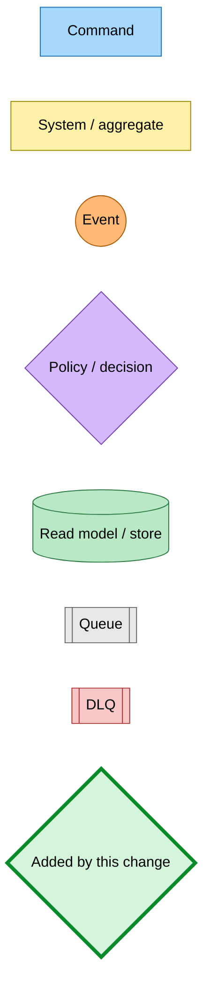
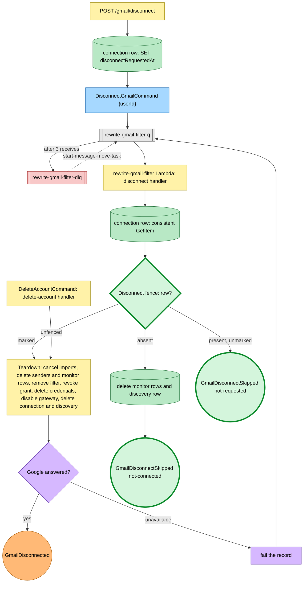
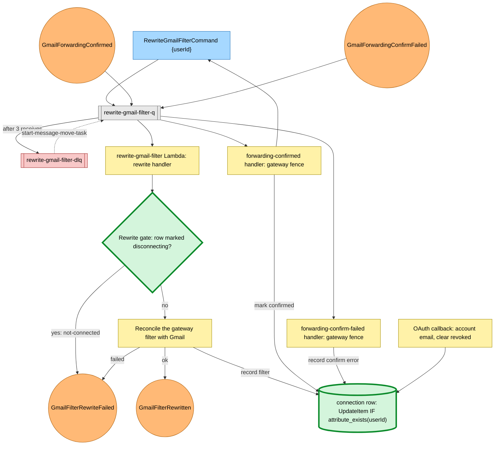

# A Gmail disconnect or filter rewrite is safe to redrive from rewrite-gmail-filter-dlq

Snapshot of the uncommitted working tree over `53aa82e77` (`main`), whose 2026-11-08 subject is **fix(hutch,@packages/infra-components): send a redriven data export only to a live account, once**. Generated 2026-11-08. The disconnect fence, the rewrite gate, the conditional connection writes and the new skipped event are uncommitted and not deployed.

`POST /gmail/disconnect` marks the reader's connection row with `disconnectRequestedAt` and then publishes `DisconnectGmailCommand`, whose detail is only `userId`. The web app and the forwarding-confirmed handler publish `RewriteGmailFilterCommand`, and Google's forwarding confirmation publishes `GmailForwardingConfirmed` or `GmailForwardingConfirmFailed`. All four route by detail type into the one `rewrite-gmail-filter-q` queue (batch size 1, three receives, then `rewrite-gmail-filter-dlq`), and the rewrite-gmail-filter Lambda dispatches each to its handler. A redrive moves all four kinds together and in no order.

- **New: the disconnect fence.** Before the teardown runs, the disconnect handler reads the connection row once. A missing row means a teardown already finished or the reader never connected: the fence deletes the mailbox's monitor rows and discovery row and answers `not-connected`, without calling the teardown. A row with no `disconnectRequestedAt` is a connection nobody asked to tear down (the reader reconnected after an old request, or the grant was revoked without a disconnect): the fence answers `not-requested` and makes no write and no Google call. Only a marked row reaches the teardown.
- **Changed: the teardown's outcome.** A marked row is torn down as before: history imports cancelled, senders and monitor rows deleted, the Gmail filter removed, the grant revoked at Google, credentials deleted, the gateway address disabled, the connection and discovery rows deleted, then `GmailDisconnected`. Google being unavailable still fails the record for a retry with no fact.
- **New: `GmailDisconnectSkipped`.** The two refusals publish `GmailDisconnectSkipped` with `reason` `not-connected` or `not-requested`, and log `[disconnect-gmail] nothing to disconnect` with the reason. Before this change the absent arm published nothing.
- **New: the rewrite gate.** A `RewriteGmailFilterCommand` for a row that carries `disconnectRequestedAt` answers `not-connected` without calling Gmail, so a redriven rewrite does not recreate a filter the teardown owns; it publishes `GmailFilterRewriteFailed{not-connected}`, which is not metered. Otherwise the existing reconciliation runs. The teardown's own filter removal is not gated, because it must run on a marked row.
- **Changed: connection writes never recreate a deleted row.** The connection store's forwarding-confirmed, confirm-error, account-email, filter, clear-filter, filter-error, revoked and clear-revoked writes now carry `attribute_exists(userId)`. A write that lands after a teardown deleted the row writes nothing instead of creating a row without its gateway address. Clearing the revoked mark still answers with the reconnect time it computed.
- **Account deletion is unchanged.** It calls the teardown directly, unfenced, on a row that is not marked.

No Pulumi change: the Lambda already had `PutEvents` on the bus and `UpdateItem` on the connections table. `GmailDisconnectSkipped` has no subscriber.

---

## Legend

Thick green marks what the uncommitted change adds or changes. Everything else is existing infrastructure shown for context.

[BPMN image](diagrams-bpmn/legend.png) · [Editable BPMN](diagrams-bpmn/legend.bpmn)

Mermaid source

---

## Disconnect on the shared queue

[BPMN image](diagrams-bpmn/disconnect-flow.png) · [Editable BPMN](diagrams-bpmn/disconnect-flow.bpmn)

Mermaid source

---

## Filter rewrite and forwarding confirmation on the shared queue

[BPMN image](diagrams-bpmn/rewrite-flow.png) · [Editable BPMN](diagrams-bpmn/rewrite-flow.bpmn)

Mermaid source

---

## Command → System → Event(s) reference

| Command / event | System | Emits | Triggers next |
|---|---|---|---|
| `DisconnectGmailCommand` (`userId`) | rewrite-gmail-filter Lambda, disconnect handler behind the **disconnect fence**, via `rewrite-gmail-filter-q` | `GmailDisconnected` for a marked row, or **`GmailDisconnectSkipped`** | Nothing: neither event has a subscriber |
| `RewriteGmailFilterCommand` (`userId`) | rewrite-gmail-filter Lambda, rewrite handler behind the **rewrite gate**, via `rewrite-gmail-filter-q` | `GmailFilterRewritten` or `GmailFilterRewriteFailed` (a marked row gives `not-connected`) | Nothing |
| `GmailForwardingConfirmed` | forwarding-confirmed handler, gateway fence; marks the row confirmed with a conditional write | `RewriteGmailFilterCommand` | The rewrite handler |
| `GmailForwardingConfirmFailed` | forwarding-confirm-failed handler, gateway fence; records the error with a conditional write | — | — |
| `GmailDisconnected` (`userId`, `filterRemoved`, `grantRevoked`) | Published after a marked row's teardown | — | — |
| **`GmailDisconnectSkipped`** (`userId`, `reason`: `not-connected`, `not-requested`) | Published when the fence refuses | — | — |
| `DeleteAccountCommand` (`userId`) | user-data-jobs Lambda; calls the teardown directly, unfenced | Unchanged | Unchanged |
