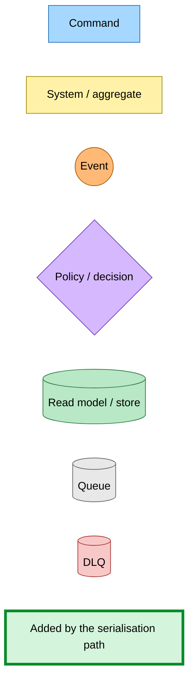
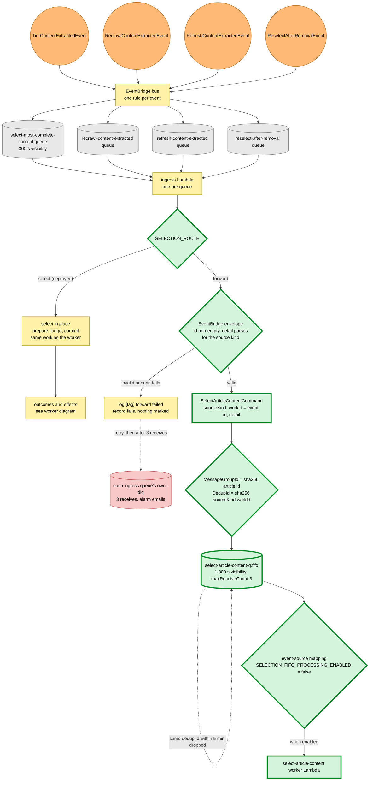
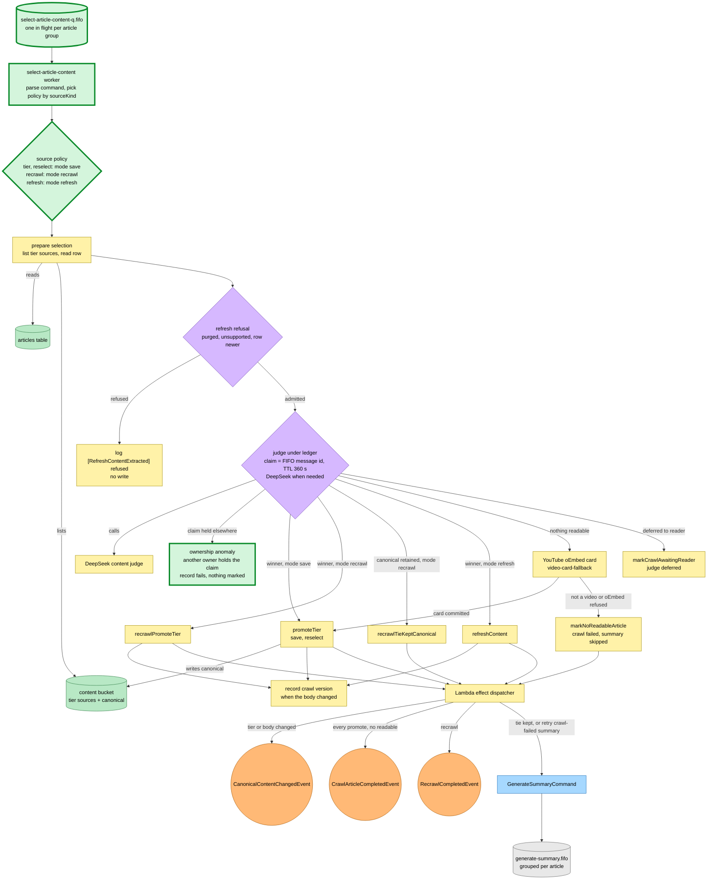
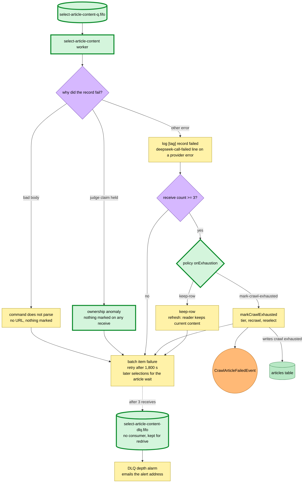

# Content selection is serialised per article through one FIFO queue

Snapshot of the uncommitted working tree over `8b4a5bb9d` (`work-tmp`, recorded for branch `rp/optimistic-fermat-y7zhyn`), whose 2026-11-08 subject is **Merge remote-tracking branch 'origin/main' into work-tmp**. Generated 2026-11-08. The serialisation path (command, FIFO queue, worker Lambda, route switch) is at the base commit; the uncommitted change makes the forward route take its work id from the ingress EventBridge event id, validated, instead of the ingress SQS message id, and parses `SELECTION_ROUTE` through a schema. Nothing on the new path runs in production yet: every ingress Lambda is deployed with `SELECTION_ROUTE = "select"`, and the worker's event-source mapping is disabled.

Four facts ask for content selection on an article: `TierContentExtractedEvent` (a save or tier-0 capture wrote a tier source), `RecrawlContentExtractedEvent` (an operator recrawl), `RefreshContentExtractedEvent` (a stale-check refresh) and `ReselectAfterRemovalEvent` (a reader's capture was erased and the shared copy must be re-chosen). Each is subscribed by its own EventBridge rule onto its own standard SQS queue and Lambda: select-most-complete-content, recrawl-content-extracted, refresh-content-extracted and reselect-after-removal. Those four ran selection concurrently, so two selections for the same article could race on the row's selection snapshot and the judge's ledger.

- **New: `SelectArticleContentCommand`.** A discriminated union on `sourceKind` (`tier-content-extracted`, `recrawl-content-extracted`, `refresh-content-extracted`, `reselect-after-removal`) carrying a `workId` and the ingress event's detail, parsed by that event's own schema.
- **New: `select-article-content` FIFO queue.** Visibility 1,800 s, `maxReceiveCount` 3, its own FIFO DLQ and a depth alarm that emails the alert address. `MessageGroupId` is the sha256 of the article's resource unique id (the same grouping the generate-summary FIFO queue uses), so selections for one article run one at a time in arrival order while different articles run in parallel. `MessageDeduplicationId` is sha256(`sourceKind:workId`).
- **Two routes on each ingress Lambda.** `SELECTION_ROUTE = "select"` (deployed) keeps selecting in place exactly as before. `"forward"` parses the EventBridge envelope (`id` must be non-empty), builds the command through the source kind's policy (which validates the detail), and sends it to the FIFO queue; a malformed body or a send failure fails the ingress record, which retries on its own queue and dead-letters into its own DLQ. Nothing is marked on that path.
- **Uncommitted: work id = ingress EventBridge event id.** A re-forward of the same event (an ingress redelivery, a redrive of the ingress DLQ) now carries the same work id and so the same deduplication id, and the FIFO queue drops it inside the five-minute dedupe window. Two distinct events for the same URL with identical bodies get different ids. A reselect's `saveAttemptId` is derived from the work id, so a reselect forwarded twice judges once.
- **New: select-article-content worker Lambda.** 3,008 MB, 300 s timeout, batch size 1, `GetItem`/`UpdateItem` on the articles table, read/write on the content bucket, send on the generate-summary queues, publish on the bus. It parses the command, picks the source kind's policy, and runs the same preparation, judge and commit as the in-place route with mode `save` (tier, reselect), `recrawl` or `refresh`. Its judge claim is keyed by the FIFO message id with a 360 s TTL; a claim held by another owner raises an **ownership anomaly** instead of asserting, and a redelivery of the same FIFO message is granted its own claim back.
- **Outcomes.** `promoteTier` (save, reselect) publishes `CanonicalContentChangedEvent` when the canonical tier or body changed, otherwise dispatches generate-summary only to retry a summary failed by a crawl failure, and always publishes `CrawlArticleCompletedEvent`. `recrawlPromoteTier` publishes `CanonicalContentChangedEvent` and `RecrawlCompletedEvent`; `recrawlTieKeptCanonical` dispatches generate-summary and publishes `RecrawlCompletedEvent`. `refreshContent` publishes `CanonicalContentChangedEvent` when the body changed. Nothing readable commits `markNoReadableArticle` (crawl failed, summary skipped, `CrawlArticleCompletedEvent`) unless the original URL is a YouTube video whose oEmbed card can be committed instead; a deferred judge commits `markCrawlAwaitingReader`; a refused refresh (purged, unsupported, row newer) writes nothing. A committed body change records a crawl version. Effects leave through the Lambda effect dispatcher: events to EventBridge, generate-summary to the generate-summary FIFO queue grouped per article.
- **Failure and dead letters.** A failed record waits out the 1,800 s visibility and blocks every later selection for that article in its group. On the third receive a source kind whose policy is `mark-crawl-exhausted` (tier, recrawl, reselect) commits `markCrawlExhausted`, publishing `CrawlArticleFailedEvent`; `keep-row` (refresh) marks nothing. An ownership anomaly marks nothing on any receive, so its dead letter leaves the row `pending`. A record that fails to parse has no URL and marks nothing. After three receives the message lands in the FIFO DLQ, which nothing consumes.

Infra wiring: the FIFO queue and DLQ exist, each ingress Lambda holds `SELECTION_ROUTE` plus the FIFO queue URL and send permission, and the worker has its own own-capture-failed metric filter feeding the shared alarm topic. `SELECTION_FIFO_PROCESSING_ENABLED = false` leaves its event-source mapping disabled.

---

## Legend

Thick green marks what the serialisation path adds: the command, the FIFO queue and its DLQ, the forward route and the worker. Everything else is existing infrastructure shown for context.

[BPMN image](diagrams-bpmn/legend.png) · [Editable BPMN](diagrams-bpmn/legend.bpmn)

Mermaid source

---

## Ingress: four facts, two routes

Each ingress Lambda reads `SELECTION_ROUTE` at start. `select` is today's deployed value; `forward` sends a `SelectArticleContentCommand` to the FIFO queue, whose worker mapping is disabled.

[BPMN image](diagrams-bpmn/ingress-routes.png) · [Editable BPMN](diagrams-bpmn/ingress-routes.bpmn)

Mermaid source

---

## The worker: one selection per article at a time

[BPMN image](diagrams-bpmn/worker-outcomes.png) · [Editable BPMN](diagrams-bpmn/worker-outcomes.bpmn)

Mermaid source

---

## Failure, final receive and dead letters

[BPMN image](diagrams-bpmn/failure-dead-letters.png) · [Editable BPMN](diagrams-bpmn/failure-dead-letters.bpmn)

Mermaid source

---

## Command → System → Event(s) reference

| Command / event | System that handles it | Event(s) / effects emitted | Next command(s) triggered |
|---|---|---|---|
| `TierContentExtractedEvent` | select-most-complete-content queue + Lambda | `select`: as `promoteTier` / `markNoReadableArticle` below. `forward`: `SelectArticleContentCommand` (`tier-content-extracted`) | `SelectArticleContentCommand` on forward |
| `RecrawlContentExtractedEvent` | recrawl-content-extracted queue + Lambda | `select`: as `recrawlPromoteTier` / `recrawlTieKeptCanonical` below. `forward`: `SelectArticleContentCommand` (`recrawl-content-extracted`) | `SelectArticleContentCommand` on forward |
| `RefreshContentExtractedEvent` | refresh-content-extracted queue + Lambda | `select`: as `refreshContent` below, or a logged refusal. `forward`: `SelectArticleContentCommand` (`refresh-content-extracted`) | `SelectArticleContentCommand` on forward |
| `ReselectAfterRemovalEvent` | reselect-after-removal queue + Lambda | `select`: as `promoteTier` below. `forward`: `SelectArticleContentCommand` (`reselect-after-removal`) | `SelectArticleContentCommand` on forward |
| **`SelectArticleContentCommand`** (new) | select-article-content FIFO queue (group = article, dedup = sha256 `sourceKind:workId`) → select-article-content worker (mapping disabled) | Per mode, the transitions below | As below |
| `promoteTier` (save, reselect) | worker or in-place ingress Lambda | `CanonicalContentChangedEvent` when the tier or body changed; `CrawlArticleCompletedEvent` always | `GenerateSummaryCommand` only to retry a crawl-failed summary; `CanonicalContentChangedEvent` drives summary regeneration and highlight re-anchoring |
| `recrawlPromoteTier` | worker or in-place ingress Lambda | `CanonicalContentChangedEvent`, `RecrawlCompletedEvent` | via `CanonicalContentChangedEvent` |
| `recrawlTieKeptCanonical` | worker or in-place ingress Lambda | `RecrawlCompletedEvent` | `GenerateSummaryCommand` |
| `refreshContent` | worker or in-place ingress Lambda | `CanonicalContentChangedEvent` when the body changed | via `CanonicalContentChangedEvent` |
| `markNoReadableArticle` | worker or in-place ingress Lambda | `CrawlArticleCompletedEvent` (crawl failed, summary skipped) | — |
| `markCrawlAwaitingReader` | worker or in-place ingress Lambda | none | — |
| Refresh refusal | worker or in-place ingress Lambda | none; logs `[RefreshContentExtracted] refused` | — |
| Ownership anomaly | worker only | none; record fails, nothing marked | redelivery after 1,800 s, then FIFO DLQ |
| Final receive, `mark-crawl-exhausted` | worker or in-place ingress Lambda | `markCrawlExhausted` → `CrawlArticleFailedEvent` | — |
| Final receive, `keep-row` (refresh) | worker or in-place ingress Lambda | none | — |
| `GenerateSummaryCommand` | generate-summary FIFO queue (worker dispatch) | out of scope here | — |
| select-article-content FIFO DLQ | no consumer; depth alarm emails | — | operator redrive |
