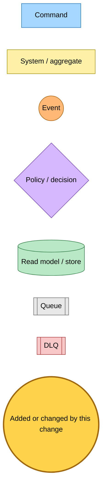
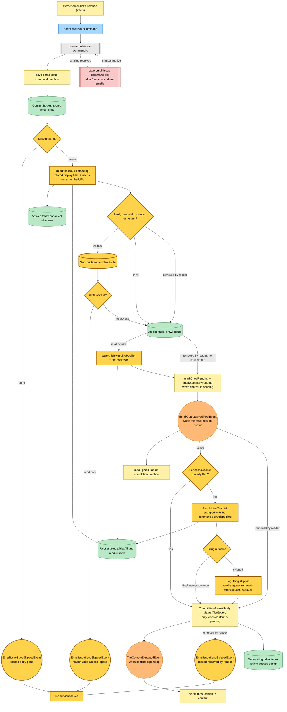

# A newsletter issue save is safe to redrive from its dead-letter queue

Snapshot of the uncommitted working tree over `9301b674b` (`main`), whose 2026-11-08 subject is **fix(save-link,inbox): redrive a dead-lettered email triage only while it still applies**. Generated 2026-11-08. Nothing here is deployed yet.

The inbox extract step publishes `SaveEmailIssueCommand` once per received newsletter. The save-email-issue-command Lambda saves the issue itself as a card in All, files it into the email's readlists, and commits the stored email body as a tier-0 candidate. Before this change the handler asserted the body was present, overwrote the card's position on every receive and filed into every readlist unconditionally, so a redrive days later could resurrect a card the reader had removed, file into a deleted readlist, or save for an account that had lost write access. The handler now reads where the issue stands before it writes.

- **Body gone.** When the stored email body no longer exists, the handler logs a warning and publishes `EmailIssueSaveSkippedEvent` (`body-gone`). Nothing is written.
- **Standing first.** The handler reads the issue's stored display URL and the user's saves for the issue URL. The issue counts as **removed by the reader** when it was saved once (it has a display URL) but no All row remains. It counts as **saved to All** when an All row exists, and it records which readlists already hold it.
- **Write access lapsed.** When the issue is neither in All nor removed, the handler reads the user's subscription. A `read-only` account gets `EmailIssueSaveSkippedEvent` (`write-access-lapsed`) and nothing is written.
- **Removed by the reader.** The card is not re-created. Crawl and summary are still marked pending when the content is pending, `EmailOutputSavedToAllEvent` still fires so a Gmail import can complete, the tier-0 body is still committed, and `EmailIssueSaveSkippedEvent` (`removed-by-reader`) is published.
- **Saved.** The All row is written while keeping an existing row's position, the display URL is set, and each readlist the issue is not already in is filed through a live-readlist check stamped with the command's envelope time. A filing that lands as `readlist-gone`, `removed-after-request` or `not-in-all` is logged as a skipped filing. No event is published for it.
- **The new event has no subscriber yet.** `EmailIssueSaveSkippedEvent` goes to the event bus and nothing consumes it.

Pulumi changes: the Lambda gains read access to the subscription-providers table and its table name, and `ConditionCheckItem` on the user-articles table.

---

## Legend

Amber marks what this change adds or changes. Everything else is existing infrastructure shown for context.

[BPMN image](diagrams-bpmn/legend.png) · [Editable BPMN](diagrams-bpmn/legend.bpmn)

Mermaid source

---

## The newsletter issue save

[BPMN image](diagrams-bpmn/save-email-issue.png) · [Editable BPMN](diagrams-bpmn/save-email-issue.bpmn)

Mermaid source

---

## Command → System → Event(s) reference

| Command or event | System | Emits | Next |
|---|---|---|---|
| `SaveEmailIssueCommand` | save-email-issue-command Lambda, via its own queue and dead-letter queue | One of the outcomes below | — |
| `SaveEmailIssueCommand`, body gone | save-email-issue-command Lambda | `EmailIssueSaveSkippedEvent` (`body-gone`) | Nothing subscribes yet |
| `SaveEmailIssueCommand`, not in All, not removed, read-only account | save-email-issue-command Lambda | `EmailIssueSaveSkippedEvent` (`write-access-lapsed`) | Nothing subscribes yet |
| `SaveEmailIssueCommand`, removed by the reader | save-email-issue-command Lambda: no card written, crawl and summary marked pending when content is pending | `EmailOutputSavedToAllEvent` when the email has an output, `TierContentExtractedEvent` when content is pending, `EmailIssueSaveSkippedEvent` (`removed-by-reader`) | Gmail import completion; content selection of the issue body |
| `SaveEmailIssueCommand`, saved | save-email-issue-command Lambda: All row kept in position, display URL set, each readlist not already holding it filed through the live-readlist check | `EmailOutputSavedToAllEvent` when the email has an output, `TierContentExtractedEvent` when content is pending; a skipped filing is a log line only | Gmail import completion; content selection of the issue body |
| `EmailOutputSavedToAllEvent` | inbox gmail-import-completion Lambda | Import completion progress | — |
| `TierContentExtractedEvent` | select-most-complete-content | Content selection outcome | Existing content pipeline |
| `EmailIssueSaveSkippedEvent` | Event bus only | — | Nothing subscribes yet |
