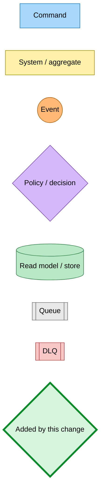
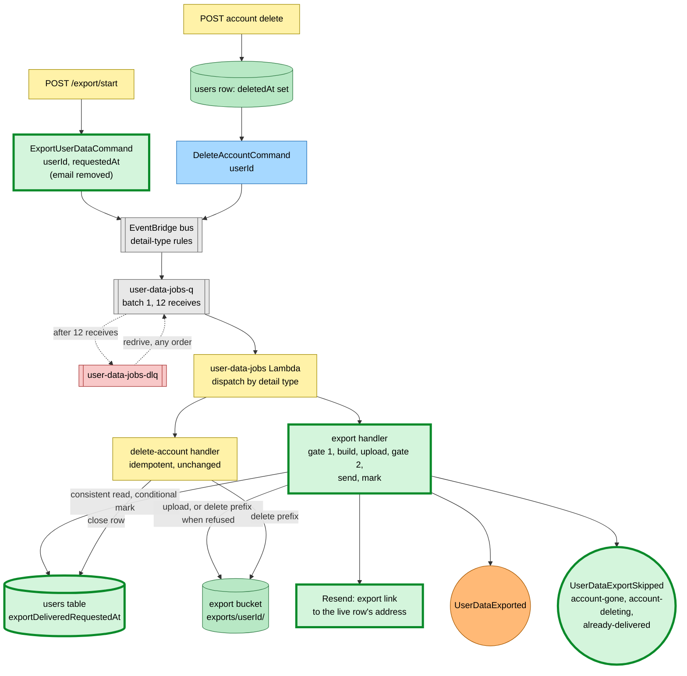
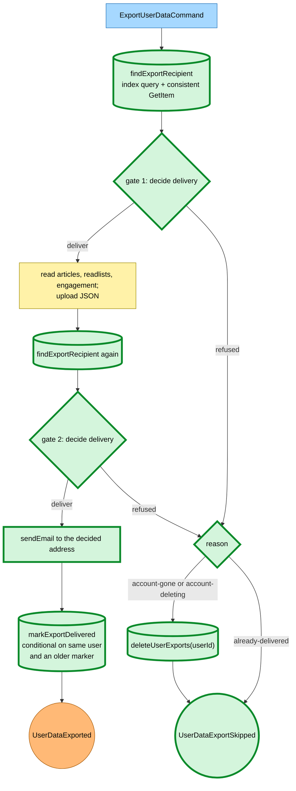

# An export job is safe to redrive from user-data-jobs-dlq

Snapshot of the uncommitted working tree over `fd4ede072` (`main`), whose 2026-11-08 subject is **fix(hutch,@packages/inbox-store): abandon a stored Gmail notice email that can no longer be sent**. Generated 2026-11-08. The export gates, the delivery marker and the new skipped event are uncommitted and not deployed.

A signed-in reader posts `/export/start`. The web route publishes `ExportUserDataCommand` carrying only `userId` and `requestedAt`; the address no longer travels on the message. The account page's delete card publishes `DeleteAccountCommand` after marking the users row `deletedAt`. Both commands route by detail type into the one `user-data-jobs-q` queue (batch size 1, twelve receives, then `user-data-jobs-dlq`), and the user-data-jobs Lambda dispatches each to its handler. A redrive moves both kinds together and in no order.

- **New: gate 1.** Before reading any article, the export handler reads the export recipient: a `userId-index` query for the address, then a consistent `GetItem` on the users row by `email`. A missing row, or a row whose `userId` differs (the address was reclaimed), is **account-gone**; a row with `deletedAt` is **account-deleting**; a row whose `exportDeliveredRequestedAt` is at or after the message's `requestedAt` is **already-delivered**. Otherwise the export is built and uploaded under `exports/<userId>/` as before.
- **New: gate 2.** After the upload, the handler reads and decides again. A delete that started during the build is caught here, and S3's strongly consistent listing means a delete that starts later finds the object.
- **New: finishing as refused.** For account-gone and account-deleting the handler removes every object under the user's export prefix, including one left by an earlier crashed attempt, then publishes `UserDataExportSkipped`. For already-delivered it only publishes, so the link already mailed keeps working. Every refusal logs `[ExportUserData] export skipped` with `userId` and `reason`.
- **Changed: the send.** The link goes to the address gate 2 read from the live row, and the sent-email log line no longer carries the recipient. After the send, a conditional update sets `exportDeliveredRequestedAt` only when the row still exists, belongs to the same user and holds no newer marker; a refused condition counts as success. Then `UserDataExported` is published as before.
- **`DeleteAccountCommand` is unchanged.** It stays idempotent and heals on redrive.
- **Dead letters.** A repeating fault (a missing article row, a rejected send) still fails the record and leaves one unused object per attempt for the bucket's seven-day lifecycle rule. Once the cause is fixed, a redrive delivers once; a redrive after the account is gone or being deleted removes the leftover object and mails nobody.

No Pulumi change: the Lambda already had `GetItem`, `Query` and `UpdateItem` on the users table, `DeleteObject` and `ListBucket` on the export bucket, and `PutEvents` on the bus. `UserDataExportSkipped` has no subscriber.

---

## Legend

Thick green marks what the uncommitted change adds or changes. Everything else is existing infrastructure shown for context.

[BPMN image](diagrams-bpmn/legend.png) · [Editable BPMN](diagrams-bpmn/legend.bpmn)

Mermaid source

---

## Export and delete on the shared queue

[BPMN image](diagrams-bpmn/export-delete-flow.png) · [Editable BPMN](diagrams-bpmn/export-delete-flow.bpmn)

Mermaid source

---

## The export handler's gates

[BPMN image](diagrams-bpmn/export-gates.png) · [Editable BPMN](diagrams-bpmn/export-gates.bpmn)

Mermaid source

---

## Command → System → Event(s) reference

| Command / event | System | Emits | Triggers next |
|---|---|---|---|
| `ExportUserDataCommand` (`userId`, `requestedAt`; `email` removed, still stripped if an old message carries it) | user-data-jobs Lambda, export handler, via `user-data-jobs-q` | `UserDataExported` or **`UserDataExportSkipped`** | Nothing: neither event has a subscriber |
| `DeleteAccountCommand` (`userId`) | user-data-jobs Lambda, delete-account handler, via `user-data-jobs-q` | Unchanged | Unchanged |
| `UserDataExported` (`userId`, `articleCount`, `s3Key`, `exportedAt`) | Published after the send and the delivery marker | — | — |
| **`UserDataExportSkipped`** (`userId`, `requestedAt`, `reason`: `account-gone`, `account-deleting`, `already-delivered`) | Published when gate 1 or gate 2 refuses | — | — |
