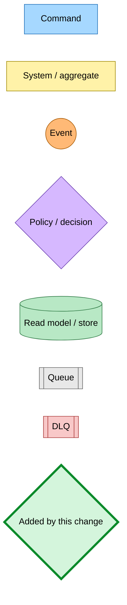
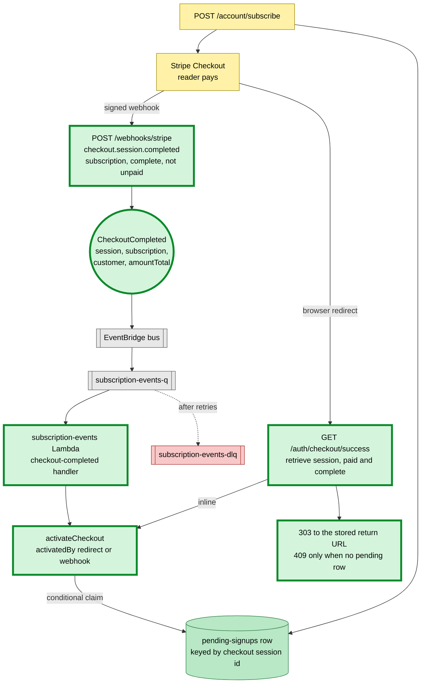
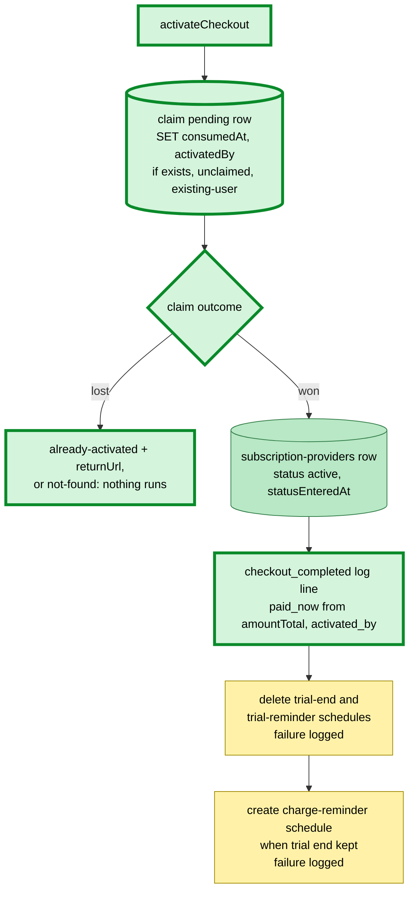

# A completed checkout activates once, from the webhook or the redirect

Snapshot of the uncommitted working tree over `4164d10fb` (`main`), whose 2026-11-15 subject is **fix: count a checkout as a charge only when it collected money**. Generated 2026-11-15. The webhook arrival, the claim and the new `CheckoutCompleted` event are uncommitted and not deployed.

A trialing or cancelled reader subscribes from `/account`. The web route creates a Stripe Checkout session in subscription mode and stores a pending signup keyed by the session id. When the reader pays, Stripe can tell Readplace in two ways, and either may arrive first:

- **Redirect (changed).** Stripe sends the browser to `GET /auth/checkout/success`. The route retrieves the session from Stripe, refuses an unknown (404) or unpaid/open (402) session, then runs `activateCheckout` inline with `activatedBy: redirect`, so the reader's next page already sees them active.
- **Webhook (new).** Stripe posts `checkout.session.completed` to `POST /webhooks/stripe`. The receiver verifies the signature, skips a session that is not subscription mode, not complete or still unpaid, and publishes `CheckoutCompleted` (`checkoutSessionId`, `subscriptionId`, `customerId`, `amountTotal`). EventBridge routes it to `subscription-events-q`, and the subscription-events Lambda runs `activateCheckout` with `activatedBy: webhook`. A failure retries and then dead-letters into `subscription-events-dlq`.

`activateCheckout` (new, shared by both arrivals):

1. **Claim.** A conditional update on the pending-signups row sets `consumedAt` and `activatedBy` only when the row exists, has no `consumedAt` and is an existing-user subscribe. The row is no longer deleted; account deletion still scrubs it.
2. **Lost the claim.** `already-activated` (with the stored return URL) or `not-found`. Nothing else runs. The redirect sends an already-activated reader to the return URL; it answers 409 only when no pending row exists. The webhook consumer acknowledges both.
3. **Won the claim.** Upsert the subscription row active, log `checkout_completed` with `activated_by`, delete the trial-end and trial-reminder schedules (failures logged), and create the charge-reminder schedule when the pending signup carries a trial end (failure logged).

Pulumi: the receiver's event list gains `checkout.session.completed`; the subscription-events Lambda gains `GetItem`/`UpdateItem` on the pending-signups table and `DYNAMODB_PENDING_SIGNUPS_TABLE`, and its EventBridge subscription gains `CheckoutCompleted`. It already held the scheduler create/delete policy. The live Stripe webhook endpoint must also enable `checkout.session.completed`.

---

## Legend

Thick green marks what the uncommitted change adds or changes. Everything else is existing infrastructure shown for context.

[BPMN image](diagrams-bpmn/legend.png) · [Editable BPMN](diagrams-bpmn/legend.bpmn)

Mermaid source

---

## Two arrivals, one activation

[BPMN image](diagrams-bpmn/two-arrivals.png) · [Editable BPMN](diagrams-bpmn/two-arrivals.bpmn)

Mermaid source

---

## activateCheckout

[BPMN image](diagrams-bpmn/activate-checkout.png) · [Editable BPMN](diagrams-bpmn/activate-checkout.bpmn)

Mermaid source

---

## Command → System → Event(s) reference

| Command / event | System | Emits | Triggers next |
|---|---|---|---|
| Stripe `checkout.session.completed` (webhook) | stripe-webhook-receiver Lambda behind API Gateway | **`CheckoutCompleted`**, or nothing for a non-subscription, incomplete or unpaid session | — |
| **`CheckoutCompleted`** (`checkoutSessionId`, `subscriptionId`, `customerId`, `amountTotal`) | subscription-events Lambda, checkout-completed handler, via `subscription-events-q` | No event: activates the subscription row and logs `checkout_completed` (`activated_by: webhook`) when it wins the claim | Nothing on the bus; EventBridge Scheduler one-shots (charge reminder) |
| `GET /auth/checkout/success` | hutch web Lambda | No event: activates inline (`activated_by: redirect`) when it wins the claim, else redirects | Same schedules as above |
| `customer.subscription.deleted`, `invoice.payment_failed` (webhooks) | stripe-webhook-receiver Lambda | Unchanged | Unchanged |
