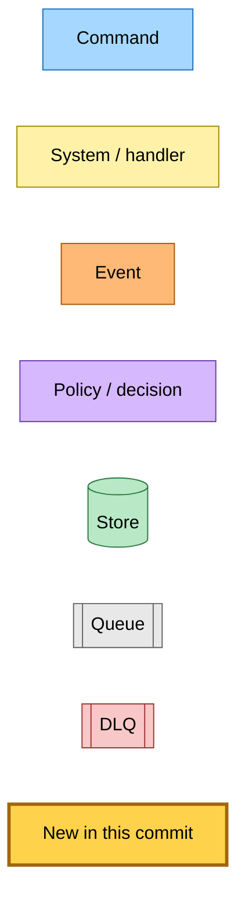
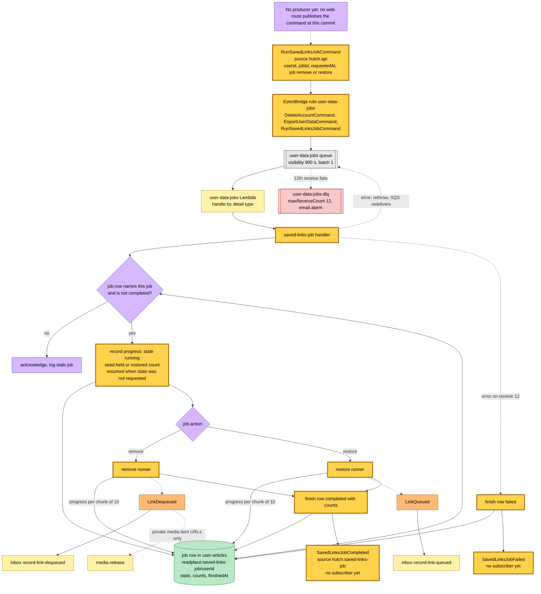
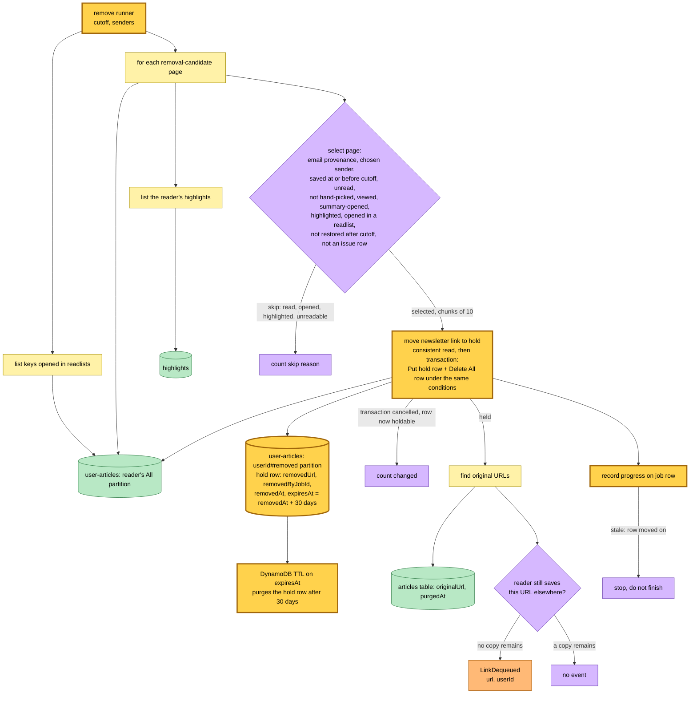
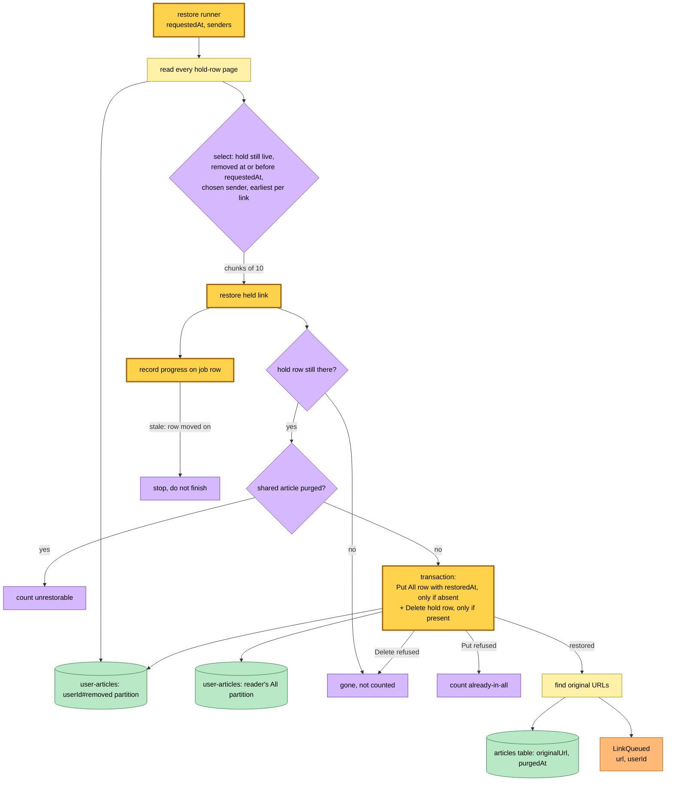
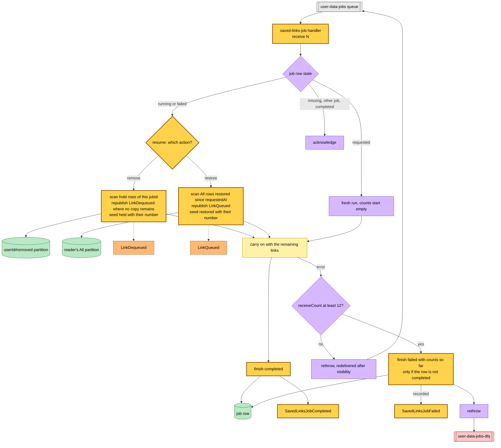

# Remove newsletter links and Restore run as a saved-links job

Snapshot of commit `d0bdf3230` (`main`), whose 2026-11-20 subject is **feat: run Remove newsletter links and Restore as a saved-links job**. Generated 2026-11-20. The snapshot reads the code at that commit, not the working tree.

A reader's request to remove their unread newsletter links from All, or to bring them back, runs as one background job per reader. `RunSavedLinksJobCommand` (source `hutch.api`) carries the user id, the job id, the request time and the job: `remove` with a cutoff and the senders (`all` or `chosen` sender emails), or `restore` with the senders. EventBridge routes it, through the same rule as `DeleteAccountCommand` and `ExportUserDataCommand`, to the `user-data-jobs` queue (visibility 900 s, DLQ after 12 receives, email alarm), and the user-data-jobs Lambda dispatches it by detail type to the saved-links-job handler.

**No producer yet.** At this commit nothing publishes the command: a `git grep RunSavedLinksJobCommand` finds only the catalogue, the Pulumi subscription, the Lambda's composition root and the handler. The job-row store already offers `requestSavedLinksJob` (claims the row when none exists or the last job ended) and `withdrawSavedLinksJob` (drops a job still `requested`), but no web route calls them yet.

The handler:

1. **Reads the job row** (`readplace:saved-links-job/<userId>` in the reader's user-articles partition). A missing row, a row naming another job, or a `completed` job is stale: the message is acknowledged and nothing runs.
2. **Starts.** It records progress (state `running`, conditional on the same job id and not `completed`), seeding the count it keeps across receives (`held` for remove, `restored` for restore). A job whose state was not `requested` is a **resume**.
3. **Runs the action** in chunks of 10, recording progress on the row after each chunk. A progress write that finds the row moved on stops the run without finishing it.
4. **Finishes** the row `completed` with the counts and publishes `SavedLinksJobCompleted`.
5. **Fails.** Any error is rethrown so SQS redelivers. On the 12th receive the handler first finishes the row `failed` and, if that write landed, publishes `SavedLinksJobFailed`; the message then goes to the DLQ.

**Remove** moves each matching newsletter link out of All into a hold row in the reader's `<userId>#removed` partition, keyed by job id and a hash of the stored key, carrying `removedAt` and `expiresAt` (30 days later, epoch seconds). A link is chosen only when it came from email, matches the senders, was saved at or before the cutoff, is unread, was never hand-picked, viewed, opened as a summary, highlighted or opened in a readlist, was not restored after the cutoff, and is not a newsletter issue row. The move is a transaction (Put the hold row, Delete the All row under the same conditions), so a row that changed between read and write is counted `changed`. For each held link whose URL has no other copy among the reader's saves, it publishes `LinkDequeued`.

**Restore** reads the live hold rows, keeps those removed at or before the request time from the chosen senders (the earliest per link), and writes each back to All with `restoredAt` in a transaction (Put the All row only if absent, Delete the hold row). A link whose shared article was purged is `unrestorable`; one already in All is `already-in-all`. Each restored link publishes `LinkQueued`.

**Resume.** A receive that resumes a started job republishes the facts for the rows an earlier receive already moved, then carries on: remove republishes `LinkDequeued` for this job's hold rows (where no copy remains) and seeds `held` with their number; restore republishes `LinkQueued` for All rows restored since the request and seeds `restored`. A failed receive therefore loses no fact.

**Purge.** DynamoDB TTL on `expiresAt`, newly enabled on the user-articles table, deletes a hold row once its 30 days end. Readers of the hold partition also skip a row past its `expiresAt` before TTL catches up.

Pulumi: the user-data-jobs EventBridge rule gains `RunSavedLinksJobCommand`; the Lambda gains `PutItem` and `ConditionCheckItem` on user-articles; the queue's `maxReceiveCount` (12) now comes from a constant the handler shares. `SavedLinksJobCompleted` and `SavedLinksJobFailed` (source `hutch.saved-links-job`) have no subscriber yet. `LinkDequeued` already reaches the inbox `record-link-dequeued` consumer and, for private media items only, the `media-release` consumer; `LinkQueued` already reaches the inbox `record-link-queued` consumer.

---

## Legend

Gold with a thick border (`:::new`) marks what this commit adds or re-wires. Everything else is existing infrastructure shown for context.

[BPMN image](diagrams-bpmn/legend.png) · [Editable BPMN](diagrams-bpmn/legend.bpmn)

Mermaid source

---

## End-to-end flow

[BPMN image](diagrams-bpmn/end-to-end-flow.png) · [Editable BPMN](diagrams-bpmn/end-to-end-flow.bpmn)

Mermaid source

---

## Remove action

[BPMN image](diagrams-bpmn/remove-action.png) · [Editable BPMN](diagrams-bpmn/remove-action.bpmn)

Mermaid source

---

## Restore action

[BPMN image](diagrams-bpmn/restore-action.png) · [Editable BPMN](diagrams-bpmn/restore-action.bpmn)

Mermaid source

---

## Resume and failure

[BPMN image](diagrams-bpmn/resume-and-failure.png) · [Editable BPMN](diagrams-bpmn/resume-and-failure.bpmn)

Mermaid source

---

## Command → System → Event(s) reference

| Command / event | Handled by | Emits | Triggers next |
|---|---|---|---|
| `RunSavedLinksJobCommand` (new, `hutch.api`) | EventBridge rule `user-data-jobs` → `user-data-jobs` queue (DLQ after 12 receives) → user-data-jobs Lambda → saved-links-job handler | `LinkDequeued` (remove, per held link with no remaining copy), `LinkQueued` (restore, per restored link), then `SavedLinksJobCompleted`, or `SavedLinksJobFailed` on the 12th receive | No producer yet at this commit |
| `LinkDequeued` (existing) | inbox `record-link-dequeued`; `media-release` for private media item URLs only | — | Inbox records the link left All; media release frees a private item's media |
| `LinkQueued` (existing) | inbox `record-link-queued` | — | Inbox records the link is back in All |
| `SavedLinksJobCompleted` (new, `hutch.saved-links-job`) | No subscriber | — | — |
| `SavedLinksJobFailed` (new, `hutch.saved-links-job`) | No subscriber | — | — |
| Hold row TTL (`expiresAt`, new) | DynamoDB TTL on the user-articles table | — | Hold row deleted after 30 days |

| Store write | Where | Condition |
|---|---|---|
| Job progress (`running`, counts) | Job row in the reader's user-articles partition | Same job id and not `completed` |
| Job finish (`completed` or `failed`, counts, `finishedAt`) | Job row | Same job id and not `completed` |
| Move to hold | Put hold row in `<userId>#removed`, Delete All row | Delete conditional on the row still matching the remove rules and the same `savedAt` |
| Restore | Put All row with `restoredAt`, Delete hold row | Put only if the All row is absent; Delete only if the hold row exists |
