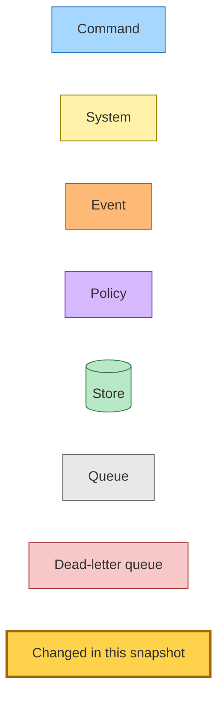
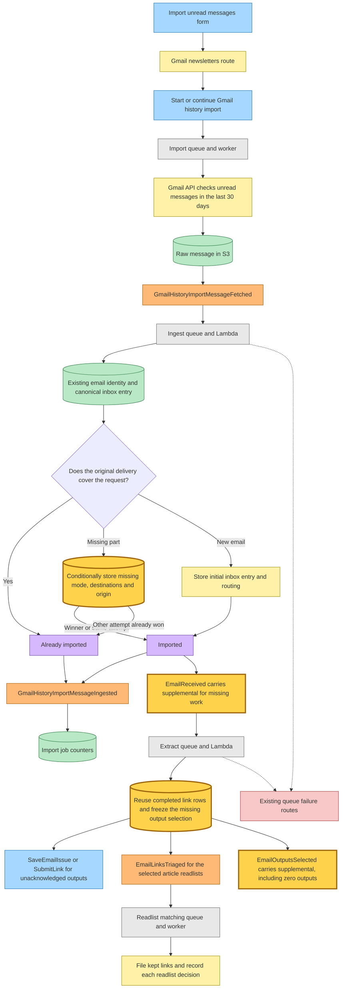
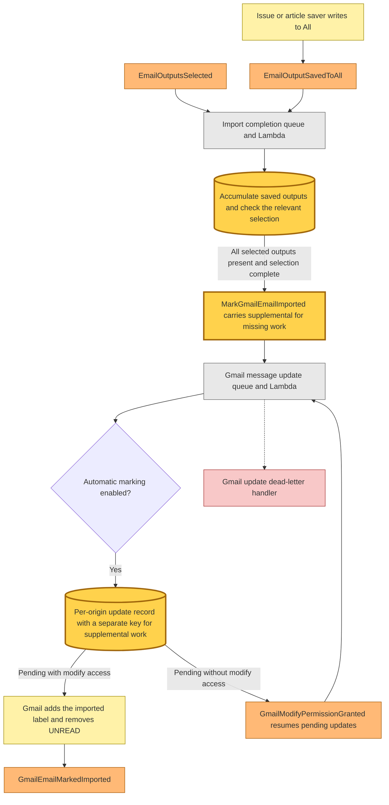

# Import the missing part of a Gmail newsletter

Captured from the working tree over `79e3a0c33` for a PR against `main`.

## Legend

Mermaid source

## Import and save

Mermaid source

## Completion and Gmail update

Mermaid source

EventBridge routes the messages to the existing queues. The extraction worker
can query the links table for the canonical email’s preview rows. Each import attempt
uses its staged raw key to resume its accepted work and destinations. Other
attempts report that the request is covered. The original output selection
and saved-output acknowledgments stay on the canonical row. Records with no
delivery mode use their stored output selection and the legacy links default.

| Command or event | System | Outcome or next command |
|---|---|---|
| `StartGmailHistoryImport`, `ProcessGmailHistoryImportPage` | Gmail history import | Stage unread messages, publish `GmailHistoryImportMessageFetched`, and continue paging |
| `GmailHistoryImportMessageFetched` | Inbox ingestion | Dispatch `EmailReceived` for accepted work and report `GmailHistoryImportMessageIngested` |
| `GmailHistoryImportMessageIngested` | Import outcome recorder | Update the job counters and complete the job once all messages settle |
| `EmailReceived` | Link extraction | Select outputs, dispatch `SaveEmailIssue` or `SubmitLink`, publish `EmailLinksTriaged` and `EmailOutputsSelected` |
| `EmailLinksTriaged` | Readlist matching | File matches and publish the readlist decision |
| `SaveEmailIssue`, `SubmitLink` | Save workers | Publish `EmailOutputSavedToAll` after the saved output is available in All |
| `EmailOutputsSelected`, `EmailOutputSavedToAll` | Import completion | Dispatch `MarkGmailEmailImported` when the relevant selection is complete |
| `MarkGmailEmailImported`, `GmailModifyPermissionGranted` | Gmail message update | Apply or resume the opted-in Gmail update, then report its outcome |
