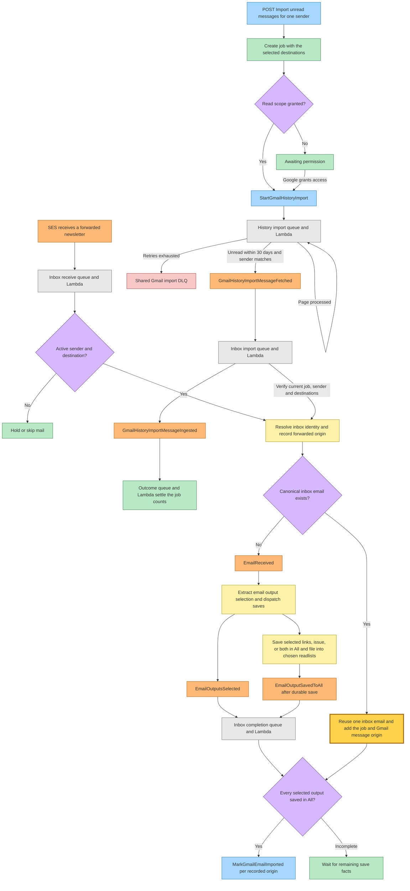
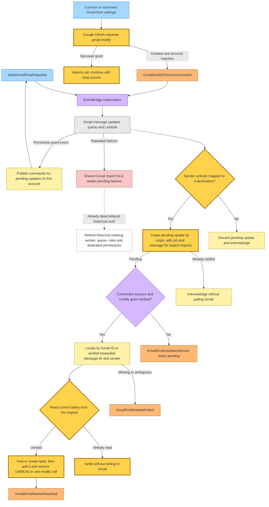

# Automatically mark unread Gmail imports as read

Captured from the feature branch working tree over base commit `79e3a0c33`. The previous behavior is recorded in the [Gmail import labelling snapshot](../2026-10-27-b918eea/gmail-import-labelling.md).

## Legend

Blue is a command, yellow is a system, orange is an event, purple is a policy, green is a store, gray is a queue, and pink is a dead-letter queue. Amber outlines highlight changed behavior. Dashed outlines show retired wiring.

## Forwarded mail and explicit unread imports

Mermaid source

## Gmail updates and reconnect

Mermaid source

The worker checks an original again when reconnect resumes it. Gmail's modify request changes only the import label and UNREAD. Disconnect still deletes the reader's shared import partition, including pending updates and any historical worker rows. Removing the historical queue and subscriptions stops that work at rollout. The shared DLQ acknowledges old deliveries from that queue. Rollout does not scan Gmail.

## Command → system → event reference

| Command or input | System | Outcome and next step |
|---|---|---|
| Forwarded message | Inbox receive Lambda | Resolves the sender, destinations and email identity. Accepted mail emits `EmailReceived`. Duplicate input records its origin against the canonical email. |
| Import unread messages | Web route | Creates a sender-scoped history job. Read access publishes `StartGmailHistoryImport`. |
| `StartGmailHistoryImport` and page continuation | History import Lambda | Fetches unread messages in the job window, stages the raw mail and emits `GmailHistoryImportMessageFetched`. |
| `GmailHistoryImportMessageFetched` | Inbox import Lambda | Accepted mail emits `EmailReceived`. An existing email adds an explicit job and message origin. `GmailHistoryImportMessageIngested` settles the history job's message outcome. |
| `EmailReceived` | Inbox extract Lambda | Freezes selected outputs and emits `EmailOutputsSelected`. Dispatches `SubmitLink` and `SaveEmailIssue` as applicable. |
| `SubmitLink` and `SaveEmailIssue` | Save-link workers | Durable saves emit `EmailOutputSavedToAll`. |
| `EmailOutputsSelected`, `EmailOutputSavedToAll`, or duplicate Gmail origin | Inbox completion | Publishes `MarkGmailEmailImported` after the selected outputs are saved. |
| `MarkGmailEmailImported` | Gmail message update Lambda | Settles an already-read original silently. A successful Gmail write emits `GmailEmailMarkedImported`. Permission or account problems emit `GmailEmailUpdateDeferred`. Terminal failures emit `GmailEmailUpdateFailed`. |
| Google OAuth callback | Web route | Stores the grant and resumes eligible imports. A verified modify grant emits `GmailModifyPermissionGranted`. |
| `GmailModifyPermissionGranted` | Gmail message update Lambda | Reads pending updates for the granted account and republishes their `MarkGmailEmailImported` commands. |
| Disconnect Gmail | Filter rewrite Lambda | Revokes access and deletes the reader's shared import partition. |
