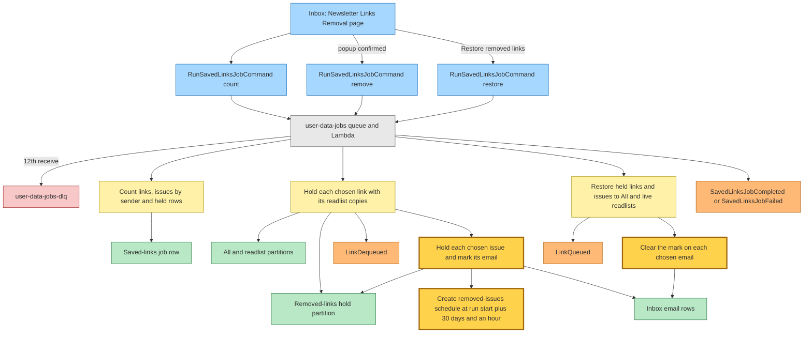
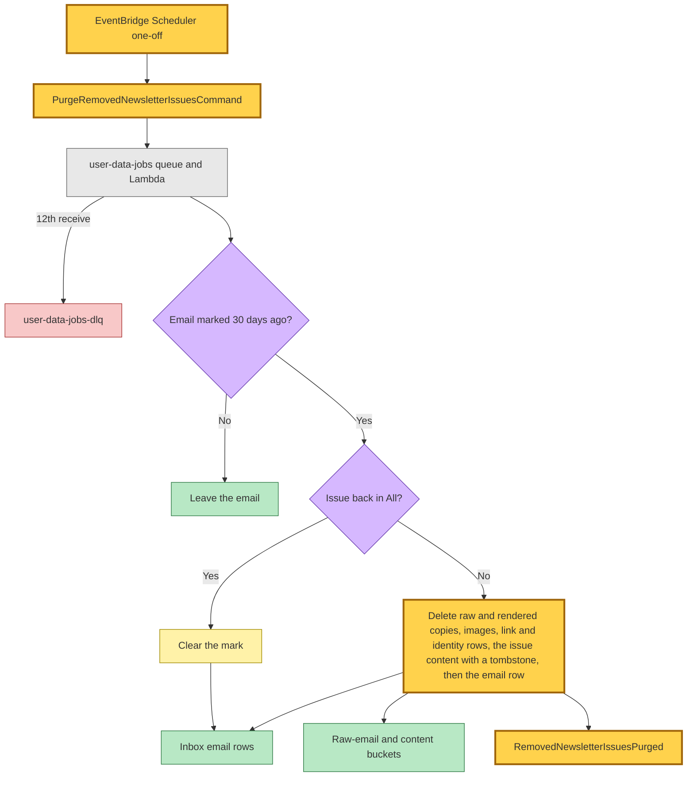

# Newsletter Links Removal: links, issues and every readlist copy

Captured at commit `1903644` on branch `rp/adoring-pascal-to5b8f`. The removal now takes a chosen newsletter's links and its issues out of All and every readlist, hides each issue's email from the Inbox, and deletes what a removal left behind once its 30 days pass.

## Legend

Blue is a command, yellow is a system, orange is an event, purple is a policy, green is a store, gray is a queue, and pink is a dead-letter queue. Gold marks what this snapshot adds.

## Count, remove and restore

Mermaid source

## Purge after 30 days

Mermaid source

## Command → System → Event(s)

| Command | System | Event(s) | Next command(s) |
|---|---|---|---|
| `RunSavedLinksJobCommand` (count) | Saved-links job handler: counts links, issues by sender with read and highlighted skips, and held links and issues | `SavedLinksJobCompleted` or `SavedLinksJobFailed` | None |
| `RunSavedLinksJobCommand` (remove) | Holds chosen links with their readlist copies, then each chosen issue, and marks each chosen email removed | `LinkDequeued` per held row, `SavedLinksJobCompleted` or `SavedLinksJobFailed` | A scheduled `PurgeRemovedNewsletterIssuesCommand` |
| `RunSavedLinksJobCommand` (restore) | Restores held links and issues to All and each live readlist, then clears chosen emails' marks | `LinkQueued` per restored row, `SavedLinksJobCompleted` or `SavedLinksJobFailed` | None |
| `PurgeRemovedNewsletterIssuesCommand` | Purge handler: shows again an email whose issue is back in All; deletes everything stored for every other email marked 30 days ago | `RemovedNewsletterIssuesPurged` | None |
